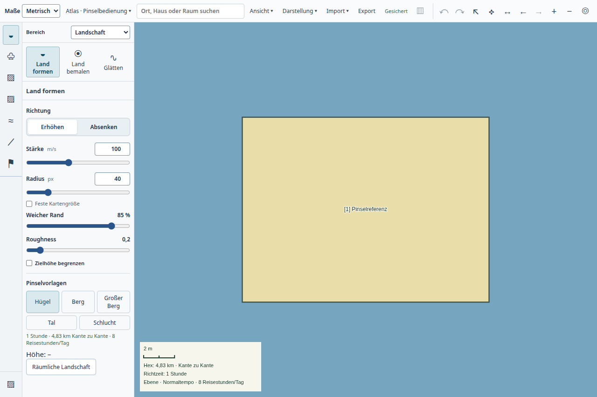

# Atlas-Pinselbedienung · 20.10.2026

Nutzerauftrag: gemeinsame Bildschirmradien und übersichtlichere, anschließend ausdrücklich kompaktere Werkzeugoptionen. [Verhalten und Vorlagen](../../plans/maps/terrain-relief.md#gemeinsame-pinselbedienung-und-kompakter-atlas--20102026).

## Umsetzung

`atlas-brush-size.ts` führt lokale Größenpräferenzen und die Umrechnung zwischen CSS-Pixeln und Weltmetern. Bestehende Befehle und gespeicherte Geometrien erhalten weiter Weltmaße. Der orthografische Maßstab berücksichtigt beide Achsen des CSS-Canvas; Gerätepixeldichte geht nicht in den Radius ein. Während eines Entwurfs bleiben Maßstab und Radius eingefroren. Kleine Bildschirmpinsel können unter einem Weltmeter liegen: Der Höhenkern akzeptiert deshalb positive Radien und feinere dyadische Kacheln bis 2⁻²⁴ Meter im bestehenden Datenformat, ohne Migration. Arbeits- und Kachelgrenzen bleiben erhalten.

Die gemeinsame Oberfläche hat Richtungstasten, Slider und direkte Zahlenfelder, fünf Vorlagentasten sowie globale Darstellungs- und Wasseroptionen. Die linke Leiste und Werkzeugoptionen beanspruchen standardmäßig 288 statt 424 Pixel. Frühere native Prüfskripte verwenden die sichtbaren Größenfelder und neuen Menüwege.

## Lokale Prüfungen

- 93 unterschiedliche automatisierte Fälle in `tests/atlas-brush-size.test.mjs`, `tests/desktop-atlas-tool-hierarchy.test.mjs`, `tests/terrain-brush.test.mjs`, `tests/terrain-relief.test.mjs`, `tests/terrain-tilted-atlas.test.mjs`, `tests/desktop-atlas-canvas.test.mjs` und `tests/terrain-height.test.mjs`: Größenumrechnung, Modus-/Werkzeugwechsel, Einheiten, Vorlagen, Sperren, Vorschau/Auftrag, kleine Radien, globale Stilinvalidierung und räumliche Projektion.
- `tools/test-desktop-atlas-brush-ux.mjs`: echte Electron-Bedienelemente, Tastatur, alle angeschlossenen Pinselfamilien, Zoom, feste Größe, Kamera-/Größensperre, Höhenzug, Undo/Redo, globale Darstellung, gekippter Atlas, PNG, normaler Neustart mit Browserzoom 1,25 und erhaltenen Präferenzen. Der Regions-/Raumteil prüft hier Größen und Werkzeugwechsel; deren vollständige Geometriebearbeitung ist kein neuer Abnahmeanspruch.
- `tools/test-desktop-terrain-spatial.mjs`: räumlicher Zoom und Größenwechsel, Zielhöhe, Vorschau, Glätten, Farbe/Radierung, Escape, Undo/Redo, Schreibfehler mit Wiederholung, Küste und Rückkehr/Neustart.

Native Ergebnisse binden Quellstand und Bundlehashes. Die Prüfkampagnen sind isoliert; keine vorhandene Nutzerkampagne wurde geöffnet. Repository- und Typprüfungen sowie beide Builds gehören zur technischen Prüfung. GitHub Candidate-CI und Integration werden separat über den zugehörigen PR nachgewiesen. Eine Paketinstallation oder Nutzerabnahme wird hier nicht behauptet.

## Native Belege

[Ergebnis mit Bundlehashes und normalen Prozessabschlüssen](result.json), [gekippter Atlas](tilted-brush.png), [PNG-Ausgabe](region.png).

