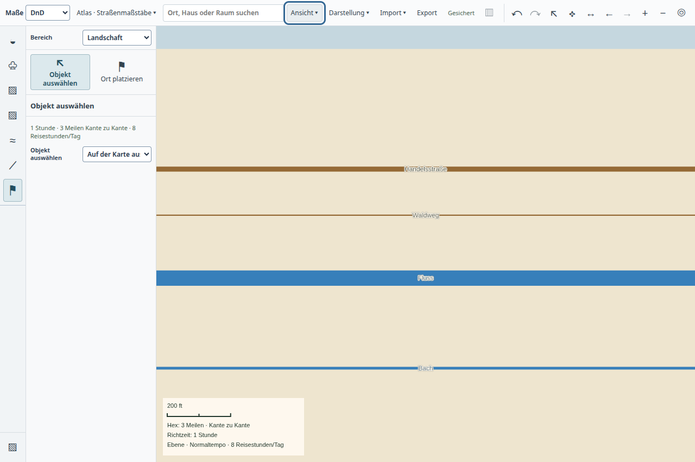

# Unsichtbare Straßen erst bei Bedarf aufbauen – 22.10.2026

Die normale Atlasfläche baute nach großen Geländeänderungen auch im Weltmaßstab
Hunderte unsichtbare Straßennetze neu auf. Das Profil ordnet drei langen
Rendereraufgaben jeweils rund 78–92 ms in `routeMeshes` zu. Der vorhandene
Sichtbarkeitstest sparte erst die GPU-Zeichnung, nachdem Geometrie, Materialien
und Höhenanpassung bereits erzeugt waren.

`TerrainSpatialView` hält jetzt die ohnehin geladenen Trassenrecords bis zur
möglichen Sichtbarkeit zurück. `routeMayDraw` prüft eine konservative Tiefengrenze
des ganzen geladenen Geländes gegen dieselbe halbe Ausblendschwelle wie der
Shader. Erzeugt werden nur Trassen, die nicht sicher unsichtbar sind. Kamera-
und Ausgabegrößenänderungen prüfen diese Records sofort; kein Datenread muss
dafür abgeschlossen werden. Angelegte Geometrie bleibt beim Herauszoomen erhalten.

Offene Trassen halten keine alten Terrain-Snapshots oder Erzeuger-Closures fest.
Bei Sichtbarkeit verwendet der Aufbau das aktuelle Gelände. Änderungen und
Entfernen eines Records ersetzen den vorhandenen Eintrag; weggefallene
Geometrie wird freigegeben. Geplante Trassen bleiben konservativ ausgenommen,
damit Brücken, Tunnelportale, Konflikte und geschützte Auswahlen weiter ihren
bisherigen Aufbau erhalten. PNG-Ausgabe benutzt ihre volle Ausgabehöhe.

## Native Gegenprobe

[Vorher](before.json), Quelle `0a3b4728`, und [Nachher](after.json), gleiche
private Kopie des Mischweltbestands und derselbe Ablauf: 2.500-Meilen-Pinsel,
Zoom nach Loslassen, zweiter Zug vor Fertigstellung feiner Kacheln.

| Messung | Vorher | Nachher |
| --- | ---: | ---: |
| Erstes Öffnen | 9,664 s | 9,809 s |
| Erneut bearbeitbar nach erstem Zug | 3,312 s | 3,213 s |
| Erneut bearbeitbar nach zweitem Zug | 2,287 s | 2,071 s |
| Längste beobachtete Rendereraufgabe | 332 ms | 311 ms |
| Größter aufgezeichneter Bildabstand | 351 ms | 333,5 ms |

In den drei langen Terrain-Veröffentlichungen entfallen die gemessenen
`routeMeshes`-Stapel. `setData` kostete zuvor etwa 256/149/190 ms und danach
155/64/84 ms (erster Abschluss / neue Projektion / zweiter Abschluss).
Die ganze erste Rendereraufgabe bleibt mit 311 ms teuer; Netzaktualisierung,
Shader-/Pufferarbeit, Speicherbereinigung und übrige Veröffentlichung bleiben
zu bearbeiten. Einzelne Messpaare begründen keine allgemeine Statistik.
**Unmittelbare Weltreaktion, 2-s-Öffnen und Pentium-Abnahme bleiben offen.**

`measure-desktop-backup-impact.mjs` speichert jetzt eine Zuordnung zwischen
Renderer-`performance.now()` und CDP-`Timestamp`. Die beiden flankierenden
Zeitabfragen begrenzen die Ungenauigkeit hier auf 4,7 bzw. 8 ms. Zur Auswertung:
CPU-Zeit in ms minus `(Timestamp*1000 - (before+after)/2)` mit den beobachteten
Long-Task-Intervallen schneiden. Selbstzeit und inklusive Stapelzeit getrennt
summieren; die Profil-Samples sind keine exakten Einzelaufruf-Timer. Die
kompakten Berichte enthalten Rohdatei-Hashes und die zugeordneten Stapel.

Beide Prozesse endeten normal und waren danach nicht vorhanden. Die
[kanonische Revision 14](persisted.json) stimmt mit sichtbarer und
Autorenrevision überein; alle 36 Detailkacheln wurden fertig. Alle elf
aktuellen Buildartefakte wurden nach der Nachher-Probe abgeglichen.

## Normale Straßen-/Flussbedienung

[Native Ergebnisse](lines.json): Der bestehende Straßenmaßstab-Test kann mit
`ROUTE_WORLD_START=1` bereits bei 80 km starten. Er zoomte über 9,2 km und
2,2 km bis 518 m, wählte den schmalen Waldweg aus und neigte dieselbe
Hauptkamera auf 60°. Autorenrecords blieben unverändert. Die ergänzende
GPU-Prüfung bestätigt vorhandene Breiten-/Ausblendschwellen, Treffer und
zusammengesetzte Bildausgabe ohne Pixelabweichung. Sie vergleicht den
Routenshader, nicht eine vollständige Vorher-/Nachher-Weltaufnahme.

Ein technisches Geradenfixture, keine gestalterisch fertige Karte. Prozess
3514644 endete normal, war anschließend weg; Fehlerliste leer und elf
Buildartefakte unverändert. Alle nativen Proben liefen einzeln über
`tools/ui-session.py timeout --signal=TERM 240s`.

## Lokale Regressionen

33 Tests in `terrain-spatial-picking`, `terrain-route-display`,
`terrain-render-reuse` und `terrain-spatial`: Kamera allein zeigt verborgene
Straßen; neueste Höhe, Entfernen, erneutes Verbergen, Ressourcenerhalt und
hochaufgelöster Export bleiben korrekt. Konservative Sichtbarkeit wird über
verschiedene Höhen, Kameraneigungen und Ausgabegrößen geprüft. Ein bestehender
Shaderaufbautest erhält ausdrücklich eine Testtextur, da die zuvor integrierte
Waldsignatur sonst im Node-Test ein DOM-Canvas verlangt. Native Waldpixel
werden weiterhin von den dafür vorgesehenen Grafikproben geprüft.

App-/Desktop-Typechecks, Desktop-Build und Repositoryprüfung bestanden. Der
erste parallele Desktop-Typecheck endete mit Signalstatus 143 ohne Diagnose;
die anschließende einzelne Wiederholung bestand.

Dies ist ein lokaler Teilbeleg; Candidate-CI, Main/Release und vollständige
Produktabnahme bleiben eigene Schritte.
