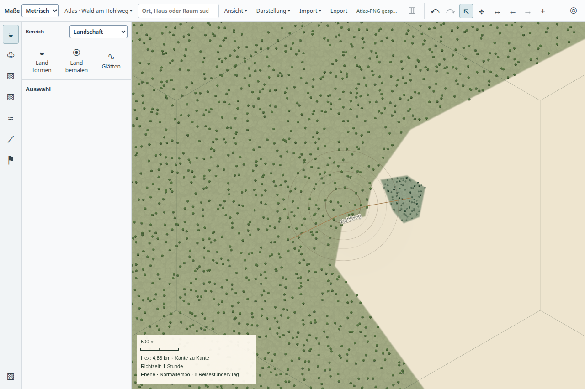
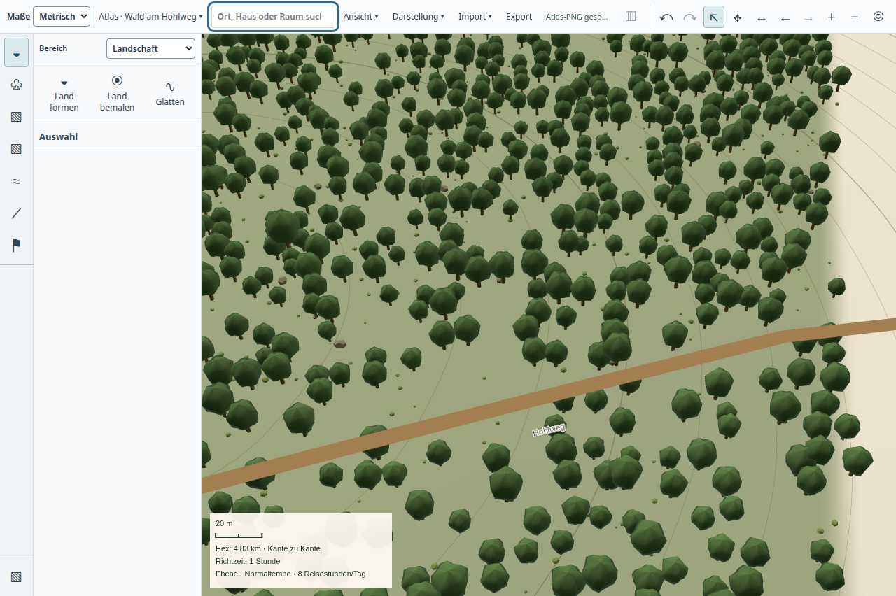

# Unsichtbare Objektraster auslassen – 22.10.2026

Der normale Atlas erzeugte im dichten Weltmaßstab vier vollständig transparente
Objektbilder. Straßen und Orte waren nach den vorhandenen Maßstabsregeln bereits
unsichtbar; automatische Einzelbäume waren durch die Waldfläche ersetzt.
`AtlasLandscapeReader` merkt sich jetzt bei der ohnehin notwendigen Lesung, ob
Rasterobjekte sichtbar sein können. Ohne solche Objekte entfallen der zweite
Objektdurchlauf und die PNG-Kodierung. Namen, genaue Treffer und Objektzahlen
werden weiterhin gelesen. Die Geländeprojektion bleibt unabhängig.

Es gibt keinen neuen Cache. Sichtbare Trassen, nahe Orte, manuelle Baumkorrekturen
und überzählige Referenzbilder behalten den Rasterweg. Bis zu 16 kleine
Referenzbilder bleiben als genaue Records erhalten. Canvas-Fallback und öffentliche
Geländeausgabe erzeugen weiter ihre Bodenbilder.

## Kontrollierte Gegenprobe

[Messdaten](paired.json): Baseline `912bb476`, dieselbe private synthetische
Weltkopie, identische aktuelle Abhängigkeiten. Der explizite Modus
`ATLAS_REGION_TRANSPARENT_OBJECT_TILES=1` dekodiert sämtliche Objekt-PNGs und
entfernt zum Vergleich nur Bilder mit ausschließlich Alpha null. Anschließend
muss die vollständige JSON-Antwort einschließlich Namen, Geometrie, Metadaten und
aller sichtbaren Raster identisch sein. Der normale Messmodus bleibt bytegenau.

| Ausschnitt | Vorher | Nachher | Ergebnis |
| --- | ---: | ---: | --- |
| Welt | 621,77 ms | 276,09 ms | Vier transparente Bilder entfallen; sonst identisch |
| Region | 45,38 ms | 62,80 ms | Vollständige Antwort bytegleich |
| Gebäude | 326,51 ms | 427,93 ms | Vollständige Antwort bytegleich |
| Dungeon | 407,55 ms | 344,44 ms | Vollständige Antwort bytegleich |

Einzelmessungen, kein allgemeiner Geschwindigkeitsnachweis für alle Maßstäbe.
Indexaufbau und Speicherbudgets sind unverändert. Die Messung betrifft Bereichslesen
und Serialisierung; die zusätzliche PNG-Gegenprüfung liegt außerhalb dieser Zeit.

```sh
ATLAS_REGION_BASELINE=912bb476 \
ATLAS_REGION_BASELINE_FILES=src/app/storage/atlas-region.ts,src/app/storage/atlas-landscape-region.ts \
ATLAS_REGION_TRANSPARENT_OBJECT_TILES=1 \
ATLAS_MIXED_SOURCE=/home/aaron/.cache/saltmarcher/ui/backup-impact-Jx2V2B/workbench.sqlite \
QA_EVIDENCE_DIR=.build/empty-object-tiles-paired \
node tools/measure-atlas-region-opening.mjs
```

## Native Bedienung und verbleibende Grenzen

`tools/measure-desktop-backup-impact.mjs` öffnete eine private Kopie des bestehenden
Mischweltbestands mit 100.000 Geländezuordnungen, 5.000 Orten, 5.000 eingerichteten
Raumgruppen und einem Dungeon mit 4.001 Räumen. Ein 2.500-Meilen-Pinselzug wurde
von Zoom und einem zweiten Zug vor abgeschlossener Detailverfeinerung gefolgt.
Das sind keine 100.000 fein ausgearbeiteten Höhenfelder und keine gestaltete
Fantasywelt.

[Vorher](before-world.json) / [Nachher](after-world.json): Öffnen 10,54 → 10,15 s;
erneute Bearbeitbarkeit nach dem ersten Zug 3,84 → 3,41 s; nach dem Folgezug
2,78 → 2,17 s. Die Bedienelemente reagierten nach dem ersten Loslassen dagegen
später (1,65 → 2,05 s). Einzelne Rendereraufgaben dauerten weiterhin bis zu
381 ms, aufgezeichnete Bildabstände bis 400,2 ms. **Die geforderte unmittelbare
Weltreaktion ist nicht erreicht.** Eine einzelne Gegenprobe ist keine
statistische Gesamtleistungs- oder Pentium-Qualifikation.

Alle 36 Detailkacheln wurden fertig. Sichtbare Revision, Autorenrevision und
[kanonisch erneut gelesene SQLite-Revision 14](persisted.json) stimmen überein.
Der [normale Waldablauf](forest.json) prüfte Welt, Übergang, Region, Dorf,
Einzelkronen, 45°-Neigung und zwei PNG-Ausgaben; geschützte Identitäten und
Autorenrecords blieben erhalten. Die Bilder wurden angesehen: Kronen und
Hohlweg sind vorhanden, Waldgrenzen und Wegstil bleiben gestalterisch einfach.
Dieser kurze technische Ablauf ersetzt keine vollständige Fantasy-Autorenreise.




Beide nativen Prozesse endeten mit Code 0 ohne Signal und waren anschließend
nicht mehr vorhanden. Alle elf gebauten Artefakte stimmen nach beiden Läufen
überein; beide Fehlerlisten sind leer ([Lebenszyklus](lifecycle.json)).
Die Proben liefen einzeln über `tools/ui-session.py timeout --signal=TERM 240s`.

## Regressionen

81 betroffene Tests bestanden: `tests/desktop-atlas-regions.test.mjs`,
`tests/vegetation.test.mjs`, `tests/desktop-landscape-paint-bounds.test.mjs`.
Der neue dichte Weltfall wurde nach Ergänzung der Straßenänderung erneut einzeln
geprüft. Abgedeckt sind Namen und genaue Treffer trotz leerem Raster, breite
Straße und Rückkehr zum leeren Raster nach Änderung, nahe Orte, genaue und
überzählige Referenzbilder, Referenzausblendung, Canvas-Boden und geschützte Bäume.
App-/Desktop-Typechecks und Desktop-Build bestanden. Lokale Belege sind weder
Candidate-CI noch Main-/Release- oder Produktabnahme.
