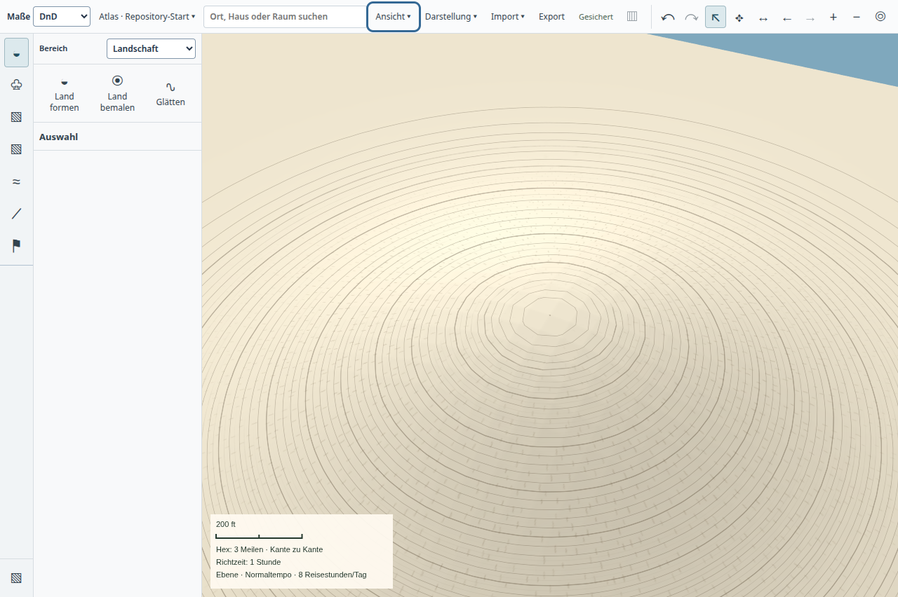
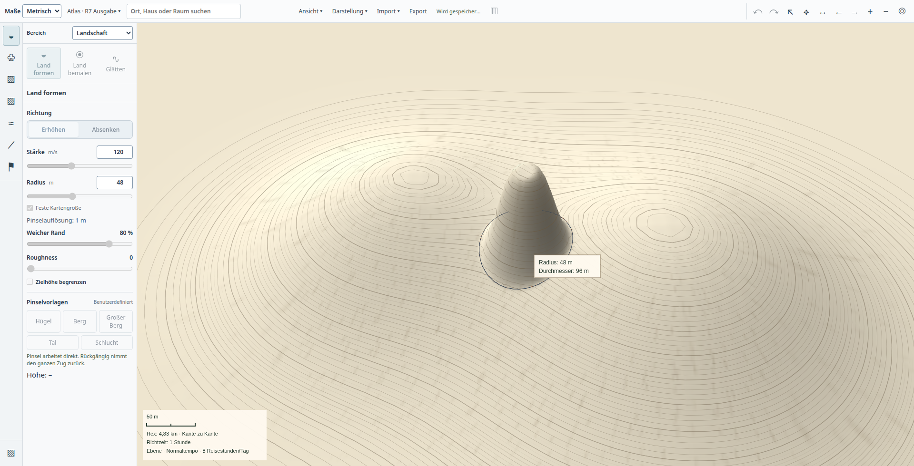

# Feinere Geländeauflösung und direkte Treffer im Hauptatlas

Produktstand: `a3226c37325d6520a56de1937f2f47269a8c1ff8`, einschließlich des Fokusrasters aus `5142415c2c0a004328fc4f83eee26853ec9f661a`. Ausgangsstand für die Backendmessung: `4b8acc1d037d848dc749413271ad2d223554a50e`.

## Änderung

Der normale Atlas verteilt 257×257 Höhenknoten auf eine feinere Mitte und gröbere Ränder. Gemeinsame Randknoten vermeiden Risse; Renderer, Höhenabfrage, Autoren-Sichtprüfung und Worker lesen dieselbe Aufteilung. Eine zusätzliche Textur mit höchstens 1024 Pixeln je Kante verfeinert den sichtbaren Ausschnitt, während eine 512er-Textur den Kontext erhält. Die Cachelimits sind unverändert; lokale Änderungen ersetzen weiter nur betroffene Teile.

Der dichtere Aufbau machte den bisherigen vollständigen Dreiecksdurchlauf beim Zeigertreffer teurer. `terrain-ray.ts` durchläuft deshalb nur Rasterzellen entlang des Strahls und schneidet dort dieselben Dreiecke. Frontseiten, Höhenüberhöhung, nahe/ferne Grenzen und die eingefrorene Trefferfläche während eines Pinselzugs bleiben erhalten.

## Sichtbarer App-Einstieg

[Repository-Probe](repository-result.json) und [Entwicklungsbefehl](development-command.log) starten wörtlich `npm run start:desktop` aus `/home/aaron/Schreibtisch/projects/SaltMarcher`, mit einem eigenen Testprofil. Kampagnennavigation öffnet den normalen Atlas. Neigen, Drehen und Mausradzoom behalten dieselbe Hauptfläche. Der Test verlangt WebGL, das neue Fokusnetz und korrekte GPU-Höhenlinien einschließlich Exportkachelgrenzen. Die App beendet sich mit Code 0, verschwundenem PID und ohne Rendererfehler. Dies ist keine Prüfung einer installierten Version oder persönlicher Kampagnendaten.

[Vorheriger Ausschnitt](../atlas-contour-zoom-20261021/02-repository-tilt-zoom.png): Die feinere Geometrie und Textur reduzieren die Vergröberung. Die 16-Meter-Quelldaten des Testhügels bleiben am Gipfel erkennbar. Oben rechts ist die begrenzte Geländeabdeckung weiterhin sichtbar; dieser Befund ist offen.

## Automatisierte Regressionen

- [47 Fälle](regressions.log): Stream, Pinsel, Relief, Projektionscache, Fokusnetz, Autorcache, Validierung und räumliche Eingabe. Enthalten sind gemeinsame Bandränder, kanonische Höhen-/Sichtgleichheit, lokale Invalidierung und Undo.
- [8 Fälle nach Auslagerung der Texturgrößenregel](layout-detail-tests.log): Fokusnetz und Cache einschließlich Welt-/Raumkoordinaten bis ±1e9.
- [15 Fälle nach der Trefferoptimierung](ray-object-tests.log): exakter Vergleich mit THREE-Dreieckstreffern, eingefrorene Pinseloberfläche, lokale GPU-Updates, Objektverdeckung und Ausgabegrenzen.
- [TypeScript](type-check.log), [Desktop-TypeScript](desktop-type-check.log) und [Repositoryprüfung](repository-check.log) bestanden. Die Teilserien überlappen; ihre Fallzahlen werden nicht zu einer Gesamtabdeckung addiert.

[Native Live-Probe](live-result.json): Formen wird vor dem Loslassen gespeichert; Glätten, kumulative Halbdeckkraft, Escape, Fokusverlust und Höhenprofile funktionieren auf der Hauptfläche. Ein gekippter Zug bleibt nach frischem Prozessstart erhalten; ein Undo stellt die ursprünglichen Höhen wieder her. Beide Prozesse endeten normal mit verschwundenen PIDs und ohne Rendererfehler. Quellen- und Buildhashes stehen im Ergebnis.

[Native Objekt-/Ausgabeprobe](objects-result.json): Ein Dach wählt das ursprüngliche Gebäude; seine Höhenänderung erhält Räume und Objektidentität. Der normale Atlas exportiert ein gekacheltes perspektivisches PNG mit 2048 Pixeln. Frisches Öffnen erhält die Höhen und Räume. Beide Prozesse endeten normal mit verschwundenen PIDs, ohne Rendererfehler. [Inspektor](building-inspector.png), [Ausgabe](building-export.png).

## Vergleichsmessung

`tools/measure-terrain-focus.mjs` liest dieselben vier kanonischen Höhenkacheln mit dem alten und neuen Backend. Ein 900×600-Meter-Ausschnitt wird in der Reihenfolge alt/neu/neu/alt jeweils kalt und dreimal warm angefordert. Die Baseline wurde aus `4b8acc1d0` archiviert. Das ist Backend-Wandzeit; Kamera-, IPC-, GPU- und Bildschirmzeiten sind nicht enthalten. Während dieses Messlaufs wurden keine eigenen nativen Proben oder CPU-Prüfungen parallel ausgeführt; der gemeinsam genutzte Host ist keine isolierte Leistungsumgebung.

| Größe | Gleichmäßiges Netz vorher | Fokusnetz jetzt |
| --- | ---: | ---: |
| Knoten | 37.249 | 66.049 |
| Texturbytes pro Antwort | 2.797.568 | 3.495.936 |
| Kalte Projektion, zwei Läufe | 2.092 / 2.036 ms | 2.254 / 2.006 ms |
| Warme Projektion, sechs Läufe | 9,0–15,2 ms | 7,0–13,0 ms |
| RMS-Höhenabweichung zur kanonischen Quelle | 4,28 cm | 1,21 cm |
| Größte Höhenabweichung im Fixture | 33,00 cm | 13,52 cm |
| Belegter Projektionscache | 3.133.607 Bytes | 4.005.127 Bytes |

[Rohmessung](projection-measurement.json). Die höhere Genauigkeit kostet mehr Geometrie und etwa 25 % mehr Texturbytes. Die kalte Zeit liegt hier im ähnlichen Bereich; zwei Läufe erlauben keine allgemeine Beschleunigungsbehauptung. Kalte Detailantworten von rund zwei Sekunden erfüllen weiterhin nicht das Ziel unmittelbarer schrittweiser Darstellung.

`tools/measure-terrain-picking.mjs` vergleicht pro Netz 200 senkrechte Strahlen auf ebenem Gelände: Der vollständige Dreiecksdurchlauf benötigt im Mittel 7,80 ms bei 193×193 und 13,35 ms bei 257×257. Die Zellsuche benötigt 0,006 beziehungsweise 0,008 ms. [Rohmessung](picking-measurement.json). Dies ist ein günstiger, einzelner CPU-Kernfall, keine allgemeine Eingabelatenz- oder FPS-Aussage. Korrektheit auf unebenem Gelände, seitlichen Strahlen, Bandrändern, Weltkoordinaten und Vorder-/Rückseiten prüfen die oben verlinkten Regressionsfälle.

## Aufbewahrte Fehlversuche

Der erste Fokusentwurf erhöhte die kalte Projektionszeit im selben Fixture auf etwa 3,7–3,8 Sekunden gegenüber 2,5–2,6 Sekunden. [Rohmessung](rejected-measurement.json). Größere Rasterbatches, das Überspringen unnötiger Wasser-/Konturarbeit und die vereinfachte Pixelreduktion wurden erst danach ergänzt.

Die erste native Live-Probe mit dem neuen Trefferverfahren bestand Formen, Profil, Glätten, Farbe, Escape, Fokusverlust und den gekippten Zug. Beim frischen Öffnen überschritt die Arbeitsfläche jedoch das unveränderte 15-Sekunden-Limit: [Fehler](live-reopen-timeout.json), [Zustand](live-reopen-state.json), [Screenshot](live-reopen-timeout.png). Zwei parallel gestartete eigene TypeScript-Prüfungen und weitere Hostarbeit liefen währenddessen. Das ist eine mögliche Belastung, keine bewiesene Ursache. Die erste App wurde normal beendet; die zweite wurde beim Fehler durch die Probe bereinigt, ihr normaler Exit ist nicht belegt. Vor der nächsten Probe wurden keine zu diesem Testprofil gehörenden Prozesse mehr gefunden. Der vollständige Bedienlauf wurde ohne eigene parallele CPU-Prüfungen erfolgreich wiederholt, einschließlich frischem Öffnen und Undo. Das Zeitlimit blieb unverändert. Der frühere Timeout bleibt als beobachtete Empfindlichkeit unter Last dokumentiert; die Wiederholung beweist keine allgemeine Ladezeitgrenze.

## Grenzen

Dies ist ein lokaler Schritt innerhalb P3, keine vollständige Leistungsabnahme. Weltfeste Kacheln, priorisiertes schrittweises Nachladen, durchgehend scharfe Küsten, semantische Objekt-/Beschriftungsstile und eine belastbare Bildzeitmessung bleiben offen. Die feine Pinseltextur ersetzt während eines Zugs noch die feine Ausschnittstextur. Starke Neigung kann die Außenkante zeigen. Die Messung qualifiziert weder 16-GiB-Systeme noch große Welten oder lange Sitzungen. Exact-SHA-Candidate-CI, Main-Integration, Paketierung, Installation, Nutzerabnahme und die drei vollständigen kritischen Abschlussprüfungen sind nicht erfolgt.
