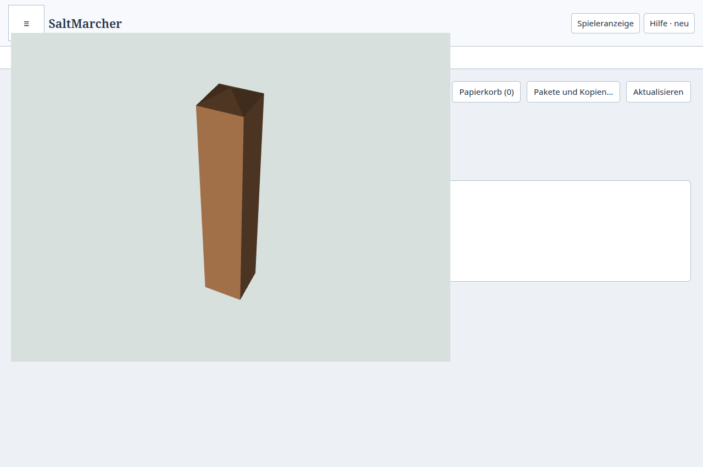
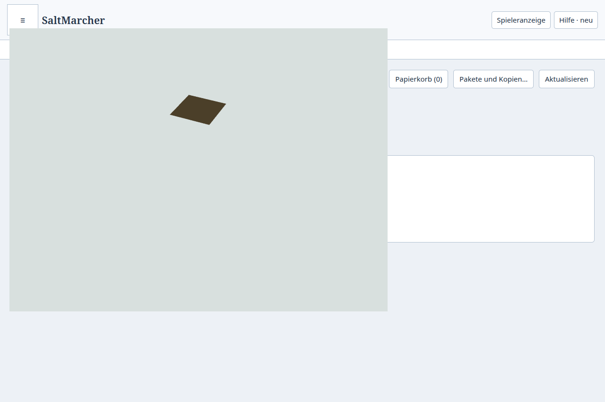
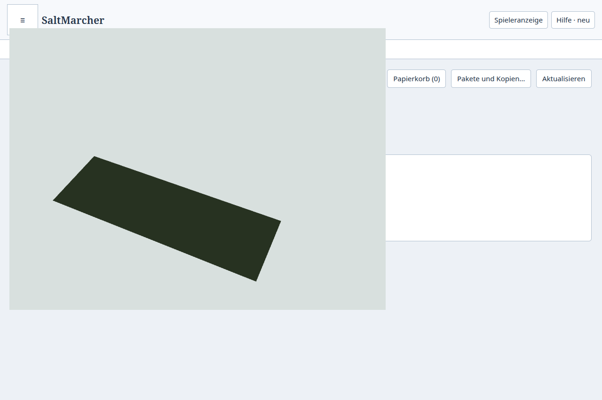
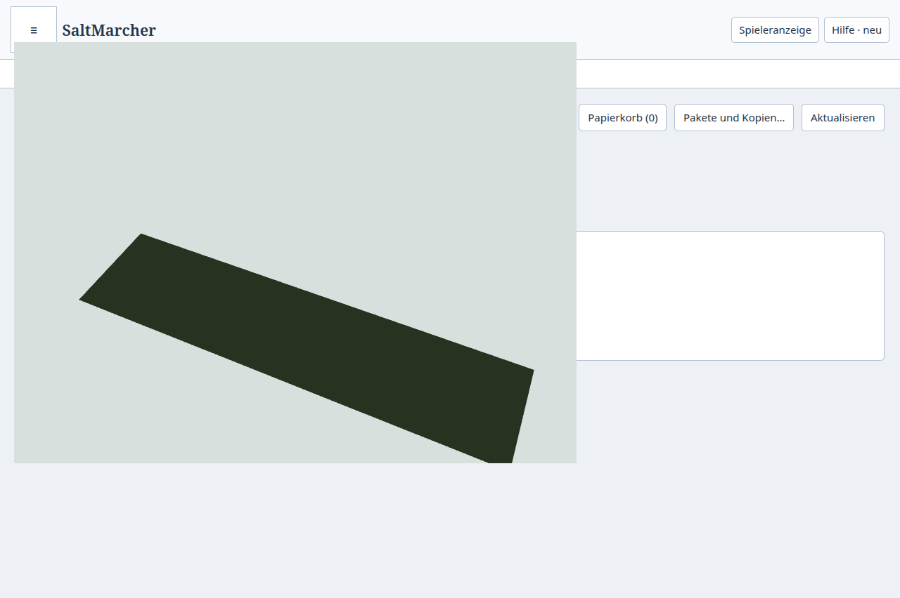

# M2-Zwischenstand: persistente Geometrie und Kamerafortsetzung

Die isolierte neue Atlasfläche lädt Gebäude- und Raumgeometrie aus fertigen
Kachelpuffern. Die [Roadmap](../../plans/maps/unified-spatial-atlas.md) bleibt
bei M2: Weitere Objektklassen, dichte grobe Geometriestufen, Materialkanäle,
kampagnenübergreifendes Plattenbudget und Weltlast sind noch offen. Der normale
Atlas verwendet weiterhin den bisherigen Renderer.

## Umsetzung und Nacharbeit

`atlasGeometryTile` liest über Preload/Main und den Readonly-Worker aus einer
geprüften kanonischen Aufnahme. Gebäude und sichtbare Räume aller Geschosse
werden in Weltmetern trianguliert, an der festen Kachelgrenze zugeschnitten und
erst danach in lokale Float32-Puffer überführt. Wände auf einer gemeinsamen
Grenze gehören genau einer Kachel. Kachelteile haben eindeutige Zeichen-IDs,
behalten aber die ursprünglichen semantischen Gebäude-/Raum-IDs.

Die binären Puffer verwenden denselben abgeleiteten Cache wie Terrain.
Unveränderte dauerhafte Quellenstände vermeiden erneute Quellen- und Höhenreads.
Nach Änderungen werden die lokale Topologie und die tatsächlich verwendeten
Höhenpunkte geprüft. Terrainänderungen können Geometrie erneuern, ohne dass sich
die Topologieversion ändert. Anzeigeauswahl, Kamera und Dachschalter gehören
nicht zur gespeicherten Geometrieidentität.

Die unabhängige Prüfung fand zwei konkrete Fehler: Verborgene Obergeschosse
verringerten die berechnete Gebäudehülle; eine verwaiste Bindung konnte alle
Kachelabfragen abbrechen. Jetzt stammen Bauhöhen aus allen gespeicherten
Geschossen, während die Raumzugehörigkeit die Sichtbarkeit berücksichtigt.
Verwaiste Bindungen erzeugen eine ausdrückliche Abdeckungswarnung. Weil ihre
räumliche Lage unbekannt sein kann, bleibt diese Warnung konservativ global;
ein Warnungswechsel allein löst keine neue Triangulierung gültiger Kacheln aus.

Der Terrainstream behält bei gleicher Quelle überlappende Kacheln während
Pan/Zoom. Er baut die neue Übersicht separat auf und tauscht sie vollständig
ein, bevor er Details nachlädt. Ein kalter Start zeigt dagegen bereits die
erste verfügbare Übersichtskachel. Quellen-/Revisionswechsel entfernen alte
Frames unmittelbar; verspätete Antworten dürfen keine neue Generation verändern.

## Prüfungen

24 gezielte Fälle bestehen in
[Geometrieclipping](../../../tests/atlas-geometry-mesh.test.mjs),
[kanonischem Szenenmodell](../../../tests/atlas-deck-scene-model.test.mjs),
[Geometriepersistenz](../../../tests/atlas-geometry-tiles.test.mjs) und
[Kachelstream](../../../tests/atlas-tile-stream.test.mjs).
Sie prüfen Nahtflächen und Randwände, große negative Weltkoordinaten, lokale
Invalidierung, unveränderte entfernte Kacheln, Umbenennung, Terrainänderungen
samt Undo/Redo, verborgene Geschosse und beschädigte Bindungen. Instrumentierte
Wiederöffnung zählt null erneute Geometriequellen- und Höhenabfragen.

`npm run check`, `npm run check:desktop` und `npm run build:desktop` bestehen.
Zusätzlich wurden vor der letzten, auf die neue Geometriequelle begrenzten
Nacharbeit 64 bestehende Worker-/Projektionsfälle erfolgreich ausgeführt.
Diese gezielten Belege ersetzen keine Candidate-CI oder Gesamtproduktabnahme.

## Native Geometrieprüfung

Der [native Ablauf](../../../tools/test-desktop-atlas-geometry-tiles.mjs) verwendet
eine gespeicherte technische Hügel-/Gebäudefixture und echte Preload-Aufrufe.
Lauf `1792790312386-1147166`, Basis `f465ecc23f81e16da6cb4b32db715d7d171e1090`
mit uncommittierten Geometrieänderungen. Der [Rohbeleg](result.json.gz) enthält
Quell- und Buildhashes; die geprüften Quellen blieben während der Probe gleich.

| Beobachtung | Ergebnis |
| --- | --- |
| Ein Gebäude über vier feine Kacheln | Vier Teile, identische semantische Gebäude-ID |
| Gedrehte und geneigte Ansicht | Dachtreffer bei 151 m; XYZ-Treffer aus tatsächlichen Dreiecken |
| Obergeschoss ohne Gebäudehülle | Richtiger Raum auf 145 m auswählbar |
| Frischer Prozess | Alle fünf Kacheln Cache-Hits, TypedArrays erhalten, Revision 3 |
| Feine Kacheln, kalter Aufbau | 20,5–22,2 ms je Abfrage |
| Feine Kacheln, nach Neustart | 18,0–19,2 ms je Abfrage |
| Erste Abfrage einschließlich Workerstart | 220,8 ms kalt, 211,4 ms nach Neustart |
| Obergeschoss kanonisch verbergen | Revision 4, Raum entfernt, Dachhöhe unverändert 152 m |
| Prozessende | Beide Starts Exit 0, kein Signal, PIDs anschließend nicht vorhanden |
| Rendererfehler | Keine |

Diese kleine Einzelprobe belegt Wiederverwendung und Datenkorrektheit, keinen
relevanten Gesamtleistungsgewinn. Die hohe Fundamentwand ist die Folge der
absichtlich steilen technischen Hügelprobe. Eine erste Probe hatte einen falschen
Raum an einem frei gewählten Punkt erwartet; die Prüfung nutzt jetzt einen Punkt
im tatsächlichen Dreieck des erwarteten Raums. Gebäude- und Geschosstreffer werden
nicht durch gelockerte Assertions ersetzt.




Reproduktion nach Desktopbuild:

```sh
QA_EVIDENCE_DIR=.build/atlas-geometry-native-session python3 tools/ui-session.py timeout --signal=TERM 180s node tools/test-desktop-atlas-geometry-tiles.mjs
```

## Native Kamerafortsetzung

Die erweiterte [Terrainprobe](../../../tools/test-desktop-atlas-tiles.mjs) bestand
in Lauf `1792790667874-1152266` ([Rohdaten](pan-result.json.gz)). Nach vollständiger
Ladung von vier Detailkacheln wird der Ausschnitt um eine Kachel verschoben.
Während die zweite neue Übersichtskachel künstlich blockiert ist, bleiben die
drei überlappenden Detailkacheln auf demselben einzelnen Canvas sichtbar.
Erst die vollständige Übersicht aus zwei Kacheln ersetzt diesen Frame, danach
folgen die vier neuen Detailkacheln. Kein veröffentlichter Übergangsframe ist leer.

Der Terrain-Treffer am 140-m-Hügelgipfel und die frische Prozesswiederöffnung
bleiben Teil der Prüfung. Beide Prozesse endeten regulär mit Exit 0; Quellenhashes
blieben gleich, Rendererfehler wurden nicht beobachtet. Die Bildprobe verwendet
eine gesteuerte Kameraänderung, keine vollständige Autorenreise oder Zielgerätmessung.




## Nächste Grenze

Die neue Quelle verwendet räumliche Kandidaten, durchläuft aber noch Bindungen
und tastet Höhen an benötigten Ankern ab. Dichte grobe Kacheln überschreiten ein
explizites Budget und verlangen eine feinere Stufe; sie sind noch keine fertige
Weltübersicht. Die Weltlastprüfung muss Aufbau, lokale Abhängigkeitsprüfung und
Übertragung messen. Weitere Geometrieklassen werden ausdrücklich als fehlend
gemeldet. Integration in Main, Release, Installation und Owner-Abnahme stehen aus.
