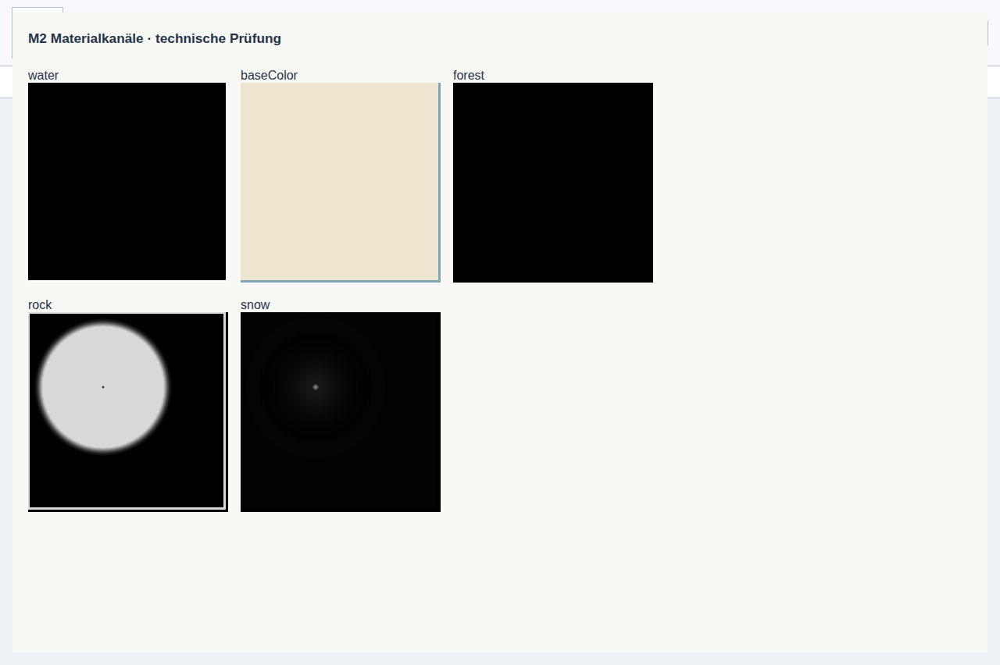

# M2: unabhängig gespeicherte Materialkanäle

Die neue `atlasMaterialTile`-Strecke liefert Grundfarbe, Wasser, Wald, Fels und
Schnee getrennt, bevor Licht, Konturen, Küstentinte und Routen aufgetragen werden.
Sie ergänzt die gespeicherten Höhen-/Geometriedaten der
[Atlas-Roadmap](../../plans/maps/unified-spatial-atlas.md). Der normale Atlas nutzt
weiterhin die bisherigen gerasterten Farben. M4 übernimmt später die GPU-Komposition;
dieser Beleg qualifiziert Materialdaten und ihren Transport, keine fertige neue Atlasfläche.

## Vertrag und fachliche Abhängigkeiten

Eine feste Weltkachel enthält 256 × 256 Pixel: Grundfarbe als RGBA und vier
Deckungskanäle mit je einem Byte. Zusammen sind das 512 KiB öffentliche Nutzdaten.
Die vier Supersamples jedes Pixels werden flächengewichtet reduziert. Wasser,
Wald und Materialgewichte unterliegen den kanonischen Boden-/Wasserregeln;
Wald, Fels und Schnee unter Wasser bleiben null. Die Grundfarbe enthält gemalte
Pigmente und den Bodenton von Vegetation, jedoch keine Beleuchtung.

| Kanal | Abhängigkeit | Nachgewiesene Wiederverwendung |
| --- | --- | --- |
| Grundfarbe | Grundpolygone, Pigment, Vegetationsbodenton, Landfarbe, Wasserverteilung | Licht, Konturen, Schneegrenze, reine Vegetationsdichte, trockene Höhenänderung |
| Wasser | Höhen, Geländewege/-flüsse, Seen, Meereshöhe, relevante Wasser-/Maskenpolygone | Licht, Pigment, Schneegrenze, Vegetationsdichte |
| Wald | Waldpolygone, Dichte/Edits, Kantenabdeckung und Wasserverteilung | Licht, Pigment, Schneegrenze, trockene Höhenänderung |
| Fels | Höhen und Hanggradient, Wasserverteilung, Gebirgsmaterialschalter | Licht, Pigment, Schneegrenze |
| Schnee | Höhen und Hanggradient, Wasserverteilung, Gebirgsmaterialschalter, Schneegrenze | Licht, Pigment, Waldänderung |

Konturen und Kamerapose gehören nicht zum Materialauftrag. Der Analysemodus ist
spätere Komposition und verändert die Rohkanäle nicht. Ein umbenanntes Objekt
ändert keine Materialidentität. Zeichenreihenfolge bleibt dagegen relevant.

Der Cache hält zusätzlich 64 KiB interne Wasser-Topologie: vier Bits je Pixel
beschreiben die Wasserverteilung der vier Supersamples. Bloße Wasserdeckung wäre
keine ausreichende Abhängigkeit für Pigment und Wald. Zwei halb bedeckte Pixel
können unterschiedliche Ufer-/Pigmentschnittmengen haben. Eine eigene Gegenprobe
verhindert genau diese falsche Wiederverwendung. Diese Metadaten werden nicht als
GPU-Kanal über die Bridge ausgegeben.

## Implementierung und Veröffentlichung

- [Rasterabschluss](../../../src/app/landscape-raster.ts): optionaler Capture vor
  Oberflächenkomposition; die Referenzpixel bleiben unverändert. Gemeinsame reine
  Fels-/Schneegewichte stammen aus [Terrainrelief](../../../src/app/terrain-relief.ts).
- [Kanalrasterung](../../../src/app/storage/terrain-material.ts): vier begrenzte
  128-Pixel-Batches mit gleichem Samplegitter und Halo, unterbrechbar ohne offenen
  SQLite-Iterator. Nicht benötigte Kanäle und ihre Farbpässe entfallen.
- [Persistenz](../../../src/app/storage/atlas-material-tiles.ts): eigene Schlüssel
  und Quellenfingerprints pro Kanal im gemeinsamen begrenzten Kachelcache.
  Kalter Erstaufbau teilt einen Rasterdurchlauf für alle Kanäle. Unveränderte
  dauerhafte Quellenversionen umgehen erneute Quellenprüfung. Nach Änderungen
  bleiben fachlich unveränderte Kanäle gültig; trockene Höhenänderungen entwerten
  beispielsweise weder Grundfarbe noch Wald. SQLite-Zeilenadressen bleiben auch
  oberhalb der JavaScript-Ganzzahlpräzision als exakte Zeichenfolgen erhalten.
- Jeder Cacheeintrag wird atomar geschrieben. Erst ein vollständiger Satz auf
  derselben geprüften Quelle wird als Antwort veröffentlicht. Fehlende Einträge
  werden gezielt ergänzt; ein unterbrochener Teilsatz wird nie als vollständige
  Kachel ausgegeben. Vorschauquellen ohne dauerhafte Version bleiben flüchtig.
- Preload nimmt nur Kacheladresse und Revision an. Main prüft Graphbarriere,
  Tokenquelle und abschließenden Quellenstand. Der lesende Worker prüft vor jeder
  Fortsetzung erneut seine SQLite-Snapshotrevision.

## Prüfung und Nacharbeit

47 verschiedene gezielte Tests bestanden über Raster, Materialpersistenz,
Workertransport, Referenzrelief/-wald/-pigment, Terrainprojektion/-dienst und
bestehende Terrainkacheln. Die Materialpersistenz wurde nach der Korrektur exakter
64-Bit-Zeilenadressen mit allen sieben Fällen erneut geprüft. Der Materialservice
prüft zusätzlich einen Commit nach einem tatsächlich beobachteten Worker-Yield:
Die alte Teilberechnung wird abgelehnt; der frische Satz stimmt mit einem kalten
Worker überein. `npm run check`, `npm run check:desktop` und Desktopbuild bestanden.

Direkte Tests: [Raster](../../../tests/terrain-material-raster.test.mjs),
[Persistenz](../../../tests/atlas-material-tiles.test.mjs),
[Worker](../../../tests/atlas-material-service.test.mjs).
Die Gegenproben fanden vor Abschluss zwei ungeeignete Testannahmen: Eine
Höhenänderung am Rand kann die Küste verschieben; und eine geänderte
Zeichenreihenfolge ist keine reine Vegetationsdichteänderung. Die korrigierten
Fixtures isolieren diese fachlichen Änderungen. Die unabhängige Kernprüfung
bewahrt außerdem den bestehenden Ablauf „nach finish weiterzeichnen“.

Die [native Probe](../../../tools/test-desktop-atlas-material-tiles.mjs)
`1792792379706-1176757` nutzte die echte Electron-/Preload-/Main-/Workerstrecke:

| Schritt | Ergebnis / beobachtete Dauer |
| --- | --- |
| Kalter Materialaufbau, Revision 3 | Alle fünf Kanäle aufgebaut, 479 ms |
| Licht-/Ink-/Stärkeänderung, Revision 4 | Alle fünf Cachetreffer, bytegleich, 377 ms |
| Schneegrenze auf 0 m, Revision 5 | Nur Schnee neu, andere vier bytegleich, 541 ms |
| Frischer App-Prozess | Alle fünf Treffer, bytegleich zu Revision 5, 255 ms |

Das sind einzelne End-to-End-Abfragen einer kleinen Hügelprobe, keine p95-Messung.
Die weiterhin hohen Start-/Commitkosten sind sichtbar; vermiedene Rasterung ist
kein Nachweis sofortiger Stilreaktion oder eines Gesamtleistungsgewinns.
Zwei App-Prozesse endeten regulär mit Exit 0, ohne Signal, danach nicht vorhanden.
Keine Rendererfehler; Vorher-/Nachher-Quellhashes identisch.
[Rohbeleg mit Quell- und Buildhashes](result.json.gz), Basis `485a5ddf` mit diesen
uncommittierten Materialänderungen. Ein erster Lauf bestand die Datenprüfungen,
sein Inspector wurde aber von der App-CSS versteckt; der archivierte Wiederholungslauf
prüft die Sichtbarkeit und zeigt die Kanäle tatsächlich.

## Abgleich mit M2 und nächster Schritt

Unabhängige Rohkanäle, lokale Wiederverwendung, Wiederöffnung und sichere
Veröffentlichung sind für diese Strecke belegt. M2 ist insgesamt **nicht fertig**:

- Die Materialstufen werden derzeit direkt aus kanonischen Quellen abgetastet.
  Flächengetreue Reduktion aus Kindern und stabile Übergänge bei gemischten LODs
  sind noch zu qualifizieren; der Hanggradient verwendet aktuell vier Samples
  derselben Stufe. Gleiche-LOD-Kachelränder allein beweisen diese Übergänge nicht.
- Dichte grobe Geometriekacheln scheitern weiterhin am Detailbudget. Weitere
  Objektklassen, ein Gesamtbudget einschließlich Projektionsindizes und die
  vollständige Weltlast fehlen.
- GPU-Darstellung, Werkzeugübernahme, Produktnavigation und Zielgeräteabnahme
  bleiben die folgenden Roadmapetappen.

Nach erneutem Lesen des aktiven M2-Auftrags ist der nächste Arbeitsschritt die
**nutzbare grobe Geometrieübersicht unter der festen M0-Weltlast**: Der bereits
vermessene 4096-m-Ausschnitt überschreitet weiterhin das Quellenbudget. Die
Übersicht muss einen begrenzten Darstellungsbestand laden können und ihre
Detailabdeckung ausdrücklich führen, statt das Limit bloß zu erhöhen.
