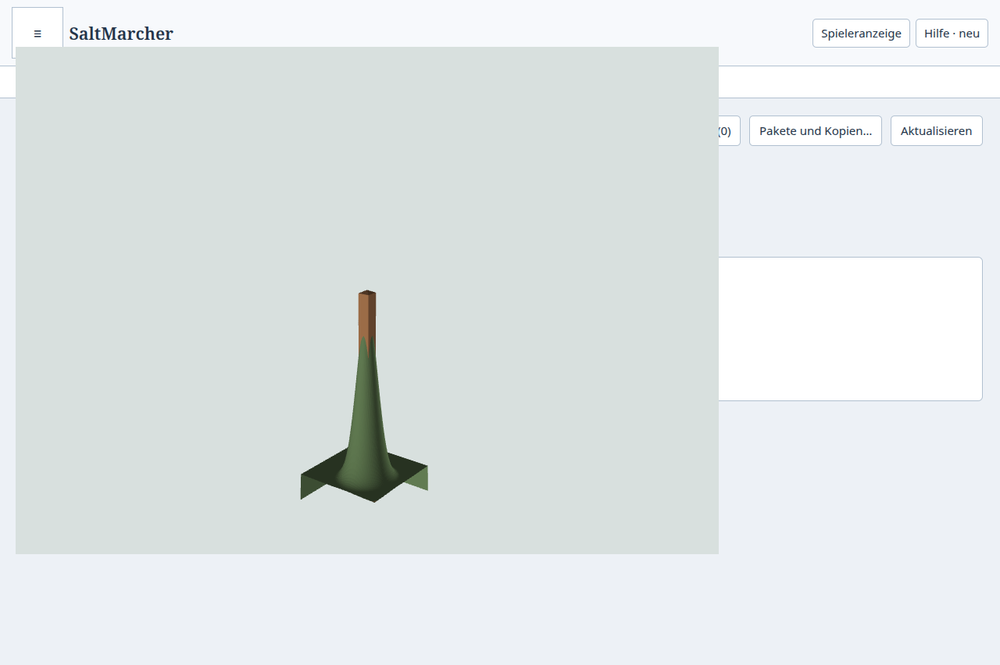
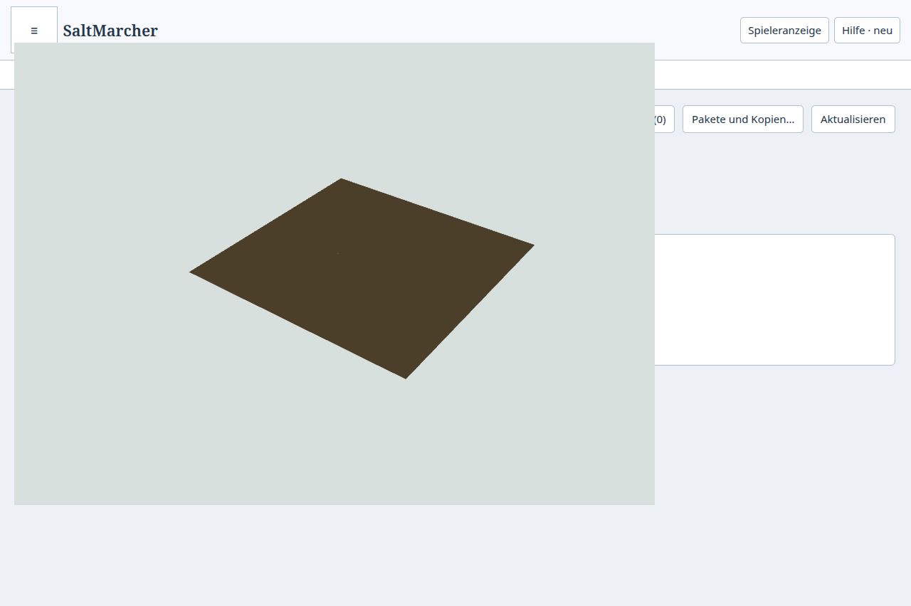
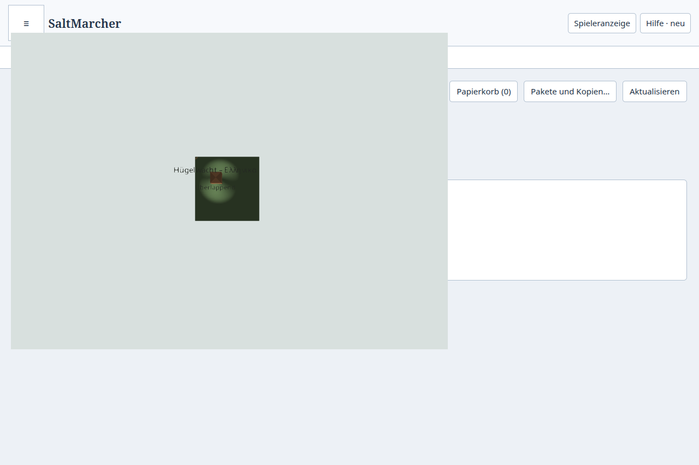

# M1: direkter metrischer Atlas-Kern

Der Ersatz für die MapLibre-Kopplung ist lokal implementiert und als isolierter
Desktop-Kern geprüft. Die [Roadmap](../../plans/maps/unified-spatial-atlas.md)
geht zu M2 über. Die normale Atlasfläche verwendet bis zur vollständigen
Werkzeugübernahme weiterhin ihren bisherigen Renderer. Eine Beschleunigung des
normalen Atlas, vollständige Produktabnahme, Installation oder Veröffentlichung
ist damit nicht nachgewiesen.

## Änderung und Nutzen

Die [metrische Kamera](../../../src/app/atlas-metric-camera.ts) besitzt Weltfokus,
Höhenfokus, Maßstab, Drehung und Neigung. Die
[direkte Deck-Fläche](../../../src/app/atlas-deck-surface.ts) verwendet öffentliche
View-/Viewport-Schnittstellen und einen gemeinsamen Tiefenpuffer für Terrain und
Objekte. Wachsende Weltbereiche ändern weder Kamera noch bestehende
[Kacheladressen](../../../src/app/atlas-world-tiles.ts). Weltpositionen bleiben
doppelt genau; lokale GPU-Puffer behalten ihre Identität beim Wechsel des
Darstellungsursprungs. Damit entfallen MapLibre-Wurzelwechsel,
Zoomübersetzungen und Eingriffe in dessen Projektionsabfragen.

GPU-Auswahl und präziser Dreiecksstrahl teilen dieselbe Kamera. Veraltete Frames
sperren Auswahl. Der separate, versionsgebundene Deck-Adapter für 24-Bit-Picking
bleibt erforderlich: Die Entfernung von MapLibre beseitigt diese Deck-Grenze
nicht. Der Renderer erhält weiterhin nur die bestehende Preload-Brücke;
Main und SQLite behalten Autorendaten und Schreibrechte.

## Geprüfter Stand

Native Probe: `1792787939191-1113728`, auf Basis des lokalen Checkpoints
`c891b74b0d6b9f91c4f5f746f93d3fa74db63768` mit uncommittierten Abschlussänderungen.
Der [Rohbeleg](result.json.gz) enthält identische Vorher-/Nachher-Hashes der
relevanten Quellen, Laufzeit, Fonts und Lockdatei sowie Desktop-Buildhashes.
Reproduktion: Desktop bauen, dann über `tools/ui-session.py` den
[nativen Prüfablauf](../../../tools/test-desktop-atlas-deck.mjs) starten.
Das Profil ist isoliert; echte Nutzerdaten werden nicht verwendet.

| Prüfung | Ergebnis |
| --- | --- |
| Kanonische Daten über Main/Preload | Hügel, Gebäude, Dach und Räume aus gespeicherter SQLite-Kampagne; korrekte semantische IDs |
| Kamera | 0°/0°, 37°/55°, −143°/75°; Dachtreffer mit XYZ-Abweichung unter 0,1 mm |
| Geschosse und Überhöhung | Räume auf 141/145 m bei 0,25×, 1× und 8×; Treffer bleiben in physischen Metern |
| Verdeckung | Terrain verdeckt einen Raum; Entfernen nur des Terrains macht ihn auswählbar; Wiederherstellen verdeckt ihn wieder |
| Fünf Maßstäbe | 40.000 km, 16.000 km, 4.000 km, 3 km und 20 m: jeweils sichtbares Terrain, Gebäude und Raum tatsächlich ausgewählt, insgesamt 15 Treffer |
| Ferne Koordinaten | Maßstabsfixtures um +70.000.000/−90.000.000 m; jeweils passende lokale Geometrie |
| Laufende Geste | Echter Pointer-Drag über 256-m-Ursprungsgrenze; Canvas, CPU-Puffer und Deck-GPU-Modelle identisch, Dachauswahl weiter korrekt |
| Zoom und Resize | Mausrad ändert Maßstab; 800×580-Viewport, veraltete Auswahl bis zum neuen Frame gesperrt |
| Kontextverlust | Tatsächlicher WebGL-Kontextverlust; frischer Canvas, gleiche Kamera und CPU-Puffer, korrekte Auswahl; keine Fehler |
| Lokale Beschriftung | Noto Sans geladen, deutsche/griechische Zeichen sichtbar; 783 geänderte Bildpixel gegenüber unbeschrifteter Szene |
| Bild und Aufräumen | Kleiner GPU-Canvas als PNG erfasst; zweimaliges Dispose hinterlässt keinen Canvas |
| Frischer Prozess | Gleiche Kampagne, semantische IDs, Dachhöhe 152 m und unveränderte Autorenrevision 3 |
| Prozessende | PIDs 1113794 und 1113958 regulär mit Exit 0 ohne Signal beendet, danach nicht vorhanden; Fehlerliste leer |

Die Maßstabsfixtures sind ausdrücklich skalierte technische Testgeometrien,
keine realistische Welt mit Millionen Gebäuden. Kanonische Gelände-/Raumformen
und deren Verdeckung werden separat geprüft. Der kleine Canvas-Mitschnitt ist
kein Nachweis des vollständigen Atlasexports oder einer 8192-Pixel-Ausgabe.
Die Bilder zeigen technische Geometrie, keine fertige Kartengestaltung.

## Nacharbeit aus der Prüfung

- Deck fragt während des Starts vorübergehend einen Viewport der Größe null ab.
  Dieser bleibt leer, statt die Initialisierung abzubrechen.
- Behaltene Geometriedaten benötigen explizite Transformations-Update-Trigger.
  Ohne sie blieb die GPU-Instanz bei einer Änderung der Überhöhung unverändert.
- Text-Billboards benötigten den richtigen Kamera-Fokusabstand und eine
  Tiefenkorrektur ihrer Pixelgröße. Der erste mechanisch erfolgreiche Lauf
  zeigte noch keine brauchbar sichtbaren Texte; Bildprüfung und Pixelvergleich
  haben das aufgedeckt und die Korrektur bestätigt.
- Ein einzelner Pixel an einer Dachspitze kann außerhalb des Dreiecks liegen.
  Die Probe verwendet deshalb einen inneren Punkt der sichtbaren Dachfläche.
  Auswahlradius und numerische Randtoleranz wurden dafür nicht aufgeweitet.
- Fehler bei der GPU-Initialisierung entwerten die Laufzeitgeneration. Ein
  verspätetes `onLoad` darf eine fehlgeschlagene Fläche nicht wieder freigeben.

## Automatisierte Grenzen und offene Arbeit

40 Tests in Kamera, Weltkacheln, Szenenmodell, Strahl/BVH, Oberfläche,
Beschriftung, Assets und Picking bestehen. `npm run check`,
`npm run check:desktop`, `npm run build:desktop` und `npm run check:repo`
sind lokal grün. Die tatsächlichen Testdateien sind im gemeinsamen
Capability-Katalog hinterlegt; Links belegen keine vollständige Ablaufabdeckung.

MapLibre-Code, alte Adaptertests und ungenutzte Abhängigkeiten wurden nach
bestandener Ersatzprüfung entfernt. Fonts und Lizenzsammler sind neutral
benannt. Historische Berichte verweisen auf den erhaltenen Git-Checkpoint;
die eingefrorene ausführbare M0-Referenz bleibt erhalten.

M2 muss persistente Detailstufen, sichtabhängige Nachladung und lokale
Invalidierung liefern. Vollständige Objektklassen, Autorenwerkzeuge,
Beschriftungsquellen, Export und Leistungsabnahme folgen M3–M8.
`coverage.unsupported` benennt fehlende Szenenklassen ausdrücklich.
Die Originalanforderungen und Owner-Abnahmen bleiben unverändert.
