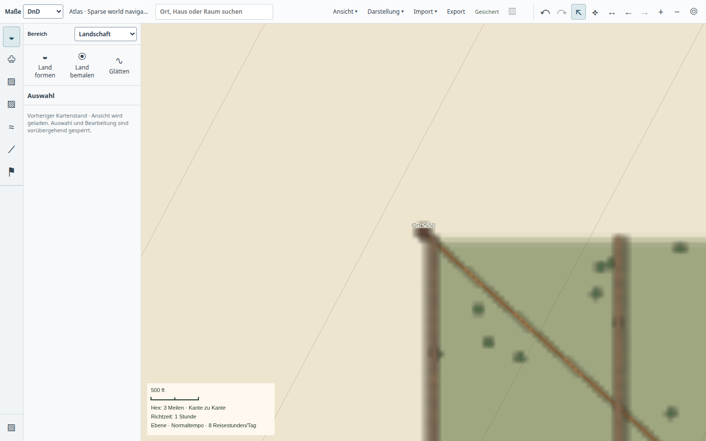
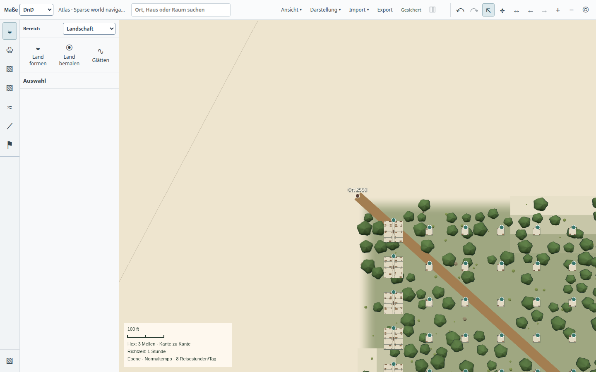

# Viele kleine Gebäude im selben Ausschnitt – 22.10.2026

Die native Langzeitprobe fand vor Beginn der eigentlichen Speicherqualifikation
einen langen Stillstand: Welt → Region → Nachbarschaft ließ Auswahl und
Bearbeitung länger als 60 Sekunden gesperrt. Die Kamera zeigte weiterhin den
vorherigen Kartenstand. [Fehlerzustand und Workerzeiten](before-stall.json)
belegen eine einzelne Bereichslesung mit 49,82 Sekunden; ihre Synchronisation
brauchte nur 1,68 ms. Der Test wurde beendet und sein Prozess ist verschwunden.
Das ist ein fehlgeschlagener Test mit Notbereinigung, kein regulärer Abschluss.

## Ursache und Korrektur

Raumgruppen besitzen voneinander unabhängige lokale Koordinaten. Viele kleine
Gebäude überlagern sich deshalb im lokalen räumlichen Index, obwohl sie im Atlas
an verschiedenen Weltpositionen liegen. Der ausschließlich räumlich beginnende
Join prüfte diese gemeinsamen Kandidaten für jedes Gebäude erneut. Bei einem
großen einzelnen Dungeon ist genau dieser Suchweg dagegen notwendig: dort muss
ein kleiner Ausschnitt nicht erst alle Objekte seines Besitzers durchlaufen.

`AtlasRegionReader.candidates` prüft nun höchstens 129 Einträge des bestehenden
Gruppenindex. Gruppen bis 128 Einträge beginnen dort und schlagen die räumlichen
Grenzen anschließend nach. Größere Gruppen beginnen weiterhin mit dem Rtree.
Beide Wege benutzen dieselben Rtree-Grenzen, Filter und Zeichenreihenfolge; es
gibt keine neue Quellzuordnung, Tabelle oder möglicherweise veraltete Größenliste.
Der Zusatz dient nur der Auswahl des günstigeren Abfrageplans.

## Vergleich auf identischer großer Welt

[Lesemessung](paired-reads.json) gegen den Main-Stand `da6c88eb`, gleiche Daten,
gleiche Abfragen und alle übrigen Abhängigkeiten unverändert:

| Ausschnitt | Vorher | Nachher |
| --- | ---: | ---: |
| Welt | 387 ms | 295 ms |
| Region | 62 ms | 69 ms |
| Einzelgebäude | 380 ms | 132 ms |
| Dungeon | 306 ms | 260 ms |
| Nachbarschaft, 11.200 sichtbare Geometrieobjekte | 56.018 ms | 2.835 ms |

**Alle fünf vollständigen Antworten einschließlich Raster sind bytegleich.**
Die Nachbarschaft ist derselbe Zwischenmaßstab wie im Fehlerlauf; reine Welt-
und Einzelgebäudeproben hatten ihn nicht abgedeckt. Es sind einzelne lokale
Messpaare, keine garantierten Laufzeiten. Auch 2,8 Sekunden liegen weiterhin
über dem Ziel unmittelbar nachladender Ansichten.

Der Vergleich ist mit `tools/measure-atlas-region-opening.mjs` und
`ATLAS_REGION_NEIGHBORHOOD=1` reproduzierbar. Die native Gegenprobe verwendet
`tools/test-desktop-atlas-scale-roundtrip.mjs` mit einer privaten Kopie der
synthetischen Mischwelt. Ohne Dauerparameter läuft sie einmal Welt → Region →
Nachbarschaft → Gebäude → Innenraum → Welt. `ATLAS_NAVIGATION_MINUTES=30` ergänzt
wiederholte Navigation mit PSS-/Heap-Messungen ohne erzwungene GC. Sie ersetzt
keine wiederholte Bearbeitungs- oder physische Pentium-Qualifikation.

## Native Gegenprobe und Regressionen

[Der vollständige Maßstabswechsel](roundtrip.json) ist nach der Korrektur
bestanden: 40.000 km → 2.000 km → 20 km → 400 m → 80 m → zurück zur Welt.
Die erste Runde einschließlich Wartezeiten und Rückweg dauerte rund 85 Sekunden.
Das 80-m-Bild erreicht den Innenraummaßstab, ist aber keine vollständige
Innenraumbearbeitung. Die sichtbare Karte ist eine technische Lastfixture, keine
gestalterische Referenz.

Landschaft, Räume, Zeichnungselemente, Gebiete und Atlasrevision blieben nach
Hashvergleich unverändert. Der native Prozess endete regulär mit Code 0, ist
verschwunden und meldete keine Rendererfehler. Alle elf gebauten Artefakte
wurden abgeglichen. 65 betroffene Bereichs-/Cachetests, beide Typechecks,
Desktopbuild und Repositoryprüfung bestanden. Neue Regressionen prüfen 2.000
kleine Gruppen mit überlagerten lokalen Koordinaten, gleiche räumliche
Kandidaten/Zeichenreihenfolge sowie den Wechsel zum Rtree beim Wachstum einer
Gruppe. Der bestehende Fall für einen großen Einzelbesitzer bleibt bestanden.

Eine 30-Minuten-Navigationsprobe ist zusätzlich vorgesehen. Dieser kurze
Durchlauf belegt noch kein Speicherplateau oder die gesamte Leistungsabnahme.
