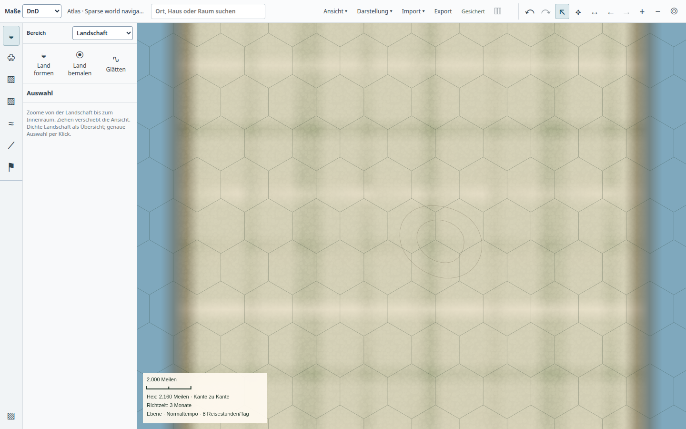
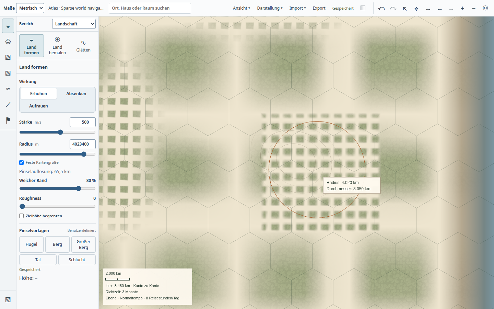

# Persistente räumliche Indizes im normalen Atlas

Arbeitsstand vom 22.10.2026 auf `d7b4750edea3e18836621fd813083ec5546ff35e` mit lokalen Änderungen. Die nativen Belege enthalten die tatsächlich gestarteten Artefakthashes. Exact-SHA-CI, Main-Integration, Paketinstallation und Nutzerabnahme sind getrennte Nachweise.

## Änderung

Der erste Aufbau nutzt weiterhin die TEMP-Tabellen und direkten SQLite-Kopien. Ein Hintergrundbackup veröffentlicht den fertigen Index. Beim erneuten Öffnen lädt der Worker eine geprüfte private Arbeitskopie; seine kanonische Verbindung bleibt schreibgeschützt. Geometrie und Landschaft aktualisieren ihre betroffenen Metadaten in derselben vorhandenen Projektionslogik.

Eine eigene Geometriekennung verhindert, dass ein reiner Terrainzug mit übergelaufenem Änderungsverlauf alle Gebäude neu projiziert. Externe Schreibverbindungen, Undo, Backupzweige und fehlende Trigger werden weiterhin berücksichtigt. Der alte JSONL-Leser ist entfernt. Unveröffentlichte Kandidaten liegen im eigenen Workerordner; veröffentlichte SQLite-Dateien benötigen keine WAL-Begleitdateien.

Entscheidung und Codebesitzer: [Architekturplan mit drei Optionen](../../plans/maps/atlas-persistent-projection.md).

## Lesebestand und Öffnung

[Lesemessung](reader.json), jeweils ein Durchlauf auf derselben vollständigen Mischwelt:

| Zustand | Kopie/Prüfung/Konstruktor + Synchronisation | Neu projizierte Geometrien |
| --- | ---: | ---: |
| TEMP ohne Veröffentlichung | 5.555 s | 64.371 |
| Erster Aufbau mit Veröffentlichung | 5.852 s | 64.371 |
| Gültiger gespeicherter Index | 0.283 s | 0 |

Die fünf vollständigen Antworten einschließlich Raster sind bytegleich: Welt, Region, Nachbarschaft, Gebäude und Dungeon. Die Nachbarschaft enthält 11.200 Geometrieobjekte. Ihr eigentliches Lesen bleibt teuer; die Indexbereitstellung ist keine Messung der gesamten App-Öffnung. Eine zusätzliche Vorher/Nachher-Prüfung gegen die bisherigen Geometrie- und Landschaftsleser bestätigte dieselben fünf Antwort-Hashes.

[Native Wiederöffnung](reopen.json), normaler App-Einstieg bei 1440 × 900:

| Sichtbarer Zustand | Erster Aufbau | Erneute Öffnung |
| --- | ---: | ---: |
| Geländeübersicht | 5.280 s | 3.291 s |
| Objektbereich bereit | 9.940 s | 4.090 s |

Beide Prozesse endeten regulär mit Code 0 und verschwanden. Keine Rendererfehler; alle elf Artefakthashes blieben gleich. Hashes von Landschaft, Räumen, Zeichenelementen und Gebieten sowie die Atlasrevision blieben unverändert. Die gespeicherten Indexdateien blieben bei der zweiten Öffnung unverändert. Das Warten auf die erste abgeschlossene Hintergrundveröffentlichung ist aus den Öffnungszeiten ausgeschlossen.

Die regelmäßigen Formen und das grobe Relief gehören zur Lastfixture. Dieses Bild ist kein gestalterischer Nachweis für eine ausgearbeitete Fantasykarte.

## Automatisierte Grenzen

[Prüfprotokoll](checks.json): 103 verschiedene betroffene Tests bestanden. Die Cachefälle wurden nach der letzten Quellenprüfung erneut ausgeführt; Wiederholungen erhöhen die Anzahl verschiedener Tests nicht. App-/Desktop-Typprüfung und Desktop-Build bestanden.

Die Fälle umfassen frische Wiederöffnung ohne vollständige Projektion, inkrementelle Änderungen im TEMP- und Dateibestand, überlappende Hintergrundbackups, exakte 64-Bit-Zeilennummern, gepinnte Quellsnapshots, Rollback, externe Änderungen, fehlende Trigger, beschädigte Caches, Archive, Backupzweige, Graphvorschauen, nicht beschreibbare Verzeichnisse sowie zwei Worker mit unabhängigen Arbeitskopien und deren Abbruch. Ein weiterer Fall verlangt die Hintergrundveröffentlichung auch während fortlaufender Kamera-Leseaufträge; unveränderte Leseaufträge dürfen den Veröffentlichungstimer nicht zurücksetzen. Ein eigener Fall überläuft den Änderungsverlauf mit 10.001 Terrainänderungen und verlangt null neue Raumprojektionen.

Reproduktion: `node build.mjs --test`, anschließend die in `checks.json` genannten Prüfungen. Die große Lesemessung verwendet `tools/measure-atlas-region-cache.mjs` mit `ATLAS_MIXED_SOURCE` auf einer synthetischen Mischwelt. Native Wiederöffnung läuft über `tools/ui-session.py` und `tools/test-desktop-atlas-cache-reopen.mjs`.

## Navigation und großer Pinsel nach Wiederöffnung

[Native Bearbeitungsfolge](world-edit.json): 100.000 Hexfelder mit Biomeigenschaften, 5.000 Orte, 5.000 eingerichtete Gebäude, 50 Detailbereiche und 4.001 Dungeonräume. Das sind insgesamt 15.701 Räume, 48.670 Zeichenelemente und 108.076 Landschaftsdatensätze; keine Behauptung über 100.000 fein bearbeitete Höhenzellen oder Volumenzellen. Zwei Sculpt-Züge mit 4.023.360 m Radius (2.500 Meilen) wurden nach einer frischen Wiederöffnung gespeichert.

| Messung | Ergebnis | Ziel |
| --- | ---: | ---: |
| Navigation Bildabstand p95 / p99 | 37,0 / 66,7 ms | ≤ 16,7 / 33,3 ms |
| Erster / zweiter Zug: sichtbare Pinseländerung | 233,6 / 136,4 ms | p95 ≤ 100 ms |
| Bildabstand beim ersten / zweiten Zug p95 | 41,3 / 39,9 ms | noch zu verbessern |

Zwei Züge ergeben noch keine belastbare p95-Verteilung der Pinselantworten. Beide Einzelwerte überschreiten bereits das Ziel. Beide Prozesse endeten regulär; keine Rendererfehler. Die Artefakthashes stimmen mit der Wiederöffnungsprüfung überein. Der technische Ablauf besteht, die Leistungsanforderung bleibt offen. Die zusätzliche Navigationsprobe während des Öffnens ist ein anderer Messablauf als die obige ruhige Öffnung.

## Offene Produktanforderungen

Die Zwei-Sekunden-Öffnung ist weiterhin verfehlt. Dichte Geometrie, Terrainberechnung, vollständige Detailverfeinerung, flüssige Navigation und schnelle Pinselabschlüsse benötigen weitere Arbeit. Persistente Farb-/Höhen-Detailstufen sind noch nicht implementiert. Diese lokale Prüfung ersetzt weder einen 30-Minuten-Test mit Bearbeitung noch die physische Pentium-Abnahme oder die gestalterische Abnahme.
