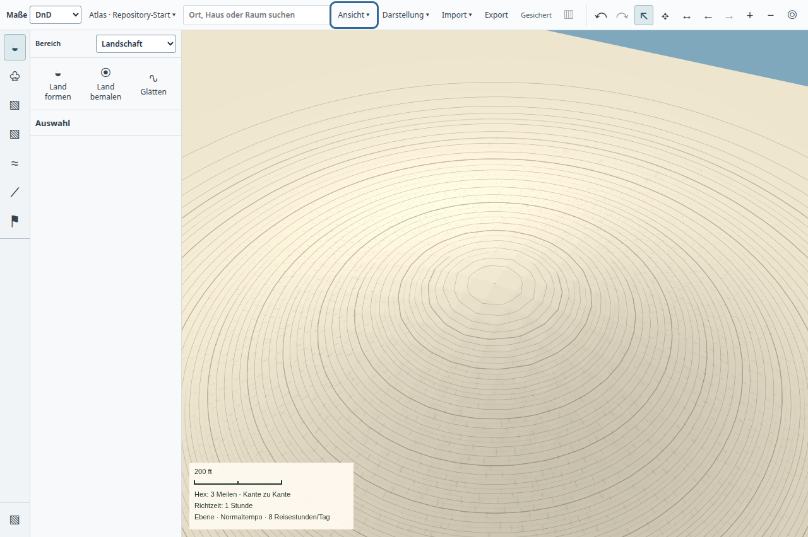

# Frühe Geländeübersicht im normalen Atlas

Produktstand: `280233aa80278fd2763a965cdbcfe27b38e7fb6b`. Die gestufte Projektion selbst stammt aus `2a30f25f36e14b54ed8b1a2869349bc26b227996`. Der vorherige Fokusnetz-/Trefferstand ist unter [Atlas-Fokusnetz](../atlas-focus-grid-20261021/README.md) belegt.

## Verhalten und Zuständigkeit

`terrain-navigation-plan.ts` beschreibt zwei abgeleitete Readonly-Aufträge. Beide verwenden dieselben 257×257 Höhenknoten, dieselben Baukörper, Straßen und Flüsse. Die erste Antwort enthält eine Farbtextur von höchstens 128×128 Pixeln und gibt die Hauptfläche bereits frei. Anschließend werden die Kontexttextur und die feinere Ausschnittstextur geladen. Die Geometrie springt beim Verfeinern nicht um; Höhenlinien reagieren weiterhin direkt auf der GPU. Bei reiner Navigation bleiben zuvor geladene Detailfarben in ihren Weltkoordinaten sichtbar, bis der neue Detailausschnitt fertig ist. Der gehaltene Ausschnitt wird bei jeder geänderten Revision oder Kampagne verworfen.

`TerrainSpatialUI` hält weiterhin genau eine Hauptfläche. Quellen- und Gestenwechsel widerrufen verspätete Antworten. Nach einer unterbrochenen Verfeinerung wird nur die fehlende Detailstufe nachgefordert. Fehler dieser Stufe erhalten die nutzbare Übersicht und zeigen den vorhandenen Wiederanlauf an. Es gibt keinen automatischen Fehlerversuchskreislauf. Main validiert Quelle und Revision für beide Stufen; frühere Antworten erhalten keine Schreibautorität.

## Normale App

Die [native Repository-Probe](repository-result.json) startet [wörtlich `npm run start:desktop`](development-command.log) mit einem isolierten Profil. Sie beobachtet eine freigegebene Übersicht, führt während ausstehender Details einen Mausradzoom aus und beobachtet anschließend die Detailstufe auf demselben Canvas. Die Ausschnittsbreite ändert sich von 900 auf etwa 798 Meter, solange noch die Übersicht aktiv ist. Zwischen beiden beobachteten Stufen liegen in diesem Lauf 2.571 ms. Das ist der Verfeinerungsabstand; die Zeit seit Appstart oder Eingabe ist daraus nicht abzuleiten.

Neigen, Drehen und weiterer Zoom bleiben auf der Hauptkarte. GPU-Höhenlinien und Exportkachelgrenzen bestehen die bestehende Pixelprobe. Die App endet normal mit Code 0 und verschwundenem PID; keine Rendererfehler wurden erfasst. Der Screenshot zeigt die fertige Detailstufe, keine separate 3D-Fläche.

Die [Zwischenansicht während der Navigation](navigation-overview.png) wurde vor und nach dem Screenshot als `overview` beobachtet. Sie verwendet bereits die neue Geometrie, behält aber überlappende Detailfarben der vorigen Ansicht. Die fertige Ansicht darüber ersetzt diese anschließend durch den neuen Detailausschnitt.

## Messung und Regressionen

[Backendmessung](measurement.json), Werkzeug `tools/measure-terrain-progressive.mjs`: Vier kalte Reader lesen dasselbe Hügel-Fixture in der Reihenfolge vollständig/gestuft/gestuft/vollständig. Der zweite Modus fordert erst die kleine Farbtextur und dann den unveränderten vollständigen Ausschnitt an. Endergebnis und Höhen sind bytegleich. Keine eigenen Prüfungen oder nativen Proben liefen gleichzeitig; der Host war keine isolierte Leistungsumgebung.

| Modus | Erste nutzbare Geometrie | Vollständige Farbe |
| --- | ---: | ---: |
| vollständig, Lauf 1 | 2.523 ms | 2.523 ms |
| gestuft, Lauf 1 | 168 ms | 2.109 ms |
| gestuft, Lauf 2 | 51 ms | 1.846 ms |
| vollständig, Lauf 2 | 1.796 ms | 1.796 ms |

Dies sind Backend-Wandzeiten ohne IPC, GPU-Aufbau und Bildschirmdarstellung, keine p95-Werte oder FPS-Abnahme. Das Fixture benötigt für die Übersicht 43.520 zusätzliche Texturbytes; der gemessene Cache steigt von 4.005.127 auf 4.051.541 Bytes. Die Cachelimits bleiben unverändert. Vollständige Farbe wird nicht grundsätzlich schneller; sie wird später benötigt.

[16 gezielte Tests](tests.log) prüfen Portrait-/Querformat und Maßstäbe, identische Geometrie beider Stufen, Gleichheit mit kaltem Vollaufbau, Revisionsschutz, Kamerawiederverwendung, späte Antworten, Konturänderungen, Gestenwiderruf und Wiederaufnahme sowie Detailfehler ohne Verlust der Übersicht. Zusätzlich wird die Wiederverwendung scharfer Farbe bei Navigation und ihre Löschung nach Edits oder Kampagnenwechsel geprüft. [App-TypeScript](type-check.log) und [Repositoryprüfung](repository-check.log) bestehen. [Neun Rendererfälle](render-tests.log) prüfen zusätzlich eingefrorene Treffer, lokale Updates, Exportgrenzen und den gleichbleibenden Farbpunkt bei einer neuen Oberfläche, die den alten Detailausschnitt anschneidet. Bei der neuen Fallbereinigung fehlten zunächst `dispose` und `forceContextLoss` im Renderer-Stub; beide wurden ergänzt. Der erste UI-Testlauf hatte eine falsch angepasste Erwartung für die Zahl der noch ausstehenden Reads; die Behauptung zweier Reads vor der ersten Antwort wurde auf einen korrigiert.

## Pinsel, Objekte und Ausgabe

Die [native Live-Probe](live-result.json) auf Produktstand `2a30f25f3` besteht Formen vor dem Loslassen, Glätten, kumulative Farbe, Escape, Fokusverlust, Höhenprofil und den gekippten Zug mit frischem Prozessstart und einem Undo. Beide Prozesse enden normal mit verschwundenen PIDs und ohne Rendererfehler. [Screenshot](tilted-live.png).

Die [native Objektprobe](objects-result.json) auf demselben Stand besteht Dachauswahl des ursprünglichen Gebäudes, Höhenänderung ohne Verlust der Räume, gekachelten 2048er-PNG-Export und frisches Öffnen. Auch diese beiden Prozesse enden normal ohne Rendererfehler. Diese Läufe liegen vor dem ergänzenden Beibehalten bereits geladener Farben bei Navigation. Dieser letzte Schritt ist separat durch die aktualisierte Repository-Probe und die Revisions-/Kampagnenwechseltests belegt; die älteren Läufe werden nicht als Prüfungen seines exakten SHA ausgegeben.

## Offen

Laufende Readonly-Detailarbeit ist weiterhin ein unteilbarer Auftrag und kann neue Ausschnitte oder Autorenaufträge verzögern. Nötig bleiben unterbrechbare, priorisierte Detailkacheln und weltfeste Wiederverwendung. Die begrenzte Geländeabdeckung bei starker Neigung, Küsten-/Texturstil, semantische Objektdetails und Beschriftung sind durch diesen Schritt nicht abgeschlossen. Ein langsamer Kampagnenstart vor Erscheinen der Hauptfläche bleibt eine getrennte offene Prüfung. Die gesamte Leistungsabnahme, große Welten, lange Sitzungen, Candidate-CI, Main-Integration, Paketierung, Installation und Nutzerabnahme stehen aus. Die drei kritischen vollständigen Abschlussprüfungen haben nicht begonnen.
