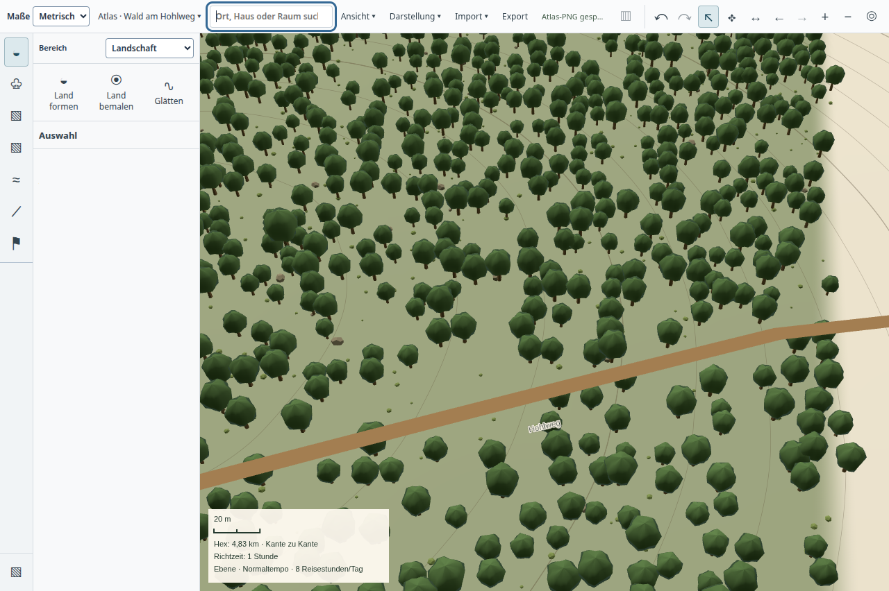

# Geländenetz und Shader wiederverwenden – 22.10.2026

Der normale Atlas ersetzt bei neuen Weltgrenzen oder Terrainbildgrößen nicht
mehr das vollständige Geländenetz samt Material. `terrain-surface-mesh.ts`
trennt Topologie (Spalten/Zeilen), Weltbereich und Bildgröße. Gleiche Topologie
behält die GPU-Puffer; andere Weltgrenzen überschreiben Positionen und UVs.
Andere Knotenzahlen ersetzen die Geometrie, andere Bildgrößen die Textur.
Mesh, Material und Shader bleiben dabei erhalten. Teilaktualisierungen dürfen
weiterhin nur mit passender bestätigter Basis alte Samples behalten.

Direkte Arrayzuweisungen vermeiden kleine temporäre Arrays pro Knoten;
Indexpuffer werden direkt typisiert angelegt. Die Live-Sculpt-Attribute behalten
bei gleicher Größe ihren Puffer und werden bei fehlenden Bearbeitungsdaten
zurückgesetzt. Der numerische Dreieckstreffer kopiert keine GPU-Geometrie mehr:
sein vorhandener eigener Raycast verwendet ausschließlich das bestätigte
Terrainraster. Eingefrorene Pinsel-Trefferflächen bleiben davon unabhängig.

## Echte GPU-Gegenprobe

`tools/terrain-mesh-reuse-probe.mjs` läuft im nativen Waldtest optional mit
`TERRAIN_MESH_VERIFY=1`. Jeder wiederholt aktualisierte Frame wird mit einer
frischen Produktrenderer-Instanz verglichen. Geprüft werden wechselnde
Knotenzahlen, verfeinerte Bereiche, Weltanker bis 2^35 m, Bildgrößen, Waldmasken,
Details, bestätigte Pinselbilder, Neigung, Drehung und ein Live-Sculpt-Zug.

[Ergebnisse](forest.json): **Alle sieben Vergleiche pixelgleich**, der Live-Zug
verändert 35.712 Farbkanäle. Der aktualisierte Renderer erzeugt dabei genau
**ein** Terrainprogramm und löscht während der Wechsel keines. Ein unbemerkt
leeres Bild wäre durch Zeichnungs- und Änderungsprüfungen nicht erfolgreich.

Der normale Atlas wurde zusätzlich von 80 km bis 300 m gezoomt, geneigt und
zweimal als PNG ausgegeben. Autorenrecords und geschützte Baumidentität blieben
erhalten. Sieben von acht UI-/Exportdateien sind bytegleich zur vorherigen
Waldprobe, darunter beide Exporte. Die abweichende geneigte UI-Aufnahme wurde
angesehen; die Ansichten bleiben funktional, ihre stilistische Einfachheit ist
weiterhin keine Fantasykarten-Abnahme.

## Große Welt und verbleibende Latenz

[Vorher](before.json), Runtime `89d47f23`, und [Nachher](after.json): derselbe
private Mischweltbestand, 2.500-Meilen-Pinsel, Zoom nach Loslassen und Folgezug
vor fertiger Detailverfeinerung. Rohprofil-Hashes und zugeordnete lange Aufgaben
sind in den Berichten enthalten; die Zeitzuordnung verwendet die bereits
beschriebene [CDP-Kalibrierung](../atlas-deferred-routes-20261022/README.md).

| Messung | Vorher | Nachher |
| --- | ---: | ---: |
| Öffnen | 9,809 s | 10,237 s |
| Erneut bearbeitbar nach erstem Zug | 3,213 s | 3,089 s |
| Erneut bearbeitbar nach Folgezug | 2,071 s | 1,944 s |
| Längste beobachtete Rendereraufgabe | 311 ms | 169 ms |
| Größter aufgezeichneter Bildabstand | 333,5 ms | 200,1 ms |

In der ersten Abschlussveröffentlichung sinkt der profilierte Netzaufbau von
rund 63 auf 17 ms, `setData` von 155 auf 71 ms. Einzelne Messpaare sind keine
statistische Gesamtqualifikation. Die gesamte Pinselwartezeit bleibt zu lang;
Öffnen, Eingabelatenz, Pentium-Bildintervalle und Speicherplateau bleiben offen.
Die Welt benötigt weiterhin keine separate Kartenansicht.

Alle 36 Detailkacheln wurden fertig; sichtbare, Autoren- und [kanonische Revision
14](persisted.json) stimmen überein. Weltprozess 3526834 und Waldprozess 3524792
endeten mit Code 0 ohne Signal und waren anschließend nicht mehr vorhanden.
Beide Fehlerlisten sind leer; alle elf gebauten Artefakte wurden abgeglichen.
Native Proben liefen einzeln über `tools/ui-session.py timeout --signal=TERM 240s`.

## Weitere Prüfungen

59 betroffene Tests bestanden: `terrain-spatial-picking`, `terrain-spatial`,
`terrain-ray`, `terrain-focus-grid`, `terrain-render-reuse`, `terrain-frame-delta`,
`terrain-live-stroke` und `terrain-commit-display`. Neue Fälle vergleichen alle
Positionen, UVs, Indizes und Höhendaten mit einem frischen Netz, prüfen exakte
Freigabe bei Größenwechseln und das Zurücksetzen wiederverwendeter Draftdaten.
App-/Desktop-Typechecks und Desktop-Build bestanden. Native GPU-Belege ergänzen
diese CPU-Fälle; sie sind keine Main-/Release- oder vollständige Produktabnahme.
