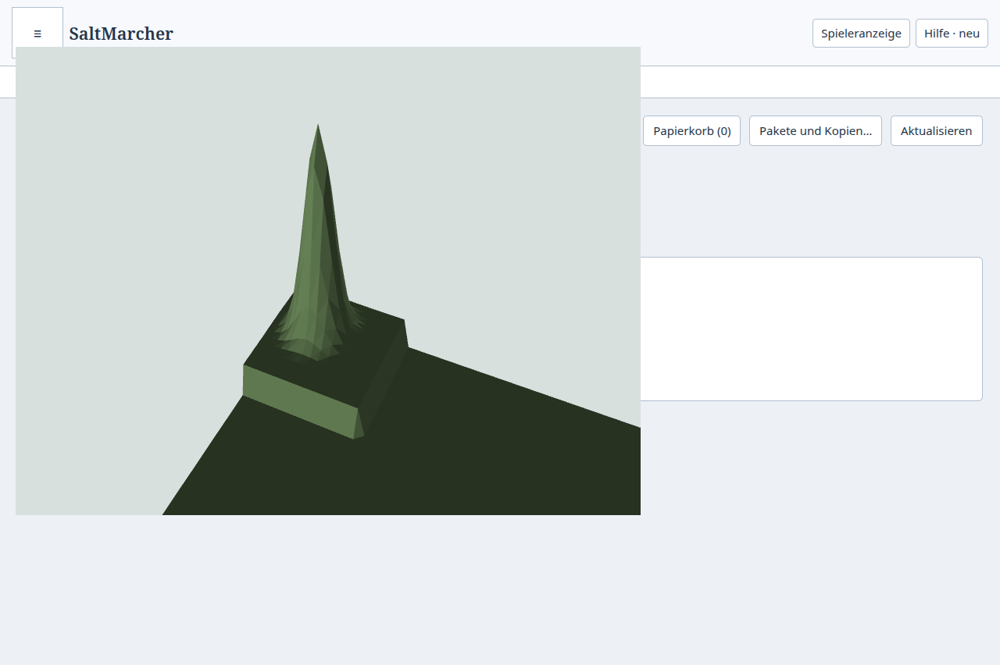
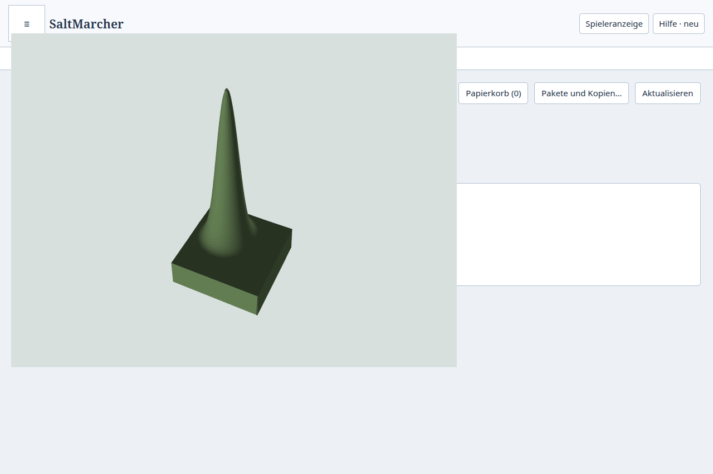

# M2-Zwischenstand: persistente Terrainkacheln

Die Terrainstrecke der [Atlas-Roadmap](../../plans/maps/unified-spatial-atlas.md)
speichert berechnete Kacheln dauerhaft und lädt zuerst eine gröbere Übersicht.
M2 bleibt aktiv: Geometrie, eigenständige Materialkanäle, Gesamtbudget über alle
Kampagnen und die vollständige Weltlast sind noch nicht abgeschlossen.
Die normale Atlasfläche verwendet weiterhin ihren bisherigen Renderer.

## Implementierter Teil

- Feste Weltadressen: 256 × 2^LOD Meter, 256 × 256 Farbpixel und Bewuchsmaske,
  65 × 65 Höhenpunkte einschließlich vorhandener Boden-/Wasserinformationen.
  Kamerapose und Fenstergröße ändern die Plattenidentität nicht.
- Eine gröbere Übersicht bleibt sichtbar, bis alle benötigten Kinder eines
  Elternbereichs bereitliegen. Ein veröffentlichter Frame enthält keine
  überlappenden Eltern und Kinder. Verspätete Antworten alter Generationen
  dürfen weder Cache noch Anzeige verändern.
- Separate abgeleitete SQLite-Dateien je Kampagne und Datenbankpfad,
  binäre TypedArrays, Prüfsummen und atomare Ersetzung. Standardmäßig 64 MiB
  Nutzdaten je Kampagne, höchstens 8 MiB je Eintrag und begrenzter SQLite-Overhead;
  Renderer-LRU einschließlich sichtbarer und vorbereiteter Daten: 32 MiB.
- Eine unveränderte dauerhafte Quellenversion vermeidet die erneute
  Fingerprint-Berechnung. Nach Änderungen prüft der Worker lokale Quellen mit
  Rasterrand und globalen Einstellungen. Ortsnamen und Trash-Status gehören zu
  den Abhängigkeiten. Vorschauquellen werden nicht dauerhaft gespeichert.
- Ungültige Cacheblobs werden neu berechnet. Beschädigte, eindeutig eigene
  Datenbanken dürfen beim exklusiven Appstart vor Workerstart entfernt werden;
  unbekannte oder gesperrte Dateien bleiben erhalten. Kampagnenlöschung entfernt
  auch ihre abgeleiteten Kacheldateien. Kanonische Daten bleiben unverändert.

## Automatisierte Prüfung

32 gezielte Fälle bestehen in
[Terrainpersistenz](../../../tests/atlas-terrain-tiles.test.mjs),
[verknüpften Ortsnamen](../../../tests/atlas-terrain-tile-location.test.mjs),
[binärem Cache](../../../tests/atlas-tile-cache.test.mjs),
[Kachelplanung](../../../tests/atlas-tile-plan.test.mjs) und
[Stream](../../../tests/atlas-tile-stream.test.mjs).

Die erste Terrainprobe zählt 48 Rasterabschlüsse für drei kalte Kacheln.
Wiederöffnen und die entfernte Kachel nach einer lokalen Änderung benötigen
keinen weiteren Rasterabschluss. Betroffene Detailkachel und Elternstufe werden
erneuert. Undo/Redo stellt die erwarteten Pixel und Höhen wieder her.
An einer Kachelgrenze erneuert eine Änderung beide Randbereiche; sämtliche
gemeinsamen Höhenpunkte bleiben identisch. Bewuchsmaske, globale Meereshöhe und
die Umbenennung einer verknüpften Location sind separat geprüft.

Weitere 22 bestehende Fälle in
[Projektionsdienst](../../../tests/terrain-projection-service.test.mjs) und
[persistenten räumlichen Indizes](../../../tests/desktop-atlas-region-cache.test.mjs)
bestehen. Sie prüfen unter anderem Worker-Unterbrechung, Änderungen zwischen
Fortsetzungsschritten, externe Writes, Index-Rollback und beschädigte Indizes.
`npm run check`, `npm run check:desktop`, `npm run build:desktop` und
`npm run check:repo` sind lokal grün. Keine vollständige Candidate-CI oder
Produktabnahme wird daraus abgeleitet.

## Native Prüfung

Der [Prüfablauf](../../../tools/test-desktop-atlas-tiles.mjs) verwendet eine
isolierte gespeicherte Kampagne und die echte Preload-/Main-/Workerstrecke.
Lauf `1792789177305-1131006`, Basis `810c5bf7d6dab9b9ce42ae4db0a40595be160e31`
mit uncommittierten M2-Änderungen. Der [Rohbeleg](result.json.gz) enthält
identische Vorher-/Nachher-Quellhashes sowie Desktop-Artefakthashes.

| Beobachtung | Ergebnis |
| --- | --- |
| Übersicht bei angehaltenem Detailabruf | LOD 0 auf einem Canvas sichtbar |
| Fortgesetzte Detailnachladung | LOD −2 ersetzt LOD 0; vollständiger Frame |
| Präziser Terrain-Treffer | XYZ-Abweichung unter 0,1 mm |
| Datenpuffer | 262.144 Farbbytes und 65.536 Bewuchsbytes |
| Erster Aufbau | Übersicht 226 ms, Detail 291 ms |
| Frischer Prozess | Beide Cache-Hits, Höhenmaximum 140 m, Autorenrevision unverändert 3 |
| Abfrage nach Neustart | Übersicht einschließlich Workerstart 202 ms, anschließendes Detail 23 ms |
| Prozessende | PIDs 1131109 und 1131264: Exit 0, kein Signal, danach nicht vorhanden |
| Fehler | Keine Rendererfehler; Quellen während der Probe unverändert |

Diese Einzelmessungen an einer kleinen technischen Hügelprobe sind kein
Gesamtbenchmark. Die Übersicht wurde vor dem kalten Abruf bereits über eine
Bereichsabfrage vorbereitet; die erste Abfrage nach Neustart enthält dagegen
den Workerstart. Daraus lässt sich keine direkte Übersichtsbeschleunigung
ableiten. Die sichtbare Fläche verwendet Terrainmeshes; die gespeicherten
Farb-/Bewuchspuffer sind noch kein Nachweis der vollständigen Materialdarstellung.
Der erste erfolgreiche Lauf hatte einen abgeschnittenen Gipfel im Bild;
der hier archivierte Wiederholungslauf verwendet einen geeigneten Kameraausschnitt.




Reproduktion nach Desktopbuild:

```sh
QA_EVIDENCE_DIR=.build/atlas-tile-native-session python3 tools/ui-session.py timeout --signal=TERM 180s node tools/test-desktop-atlas-tiles.mjs
```

## Nacharbeit und offene Grenzen

Die unabhängige Prüfung fand einen fehlenden Ortsnamen im Quellenfingerprint.
Ohne Korrektur hätte eine Umbenennung einen alten Routennamen auf die neue
Version gehoben. Der neue Rename-Test verhindert diese Wiederverwendung.
Die RAM-Budgetprüfung traversiert einen empfangenen Tile-Puffer jetzt nur einmal,
statt dessen Inhalt bei jeder LRU-Prüfung erneut zu zählen.

Für den Abschluss von M2 fehlen persistente Geometriedetails, eigenständige
Materialdaten, ein kampagnenübergreifendes Plattenbudget und Weltlastproben.
Die Quellenprüfung nach einer Änderung scannt derzeit räumliche Filter und
globale Einstellungen; deren Aufwand muss an der großen Welt geprüft und
gegebenenfalls über den vorhandenen Index begrenzt werden. Neue Kamerapläne
beginnen noch mit einem leeren Frame; das Halten gültiger Kacheln beim Pan
braucht eine konfliktfreie Übergabe. Benachbarte gemischte Detailstufen und
vollständige Materialdarstellung sind nativ noch offen. Der bisherige Workerstart
bleibt messbar. Installation, Veröffentlichung und Owner-Abnahme sind nicht erfolgt.
