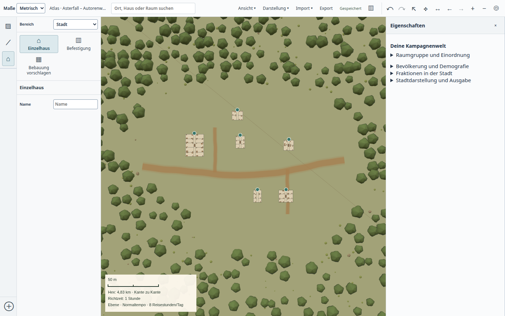
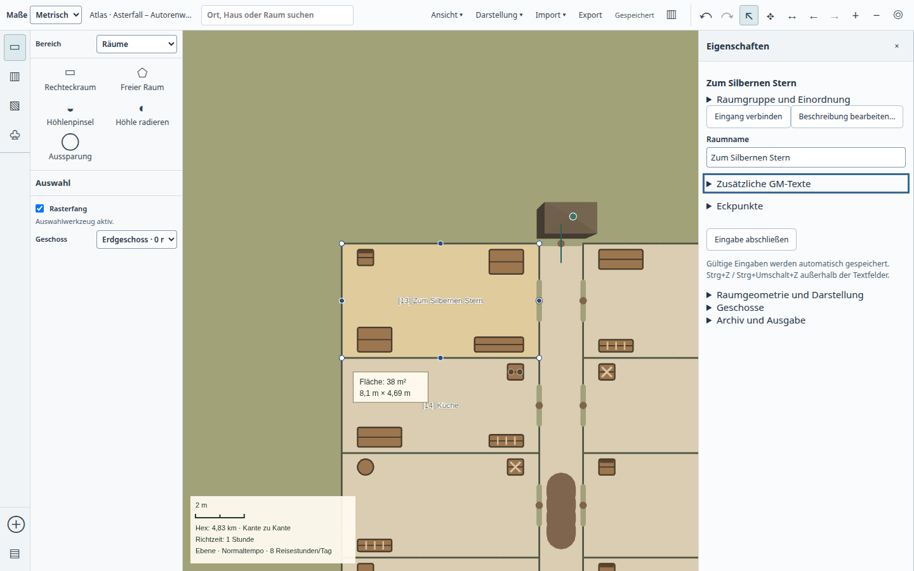
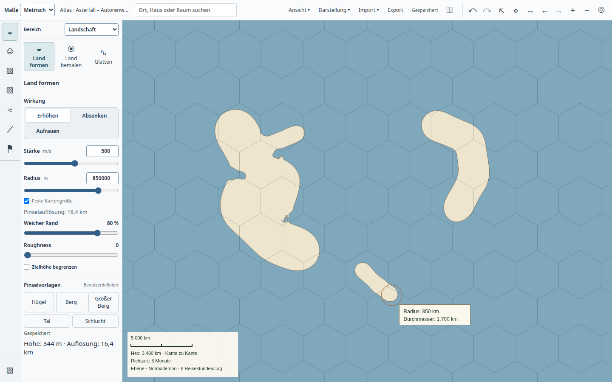
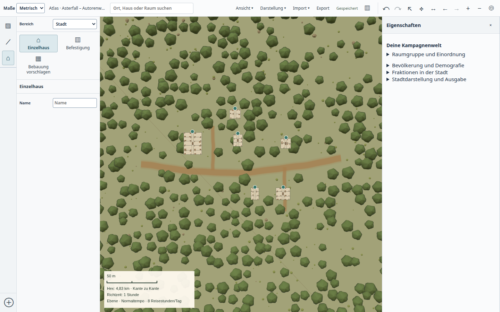
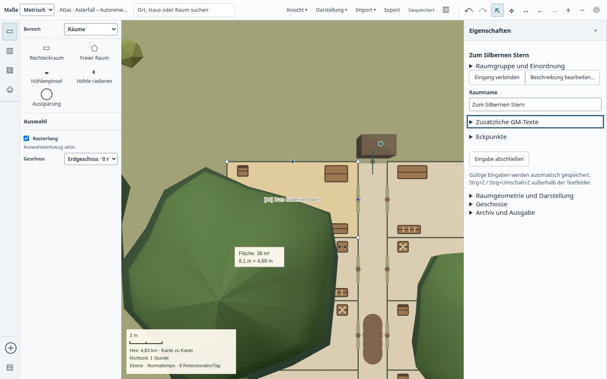

# Eine Welt bis zum Gasthaus gestalten – 22.10.2026

Die regelmäßige Autorenreise verwendet den normalen Atlas. Nur eine leere
Kampagne und der Meeresspiegel werden vorbereitet; Kontinente, Relief, Wald,
Königreich, Straßen, Gebäude und Raumname entstehen über die sichtbaren Werkzeuge.
Die Karte soll ein westliches Festland mit Kap und Bucht, einen bewaldeten
Gebirgsraum und eine kleine Siedlung im Königreich Aster zeigen.

## Was tatsächlich geprüft wurde

Der [erste vollständige Durchlauf](baseline.json) legte drei Gebäude an und
öffnete sie frisch. Die Bilder zeigten zu gleichförmige Kontinente und falsch
platzierte Reliefarbeit: Der Prüfablauf hatte beim Zoom den Zeigeranker mit
Bildmitte verwechselt. Die überarbeitete Reise verschiebt den gewählten
Landstrich zunächst mit dem normalen Verschiebewerkzeug in die Mitte. Das ist
eine Korrektur des Autorenablaufs, keine Änderung der Produktkamera.

Die [überarbeitete Reise](composed.json) gestaltete Kap, Bucht und aufgerautes
Gelände, drei Straßen und sechs unterschiedlich große Gebäude mit 95 Räumen.
Das politische Gebiet bleibt ein unabhängiges Overlay. Es entstanden keine
Stadtdokumente. Der Raum „Zum Silbernen Stern“, sämtliche Raum-IDs und die
kanonische Revision 326 blieben im frischen Prozess erhalten. Beide Prozesse
endeten mit Code 0 ohne Signal und waren anschließend verschwunden; Fehlerliste
leer. Alle elf gebauten Artefakte wurden gegen den aktuellen Build geprüft.
Der Bericht nennt den Quellstand beim Start und die damaligen uncommitteten
Änderungen; der getestete Laufzeitstand enthält die inzwischen als `5b942ba6`
gesicherte Wiederverwendung des Geländenetzes.

Ein [vorheriger Versuch](failed-attempt.json) wartete nach fünf Gebäuden
vergeblich auf den sechsten Erzeugungsdialog. Er wurde durch die begrenzte
Prüfsitzung beendet; Prozess 3520420 ist verschwunden. Die Ursache ist offen.
Der folgende erfolgreiche Durchlauf zeichnet Pointerdown/Click, Werkzeug,
Kartenbereitschaft und Speicherstatus auf. Sein Erfolg beweist keine Behebung
des vorherigen Eingabeverlustes.

## Lichtung ausdrücklich malen

Die [abschließende Reise](clearing.json) verwendet vor Straßen und Gebäuden
„Freihalten“ mit 55 m Radius. Es wird genau eine dauerhafte `clear`-Korrektur
im bestehenden Bewuchs gespeichert; die Gebäude entstehen anschließend weiterhin
als unabhängige Objekte. Sechs Gebäude, 95 Räume, drei Straßen, ein Wald und die
Region bleiben bei Revision 334 nach frischem Öffnen unverändert. Beide Prozesse
3531506/3533401 endeten regulär und sind verschwunden; Fehlerliste leer,
alle elf Build-Hashes stimmen. Die Version wurde erst nach dem Laufzeitbuild
auf 0.185.0 erhöht; dieser native Befund gilt nicht als Test des Releasepakets.

Das Freihalten macht die Bebauung und den Innenraum tatsächlich lesbar. Die
Lichtung ist noch sehr weit und gleichförmig; für eine überzeugende Siedlung
fehlen engere Wegeanschlüsse, kleinere gestaltete Freiflächen und deutlichere
Hausansichten. Die Wiederöffnung wurde ebenfalls [angesehen](reopened-clearing.png).

## Sichtprüfung und nächste Verbesserungen

Die Küsten sind abwechslungsreicher, aber noch zu glatt und pinselartig. Relief
und Höhenlinien vermitteln Gebirgszüge schwach; die große Waldfläche bleibt
schematisch. Eine konventionelle D&D-Kartenqualität ist damit nicht erreicht.

Die Siedlung besteht aus unabhängigen Straßen und Gebäuden. Große Baumkronen
verdecken Wege und Räume. Eine gemalte Lichtung ist eine sinnvolle Autorenaktion;
die Gebäude dürfen dafür keine verborgene Stadtfläche erhalten. Straßen wirken
noch wie einfarbige Bänder, Hausansichten zeigen bereits sehr viele Innenwände.

Weitere konkrete Befunde: Der ausgewählte Raum liegt sichtbar in der freien
Kartenmitte; angrenzende Teile der Raumgruppe reichen hinter den rechten
Inspektor. Eine vollständige Gebäudeübersicht wurde damit nicht geprüft. Die
Gebäudeansicht braucht eine klarere Detailhierarchie; Raum- und Eingangsmarker
sollten die Karte weniger dominieren. Bäume in Nähe eines
Innenraums brauchen eine verständliche Sicht-/Bearbeitungslösung. Das manuelle
Freihalten ersetzt diese Produktentscheidung nicht. Neue Terrainfeatures,
Gewässer, alle Geländearten, Hierarchieebenen und die vollständige große
Weltlast wurden in dieser Reise nicht vollständig geprüft.

Der ausführbare Ablauf ist `tools/test-desktop-world-authoring.mjs`; die
Sitzungen laufen über `tools/ui-session.py timeout --signal=TERM 600s`.
Die Reise liefert einen funktionalen und visuellen Arbeitsbefund, keine
stilistische, Pentium-, Main-/Release- oder vollständige Produktabnahme.
