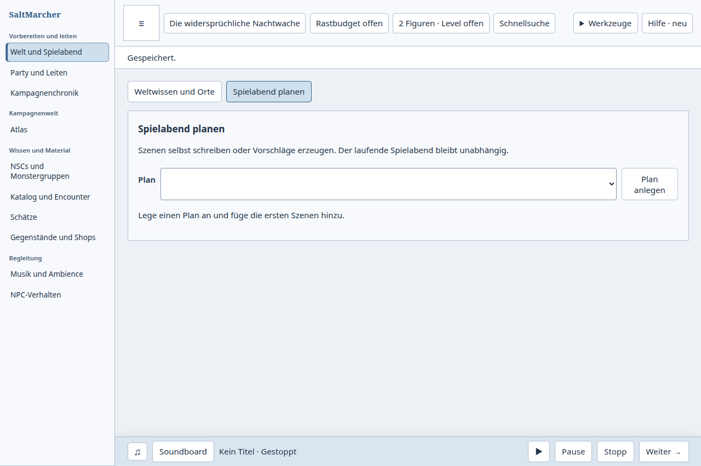
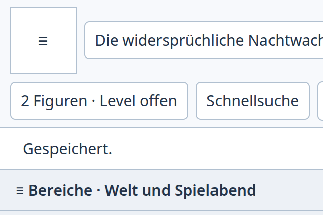
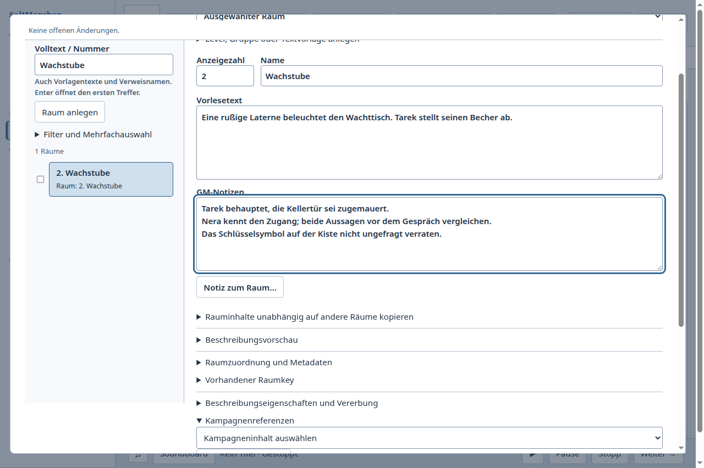
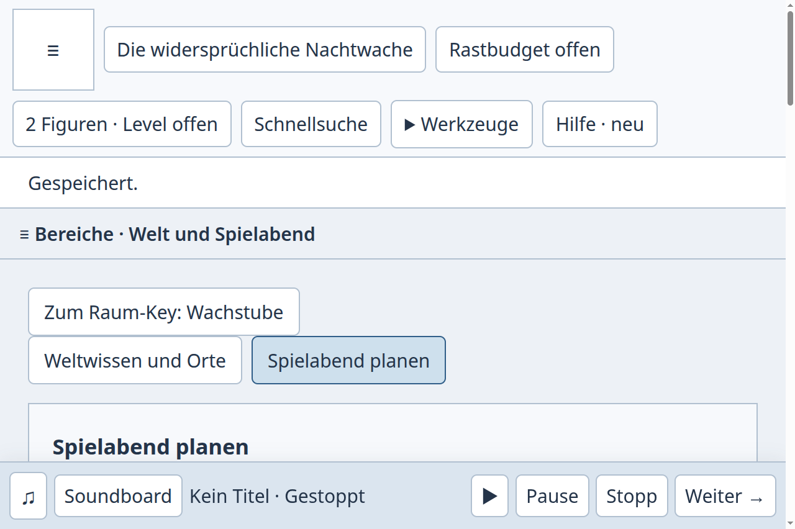
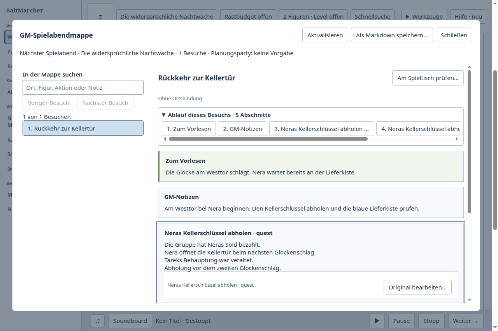
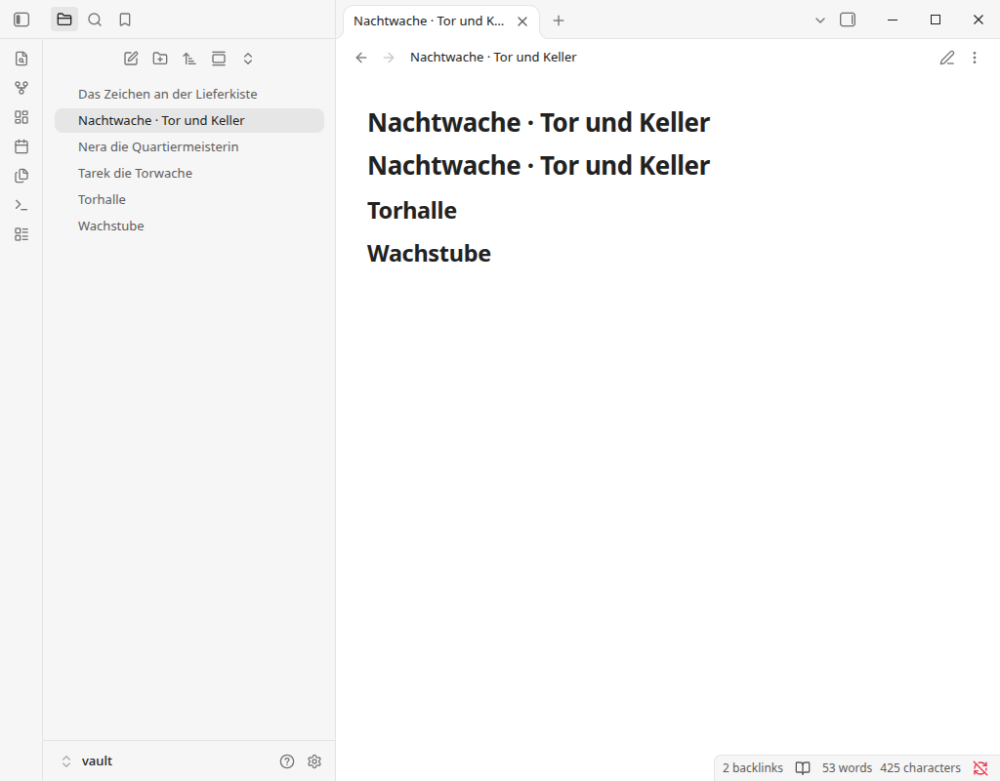
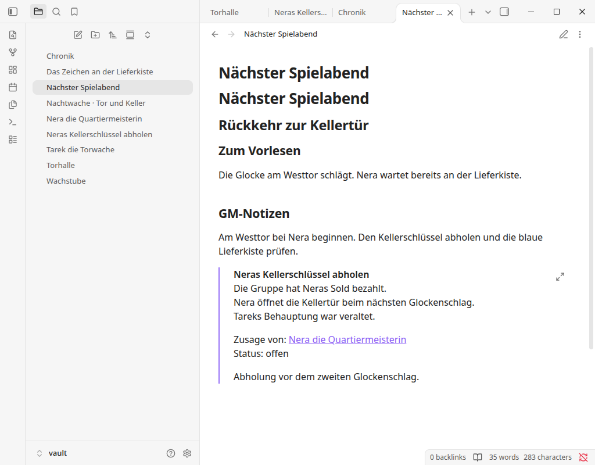

# Zwei Raum-Keys bis zum folgenden Spielabend weiterführen

Tatsächlich ausgeführter Vergleich vom 17. Oktober 2026: SaltMarcher und
Obsidian 1.14.4 ohne Community-Plugins, jeweils mit isolierten Testdaten.

## GM-Aufgabe

Torhalle und Wachstube mit Vorlesetext und privaten Notizen vorbereiten. Neras
und Tareks widersprüchliche Aussagen sowie das Schlüsselsymbol an der Lieferkiste
in den Originalquellen lesen. Aus beiden Raum-Keys den vorhandenen Plan
„Nachtwache · Tor und Keller“ verwenden, zwei Besuche mit Originalquellen
vorbereiten und lesen. Das tatsächliche Spielergebnis als Quest „Neras
Kellerschlüssel abholen“ mit Nera verbinden. Rückblick und Übergabe abschließen,
dieselbe Quest im folgenden Abend verwenden, regulär schließen, frisch öffnen,
die Quest wiederfinden, um eine Frist ergänzen und im Folgeabend lesen.

Beide Produkte lieferten dieses Ergebnis. Die Gegenprobe war tatsächliche
Fenster-, Klick- und Tastaturbedienung mit ausdrücklich genehmigtem lokalem
Playwright. Nur die Ausgangsfixtures wurden vorab angelegt; neue Texte,
Quest, Chronik und Folgeabend entstanden über die Oberfläche.

## Beobachtung und zusammenhängende Korrektur

| Übergang | SaltMarcher vorher | Tatsächlicher Obsidian-Ablauf | SaltMarcher nachher |
| --- | --- | --- | --- |
| Raumquelle lesen, dann planen | Nach dem ersten NSC-Aufruf aus dem Key blieb die Planauswahl leer. Der gültige Plan war weiterhin gespeichert. Regulärer Neustart war für die Fortsetzung nötig. | Nach dem Lesen der Quellen öffnete der Raum-Wikilink den vorhandenen Plan; kein Neustart. | Die vorzeitig geladene Wissensansicht wird um die noch fehlenden Planungselemente ergänzt, ohne den Notizeditor erneut aufzubauen. Vorhandener Plan sofort verfügbar. |
| Raum → Plan → Raum | Planreferenz nur Text mit „Entfernen“. Key schließen, Vorbereitung, Planung und Plan erneut auswählen. | Link zum vorhandenen Original und normale Zurück-Navigation zum geschriebenen Raum. | Planreferenz öffnet exakt die gespeicherte Plan-ID. „Zum Raum-Key: Wachstube“ kehrt mit Suchbegriff, Auswahl, Raumtext und Textfokus zurück. |
| Weiterarbeit und Übergabe | Gesamte Aufgabe nach Neustart machbar. | Szenentexte und Quelleinbettungen als Markdown, Quest in Chronik und Folgeabend eingebettet. | Gesamte Aufgabe ohne Neustart bis zur frischen Weiterbearbeitung abgeschlossen; die bisherigen Writer und Bestätigungsgrenzen bleiben zuständig. |

Die Änderung übernimmt den direkten Bezug auf das vorhandene Original. Es gibt
keinen kopierten Plan, kein weiteres Datenmodell und keine aus Raumnamen erratene
Besuchsauswahl. Rückkehr wartet auf die vorhandenen Schreibgrenzen. Fehlgeschlagene
Lesevorgänge behalten den Rückweg; Kampagnen- oder Raumwechsel entwerten alte
Antworten. Ein Plan ohne Besuche bleibt über seinen Namen bearbeitbar.

Bewusste Arbeit bleibt: Szenentexte schreiben, Quellen auswählen, das tatsächliche
Spielergebnis bestätigen und die Übergabe vorbereiten. Die Folgemappe zeigt im
gewählten Ablauf Questinformationen sowohl als Wissensblock als auch im übernommenen
Ergebniszusammenhang; die Prüfung behauptet keine Reduktion dieser Darstellung.
Keine gemessene Geschwindigkeitsrangliste oder menschliche Verständlichkeitsabnahme.

## Getrennte Nachweise

- Ausgang SaltMarcher: `f2062971bce4a0d054432f6fd6c66b3fb2e16467`,
  [vollständiger Lauf](saltmarcher-before.json), [UI-Spur](saltmarcher-before-ui.jsonl),
  [beobachtete leere Planung](planning-block.json). Drei reguläre Exits 0 ohne Signal.
  Die Quellen lagen unverändert vor; die leere Auswahl war keine Datenlöschung.
- Umsetzung auf aktuellem Main `347ddd528db516e123cf667b0ed3926a921c69fc`.
  Zwischen Ausgang und diesem Integrationsstand lag nur Dokumentation.
- Native Nachprüfung auf sauberem Produktcommit
  `ed35602ace5eee276fc5524319e8421a17de1018`:
  [Resultat mit fünf Artefakthashes](saltmarcher-after.json).
  Vollständige Aufgabe bei 100 %, Fresh mit Frist in derselben Originalquest,
  separat begrenzte Raum/Plan/Raum-Navigation bei 200 %. Drei reguläre Exits 0,
  keine UI-Fehler, alle Hauptprozess-PIDs anschließend abwesend.
  Drei Wissensquellen und ursprüngliche CRLF-Raumabschnitte exakt erhalten,
  genau eine Quest, Weltuhr unverändert. Reproduktion:
  `npm run build:desktop`, dann `node tools/test-desktop-connected-room-prep.mjs --out=/tmp/connected-room-check`.
- Lokale betroffene Tests: 104 bestanden, keine Fehler/Skips.
  Die beiden neuen Initialisierungsregressionen scheiterten am Ausgangsstand und
  bestanden nachher. Typprüfung, Desktop-Typprüfung, Repository-Prüfung und
  Desktop-Build bestanden. Vollständige Qualifikation und Main-Integration sind
  separate CI-/PR-Nachweise, keine Folgerung aus diesen lokalen Checks.
- Obsidian: [Resultat mit neun Dateiinhalten und Hashes](obsidian-result.json),
  [UI-Spur](obsidian-ui.jsonl), offizielles AppImage 1.14.4 SHA-256
  `6362ddbeeeebb7bbccb48fae009572cf2284ef92f5c919c1332aba48de6ffeaa`.
  Zwei reguläre Exits 0 ohne Signal, PIDs anschließend abwesend. Drei
  Originalquellen bytegenau, bearbeitete Raumdateien mit LF-Normalisierung.
  Strukturierte Zeit-, XP- oder Kampagnencommand-Gleichwertigkeit ungeprüft.
- Menschliche Abnahme, installierte Paketabnahme, große Kampagnen und allgemeine
  Barrierefreiheit bleiben offen. Kanka-Einrichtung ist kein abgeschlossener
  Kanka-Produktvergleich.

## Sichtbares Ergebnis

