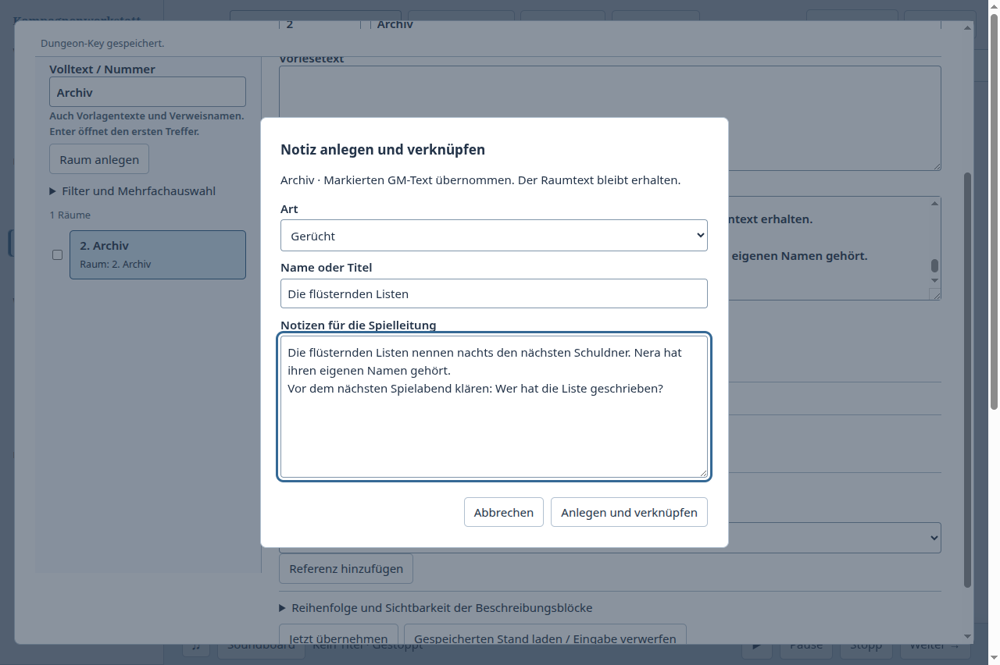

# Neue Spur beim Schreiben eines Raum-Keys erfassen

Fall: Im längeren Key des Archivs fällt die Spur „Die flüsternden Listen“ auf.
Die Spielleitung möchte daraus ein eigenes Gerücht machen, die offene Frage
für den nächsten Abend notieren, den Raum verknüpfen und an seinem Key
weiterschreiben. Synthetische Kampagne mit zwölf Textabschnitten, einer
vorhandenen NSC-Notiz und zwei Räumen. Keine Benutzerdaten wurden verwendet.

Zuerst wurde unsere tatsächliche Electron-Oberfläche benutzt. Danach folgte
derselbe Fall in der bereits geöffneten offiziellen Logseq-Browserdemo.
Die geänderte Kampagnenwerkstatt wurde anschließend wieder nativ geprüft.

## Direkter Vergleich

Die bisherige Referenzauswahl am Key enthielt nur vorhandene Inhalte.
Der tatsächlich benutzte Weg für eine neue Spur war:

1. Key schließen und zu Welt und Spielabend wechseln.
2. Weltwissen anlegen, Art und Titel eingeben, anschließend den Hinweistext
   und die Frage in den Notizeditor übertragen und speichern.
3. Zum Atlas und zum Key zurückkehren, die neue Notiz aus der Auswahl suchen
   und die Referenz eigens hinzufügen.

Der Raumtext und sein Suchfilter blieben erhalten; Datenverlust wurde nicht
beobachtet. Die Reibung lag im Ansichtswechsel, dem Übertragen des Texts und
der getrennten Herstellung der Verbindung. [Vorherbeleg](before.json),
[Ausgangsoberfläche](before.png). Seine fünf Artefakthashes stimmen mit dem
abschließenden Build der vorherigen Vergleichsrunde überein.

In Logseq wurde an den gleichen langen Raumtext `[[Die flüsternden Listen]]`
angehängt. Shift-Klick öffnete die neue, zunächst leere Seite neben dem Archiv;
der Rückverweis zum Raum war schon vorhanden. Der Hinweistext und die Frage
wurden dort eingefügt. Das Archiv musste nicht verlassen werden. In diesem
bedienten Weg wurden weder der ausgewählte Hinweistext automatisch übernommen
noch die große Referenz auf einen kurzen passenden Ausschnitt begrenzt: Der
lange verweisende Block wiederholte sich in der Seitenleiste.
[Bediente Schritte, Beobachtungen und Grenzen](comparator.json).

## Änderung

Direkt unter dem GM-Text steht jetzt „Notiz anlegen und verknüpfen…“.
Markierter Text wird in die neue Notiz übernommen und bleibt zugleich im Raum
stehen. Eine kurze Maske fragt Art, Titel und GM-Notiz ab; NSC, Fraktion, Quest
und Gerücht entsprechen den bestehenden Weltwissen-Arten. Ein Klick legt die
Notiz an und verknüpft sie mit dem Raum. Anschließend öffnet derselbe bereits
vorhandene Notizeditor neben dem Key. „Zum Raumtext“ kehrt an den Ausgang zurück.
Sichtbare Referenzarten heißen jetzt beispielsweise „Gerücht“ und „NSC“.

Notiz und Raumverknüpfung werden in einer SQLite-Transaktion gespeichert.
Die beiden vorhandenen Autorenpfade für Weltwissen und Keys erledigen die
Änderung; das neue Fenster ist nur die Eingabe vor dem Anlegen. Weitere
Notizänderungen benutzen den vorhandenen Preparation-Editor. Eine spätere
Key-Undo-Aktion entfernt dessen Verknüpfung und löscht keine eigenständige Notiz.

Bei unklarer Antwort bleibt die Eingabe lesbar und kopierbar. „Status prüfen“
prüft den gespeicherten Auftrag, ohne erneut anzulegen. Ein bestätigter Auftrag
öffnet nur die gespeicherte Notiz; nach bestätigtem Nicht-Anlegen kann der
Benutzer ausdrücklich neu anlegen. Ein Konflikt hält den Text zum Sichern
bereit. Es gibt keinen automatischen Wiederholungsversuch.

## Nachweis

179 gezielte Tests bestanden auf `e5698970`, einschließlich der aktuellen
Integrationsbasis `381b50f3`. Beide Typprüfungen, Plugin- und Desktopbuild
bestanden. Abschließende Belege stehen in
[Prüfzusammenfassung](validation.json). Nativ geprüft wurden:

- ausgewählten Absatz übernehmen und Titel, Art und Frage erfassen;
- bei 200 Prozent Zoom die sichtbare Schaltfläche tatsächlich anklicken;
- neue Notiz direkt neben dem Key sehen, ohne dessen Raum oder Suchfilter
  zu verlieren; genau eine passende Referenz erhalten;
- zum Raumtext zurückkehren und **danach nochmals am Key schreiben und speichern**;
- Datenbank separat öffnen: genau eine neue Notiz, genau eine Verbindung,
  beabsichtigter Key-Text sowie unveränderte ursprüngliche CRLF-Raumabschnitte;
- in einem frischen Prozess Notiz und Verbindung wiederfinden; einen weiteren
  Erfassungsversuch abbrechen und nachweisen, dass dadurch nichts angelegt wurde.

[Native Ergebnisse](after.json), [200-Prozent-Aufnahme](capture-200percent.png),
[geöffnete Notiz neben dem Raum](linked.png).

Die automatisierten Prüfungen decken außerdem Transaktionsabbruch beim
Key-Schreiben, Wiederholung desselben Auftrags, verlorene Antworten,
Statusabfrage nach frischem Prozess, Backups, veraltete Revisionen und Eigentümer,
Identitätskonflikte, alle vier Arten und die unveränderten Quelltexte ab.
DOM-Prüfungen decken doppelte Klicks, IME-Eingabe, verspätete Antworten,
Statusfehler, ausdrücklich erneutes Anlegen und reines Wiederöffnen nach einem
Anzeigefehler ab. Die künstlichen Fehlerbelege sind getrennt von den normalen
nativen Bedienläufen zu bewerten.

Die vorherigen drei Notizabläufe wurden auf demselben Build erneut bedient:
[Raumsuche](integrated-lookup.json),
[verknüpfte Notiz bearbeiten](integrated-note-context.json),
[Raumrückverweise](integrated-room-uses.json).
Alle neun Appstarts endeten regulär mit Exit 0.
[Artefakthashes und reguläre Prozessenden](native-integration.json) binden die
Ergebnisse an den gebauten Stand. Vollständige CI und Merge bleiben eigene
Prüfschritte; lokale Tests beweisen keine allgemeine Produktüberlegenheit.

Die Logseq-Demo zeigte dieselbe zuvor geprüfte Version 1.0.0 und warnt vor
fehlender Speicherung ohne lokales Verzeichnis. Ein Verzeichnis wurde nicht
freigegeben; dort wurde kein Neustart oder Festplattenspeichern geprüft.
Das neue Erfassungsfenster betrifft den primären GM-Text eines Raum-Keys;
noch nicht abgesendete Eingaben wurden nicht als absturzfester Entwurf geprüft.
Weitere Notizorganisation und das Arbeiten an langen Keys bleiben Gegenstand
des laufenden Vergleichsauftrags.
