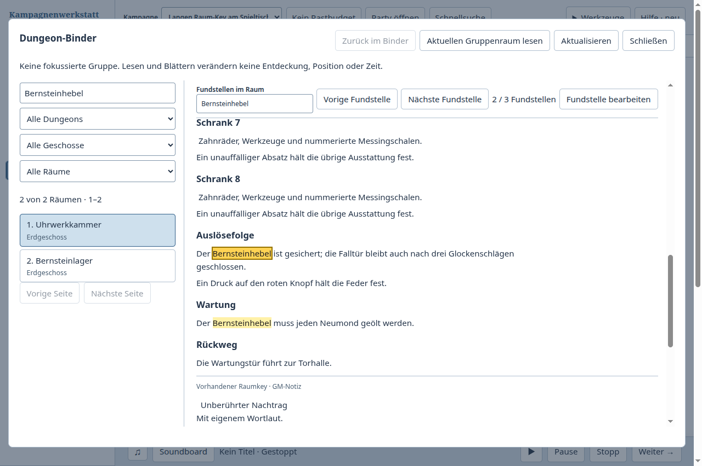

# Langen Raum-Key lesen, eine Fundstelle ändern und dort weiterlesen

Fall: Während der Sitzung den Bernsteinhebel in der Uhrwerkkammer wiederfinden,
die Auslösefolge korrigieren und an dieser Lesestelle bleiben. Der importierte
Markdown-Text enthält Ankunft, acht Schränke, Auslösefolge, Wartung und Rückweg.
Drei Absätze erwähnen den Hebel; ein zweiter Raum ist ein weiterer Suchtreffer.
Eigene synthetische Daten, kein Benutzervault.

Unsere native Oberfläche wurde zuerst benutzt, danach derselbe Hauptfall in
der offiziellen Logseq-Browserdemo. Anschließend wurden die Änderungen wieder
nativ geprüft. Zusätzliche Nachprüfungen verwenden eine eigene Textvorlage und
einen eigenen Key-Block; diese ergänzen den gemeinsamen importierten Haupttext.

## Beobachteter Ablauf

Der Binder fand vorher beide Räume. Er markierte keine Fundstelle und zeigte
die Markdown-Überschriften innerhalb eines langen Rohtexts. „Key bearbeiten“
schloss den Binder. Im Key-Dialog war der importierte Text wiederum nur lesbar;
zum Ändern musste auch dieser Dialog geschlossen und der ursprüngliche
Raumeditor benutzt werden. Beim erneuten Öffnen des Binders war die Suche leer.
Der beabsichtigte Text ließ sich auf diesem Umweg speichern; Datenverlust wurde
nicht beobachtet. [Ergebnisse vorher](before.json),
[Leseansicht](before-reader.png), [Zwischenschritt im Editor](before-editor.png).

Logseq teilte den normal eingefügten Markdown-Text in Überschriftenblöcke auf.
Seine Suche zeigte die drei passenden Abschnitte mit Überschrift und Kontext.
Ein Klick auf „Auslösefolge“ sprang direkt zum Abschnitt. Dort ließ sich der
Text bearbeiten und nach Escape am selben Ort weiterlesen. Dieser Klickweg
hatte keinen beobachteten Navigationsumweg.

Ein zusätzlicher Tastaturversuch zeigte dort allerdings eine andere Reibung:
Bei derselben Suche waren drei Blocktreffer sichtbar, aber Enter führte die
voreingestellte Aktion „Create“ aus und legte die leere Seite „Bernsteinhebel“
an. Ein expliziter Klick auf den gewünschten Block vermied das. Die zusätzliche
synthetische Seite bleibt in der Demo; der bearbeitete Raum wurde per Zurück
wieder geöffnet. [Bediente Vergleichsschritte und Grenzen](comparator.json).

## Änderung in der Kampagnenwerkstatt

Der Binder zeigt jetzt lesbare ATX- und Setext-Überschriften sowie eine
Abschnittsübersicht. Die Raumverzeichnissuche übernimmt ihren Suchtext in
„Fundstellen im Raum“. Treffer werden markiert und lassen sich mit Vor/Zurück
oder wiederholtem Enter und Umschalt+Enter durchgehen. Die Tastatursuche bleibt
im Eingabefeld und legt nichts an.

„Fundstelle bearbeiten“ öffnet den bestehenden Key-Editor über dem Binder.
Der passende Originalabschnitt beziehungsweise eigene oder verknüpfte
Vorlagenblock wird gewählt. Die konkrete Passage ist ausgewählt **und im
Textfeld sichtbar**. „Zurück zum Binder“ liest den gespeicherten Stand neu und
stellt Raum, Suche und Lesestelle wieder her. Das gilt auch, wenn das Suchwort
aus dem bearbeiteten Absatz entfernt wurde: Dann bleibt der neue Absatz die
Lesestelle, statt zu einem anderen Treffer zu springen.

Importierte Markdown-Abschnitte sind im Key-Dialog einzeln bearbeitbar. Die
Änderung benutzt den bestehenden Key-Auftrag, dessen Revisionsschranken und
gemeinsame Autoren-History. Abschnitts- und Türbindungsidentitäten bleiben
erhalten. Die Leseraufbereitung erzeugt keine neuen Autorenabschnitte und
schreibt weder Markdown noch Gruppenwissen beim Lesen um. Vorlagen werden
sichtbar als Vorlagenquelle geöffnet. Berechneter Text bleibt lesbar und
suchbar, ohne eine unzutreffende direkte Textbearbeitung anzubieten.

Private Entdeckungshinweise, Suchmethode, DC und der bestätigte Wissensstatus
bleiben im GM-Binder sichtbar. Die öffentliche Textvorschau benutzt weiterhin
die bestehende Filterung. Die Notiz- und Key-Layoutregeln liegen nun in einer
eigenen CSS-Quelldatei; der Desktopbuild fügt sie in die weiterhin gemeinsame,
in den nativen Belegen gehashte `app.css` ein.

## Nachweise

234 gezielte Tests bestanden auf `b267f130` mit der integrierten Basis
`875c6acd` und Version 0.132.0. Beide Typprüfungen, Plugin- und Desktopbuild
bestanden. Details stehen in
[Prüfzusammenfassung](validation.json). Der Hauptfall wurde über die tatsächliche
Electron-Oberfläche geprüft:

- drei Fundstellen erkennen, per wiederholter Tastatureingabe die richtige
  wählen und die exakte importierte Passage im Editor erhalten;
- sichtbare Auswahl statt einer nur rechnerisch richtigen, weggescrollten
  Textauswahl; laufende Komposition verhindert vorzeitiges Schließen;
- speichern, neu lesen und mit unveränderter Suche bei der aktualisierten
  Auslösefolge bleiben; bei 200 Prozent Zoom ist die Fundstelle nicht verdeckt;
- Datenbank separat öffnen: nur der beabsichtigte importierte Absatz ändert
  seinen Text; Nachtrag, anderer Raum und die übrigen Key-Inhalte bleiben erhalten;
- nach einem frischen Prozess erneut suchen und den gespeicherten Absatz finden;
- ergänzend eine Vorlagenfundstelle und einen eigenen Key-Block direkt ändern
  und ihre tatsächlichen Quellen in SQLite bestätigen;
- anschließend das Suchwort aus der bearbeiteten Auslösefolge entfernen und
  dennoch zur neuen, nun nicht mehr passenden Passage zurückkehren.

[Native Ergebnisse](after.json), [gezielter Editor](editor.png),
[200-Prozent-Aufnahme](reader-200percent.png).
Das erneute Suchen nach einem Neustart ist ein Persistenznachweis für den
Autorenstand; ein über Neustarts gespeicherter Binder-Leseplatz wird nicht behauptet.
Die IME-Prüfung verwendet kontrollierte Kompositionsereignisse, keine physische
Eingabemethode.

Automatisierte Prüfungen decken Quellenzuordnung und Offsets, gemischte
Zeilenenden, unveränderte Lesedaten, sichere Textknoten, Literalsuche,
begrenzte Trefferlisten, veraltete Bedienelemente und Rückkehrabsichten ab.
Speicherprüfungen decken einzelne ursprüngliche Abschnitte, fremde und doppelte
Identitäten, erhaltene Türbindungen, veraltete Revisionen, atomare Ablehnung,
Undo/Redo und die Wiederholung desselben Auftrags ab. Ein vorheriger neuer
Rückkehrtest verwechselte zufällig sortierte Räume nach Listenposition; er
wurde auf die tatsächliche Raum-ID korrigiert.

Die bisherigen vier Abläufe wurden auf demselben Build wiederholt:
[Raumsuche](integrated-lookup.json), [Notizkontext](integrated-note-context.json),
[Raumrückverweise](integrated-room-uses.json),
[neue Notiz erfassen](integrated-capture.json).
Alle elf Appstarts endeten regulär mit Exit 0; ihre eigenen Haupt-PIDs waren
danach nicht mehr vorhanden.
[Artefakt- und Prozessbelege](native-integration.json) binden alle Ergebnisse
an den gebauten Stand. Vollständige CI, Merge und allgemeine Produktabnahme
bleiben getrennte Aussagen.

Die Leseaufbereitung interpretiert Überschriften und Absätze; sie ersetzt
keinen vollständigen Markdown-Renderer. Die Abschnittsgliederung und markierte
Treffernavigation sind begrenzt, während der übrige Text erhalten bleibt.
Logseq wurde im selben zuvor mit 1.0.0 geprüften Demo-Dokument benutzt. Die
Demo warnt vor fehlender Speicherung ohne lokales Verzeichnis; keines wurde
freigegeben. Dort wird keine Festplatten- oder Neustartabnahme behauptet.
