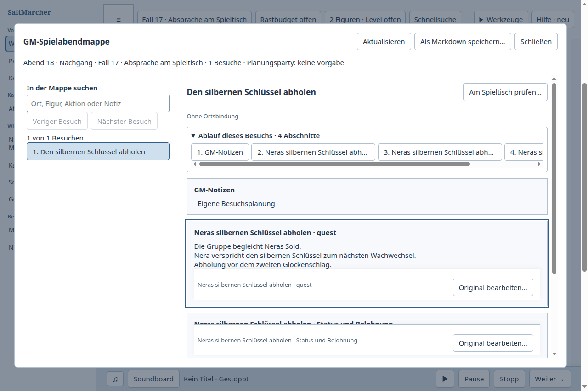
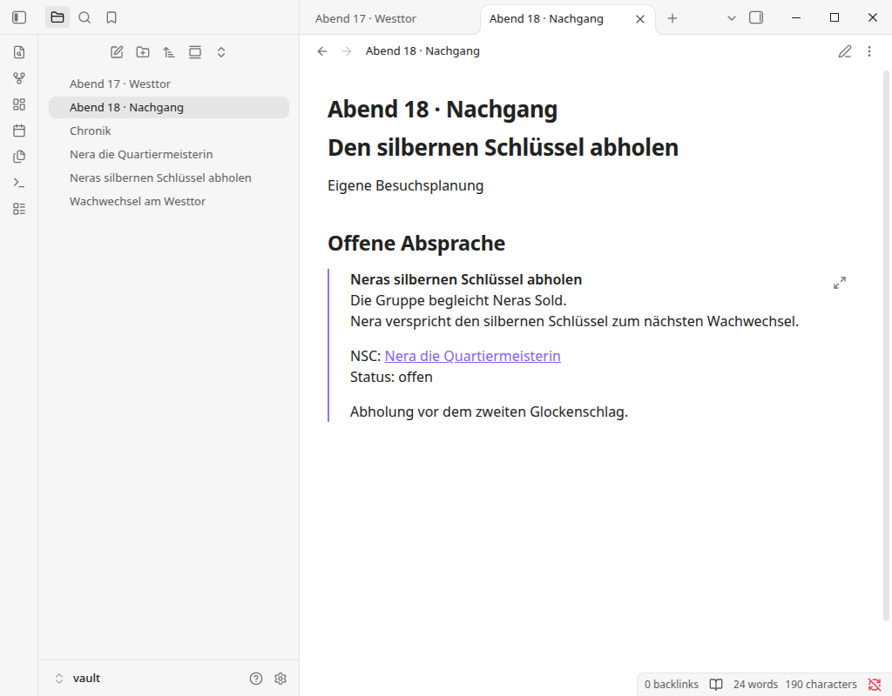
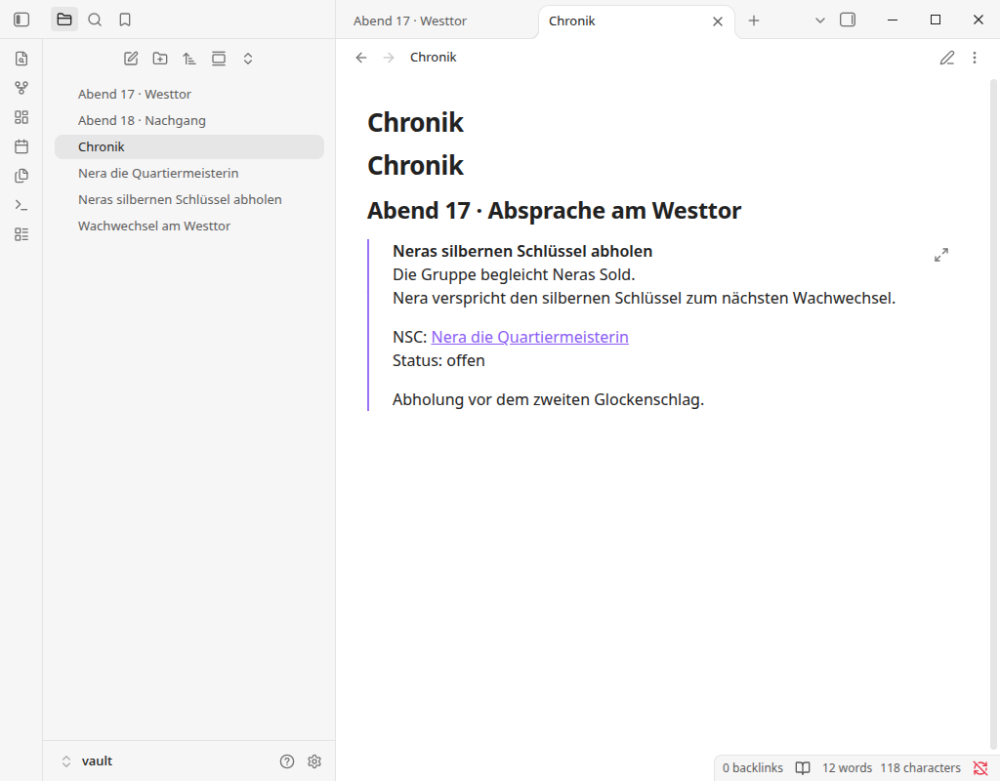

# Spontane Absprache als Quest zum nächsten Abend mitnehmen

Prüfung am 16./17. Oktober 2026. Tatsächlich ausgeführter Fall 17 in
SaltMarcher und Obsidian; keine bloße Dokumentations- oder Anmeldeseitenprüfung.

## Gemeinsame GM-Aufgabe und Ergebnis

Im vorbereiteten Abend verlangt Nera ihren ausstehenden Sold. Während des
Spiels bezahlt die Gruppe; Nera verspricht den silbernen Schlüssel zum nächsten
Wachwechsel. Diese tatsächliche Absprache als Chronikmoment und offene Quest
erfassen, mit Nera verknüpfen und zum folgenden Abend mitnehmen. Regulär
schließen, frisch öffnen, dieselbe Quest wiederfinden, um „Abholung vor dem
zweiten Glockenschlag.“ ergänzen und im Folgeabend lesen.

Beide Oberflächen lieferten dieses nutzbare Ergebnis. In beiden Fällen gibt es
genau eine Questoriginalnotiz, auf die Chronik und Folgeabend verweisen. Die
vorbereiteten Nera-/Wachwechseltexte bleiben erhalten. Obsidian verwendet dafür
gewöhnliche Markdownnotizen und Links; ein strukturierter Kampagnencommand oder
eine Weltzeitwirkung ist dort durch diese Prüfung nicht belegt.

## Tatsächliche Bedienung

| Schritt | SaltMarcher | Obsidian 1.14.4 ohne Community-Plugins |
| --- | --- | --- |
| Ausgangslage verwenden | Vorbereiteten Besuch prüfen, an den Spieltisch übernehmen und Sitzung beginnen; aus dem Wissensblock einen Moment vormerken. | Vorbereiteten Abend mit eingebetteter Wachwechselnotiz und Nera lesen. |
| Absprache festhalten | Tatsächlichen Ausgang eingeben, Folgespur „Quest“ wählen und speichern. | Mit Strg+N eine Questnotiz anlegen, Titel, Ausgang, Status und Nera-Wikilink schreiben. |
| Original bearbeiten | „Quest öffnen…“ öffnet die bestätigte Originalnotiz; Beziehung zu Nera ergänzen. | Die neue Notiz ist bereits geöffnet. Der geschriebene Nera-Link wurde später tatsächlich geöffnet und per Zurück verlassen. |
| Zum Folgeabend mitnehmen | Vorhandene „Notizmappe öffnen…“, Original auswählen und für den nächsten Besuch verwenden. | Dieselbe Quest als Einbettung in Chronik und Folgeabend schreiben. |
| Fresh und Fortsetzung | Regulär beenden, neu starten, Original finden und Frist ergänzen; Folgeabendmappe zeigt die Ergänzung. | Fenster regulär schließen, frisch starten, Strg+O mit Teil des Questtitels, Original öffnen und Frist ergänzen; beide Einbettungen zeigen die Ergänzung. |

Die Eingaben in Obsidian erfolgten durch normale Klicks und Tastaturbedienung
mit ausdrücklich genehmigtem lokalem Playwright. Nur die vorbereiteten fünf
Markdowndateien und die Registrierung des isolierten Test-Vaults wurden vor der
Aufgabe angelegt. Quest, Links, Chronikeintrag und Ergänzung entstanden über die
UI. Die abschließende Dateiprüfung war schreibgeschützt nach Prozessende.

## Beobachtete Belastung und eigene Änderung

Im SaltMarcher-Ausgangsstand musste die soeben gespeicherte Quest für ihre
Beziehung über Wissen erneut nach Titel gesucht werden. Die Zuordnung zum
Folgeabend erforderte eine weitere Titelsuche. Das unterbrach die Weiterarbeit
am gerade erzeugten Ergebnis. [PR 786](https://github.com/ThonkTank/Salt-Marcher/pull/786)
ergänzt den direkten Weg zum bestätigten Original; die bestehende Notizmappe
übernimmt es anschließend in den Besuch. Dafür ist kein zweites Datenmodell
oder kopierter Questtext nötig.

Obsidian zeigte die neue Notiz unmittelbar zum Weiterbearbeiten. Seine
Einbettungen zeigten danach das Original einschließlich der frischen Ergänzung
an beiden Einsatzstellen. Diese Arbeitsweise stützt das Ziel, am selben Original
weiterzuarbeiten. Im gewählten Ablauf mussten die Nera-Verbindung sowie die
beiden Einsatzstellen ausdrücklich als Markdownlinks geschrieben werden.
Das ist die beobachtete Arbeit dieses Ablaufs, keine Behauptung, Obsidian
erzwinge vollständige Titelneueingabe: Linkvervollständigung und alternative
Automatisierungen wurden hier nicht verglichen. Der Schnellauswähler nach Fresh
akzeptierte tatsächlich einen Teiltitel.

Die eigene Änderung beseitigt die beiden beobachteten erneuten Titelsuchen.
Beziehung und Besuchsauswahl bleiben bewusste Arbeit. Der erfolgreiche
Obsidian-Ablauf begründet keinen zusätzlichen kosmetischen Umbau. Ein
generelles Geschwindigkeits- oder Überlegenheitsurteil und menschliche
GM-Verständlichkeit wurden nicht gemessen.

## Getrennte Nachweise

- Eigener Ausgangsablauf: `fa154bced736661fab2192ca64ae82d0bc727701`;
  eigener Kandidat `109156115e07d396b348354418e336ce975e1f61`, integriert über
  PR 786 als `cda9945c8f47f0acace9e377d9c8921ed1d17521`.
- Eigene native Nachprüfung einschließlich Fresh und Frist auf tatsächlichem
  Main `a1dce205547e4d94590f06a8c5d1ad31d17e68c3` bei 100 %:
  [Resultat und fünf Artefakthashes](saltmarcher-result.json), zwei reguläre
  Prozesse mit Exit 0, keine UI-Fehler. Das ist der geprüfte Produktstand;
  die spätere Veröffentlichung dieses Berichts ist ein eigener Commit.
- Separate [Main-CI zu a1dce205](https://github.com/ThonkTank/Salt-Marcher/actions/runs/38981424388):
  3.530 Tests, 3.529 bestanden, kein Fehler, ein Skip. CI ersetzt weder die
  native Aufgabe noch die Gegenprobe.
- Tatsächlicher Gegenstücklauf: [Obsidian-Resultat mit Dateihashes und Inhalten](obsidian-result.json),
  [UI-Aktionsspur](obsidian-ui-trace.jsonl). Offizielles AppImage 1.14.4,
  SHA-256 `6362ddbeeeebb7bbccb48fae009572cf2284ef92f5c919c1332aba48de6ffeaa`.
  Isolierter Vault; kein Nutzervault geöffnet. Nera, Wachwechsel und ursprünglicher
  Abend sind bytegenau unverändert, einschließlich CRLF der beiden Quellen.
- Obsidian-Prozessgrenze: Erster Fensterabschluss tatsächlich per „Close window“,
  ursprüngliche PID vor Fresh abwesend; dessen nativer Exitcode wurde vom
  fehlerhaften anfänglichen Electron-Starthelfer nicht erfasst. Keine Exit-0-
  Behauptung für diesen ersten Prozess. Direkte Playwright-Anbindung derselben
  bereits laufenden Instanz funktionierte. Frischer Prozess separat beobachtet:
  regulärer Fensterabschluss, Exit 0 ohne Signal und PID anschließend abwesend.
  Der Anbindungsfehler ist kein Obsidian-Produktmangel.
- Menschliche Abnahme, installierte SaltMarcher-Paketabnahme und vollständige
  Gleichwertigkeit der Produkte bleiben ungeprüft. Der erhaltene Kanka-Register-
  Bildschirm zählt weiterhin nicht als ausgeführte Kanka-GM-Aufgabe.

## Sichtbares Ergebnis nach Fresh und Weiterbearbeitung

