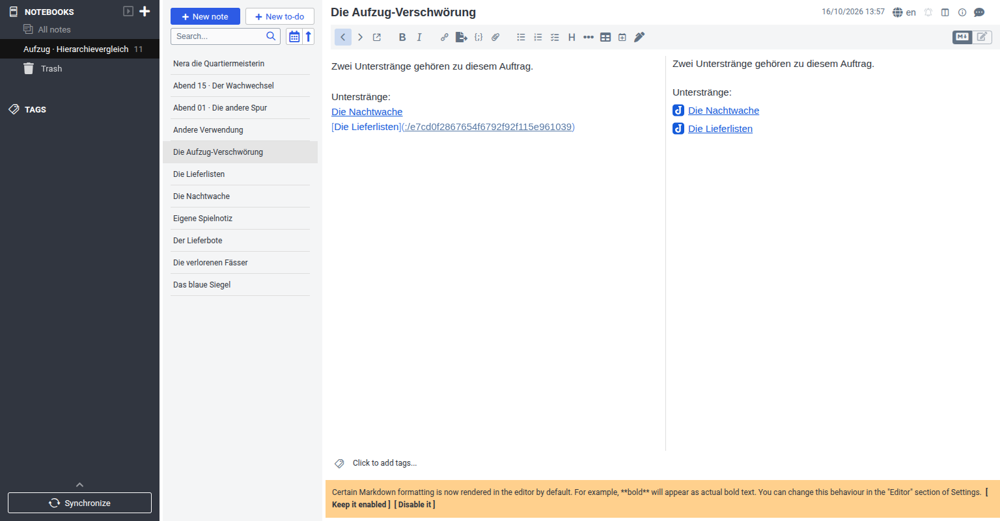
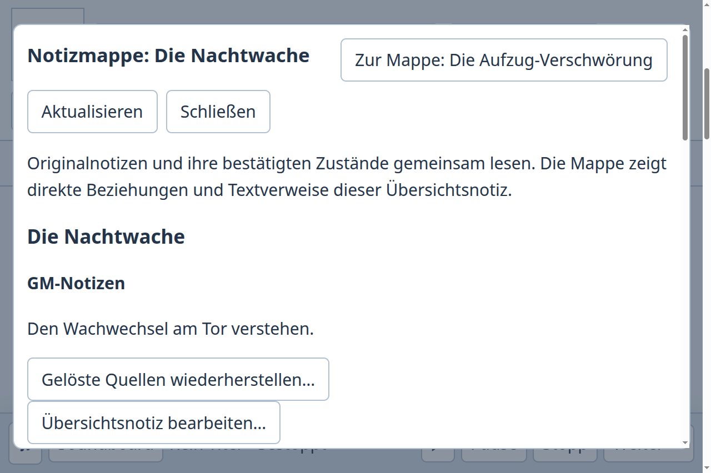
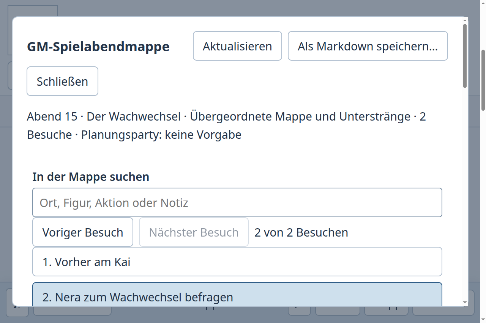

# Von der Auftragsübersicht in den Unterstrang und zurück

Fall 15: Der GM öffnet „Die Aufzug-Verschwörung“, wählt den Unterstrang „Die Lieferlisten“ und die Übersichtsnotiz für die Vorbereitung ab, öffnet „Die Nachtwache“ und ergänzt das Original „Nera die Quartiermeisterin“ um die neue Wachzeit. Anschließend kehrt er zur Übersicht zurück und verwendet die aktiven Quellen der Nachtwache beim zweiten Besuch des zweiten Spielabends. Die persönliche Besuchsnotiz bleibt erhalten. Abgeschlossene Fässer, Lieferbote und der andere Unterstrang werden nicht als Besuchsquellen ergänzt. Das Paket muss den aktuellen NSC-Text auch nach frischem Prozess lesen.

## Tatsächlich beobachteter Vorlauf

Auf **8a3151dc**, Version **0.157.0**, wurde die vollständige Aufgabe in der Desktop-Werkstatt ausgeführt. Im Originaleditor innerhalb einer Mappe war „Notizmappe öffnen…“ absichtlich durch CSS verborgen. Das Folgen der sichtbaren Beziehung zur NSC-Quelle schloss die Mappe. Über Rückverweise konnte die Übersicht wiedergefunden werden; die abgewählte Übersichtsnotiz und der abgewählte Unterstrang waren dann wieder ausgewählt. Nach erneuter Auswahl konnte der Besuch korrekt vorbereitet werden. [Ergebnis](before-result.json).

Der gescheiterte frühe Versuch, den verborgenen Mappenknopf zu benutzen, ist kein Nachweis eines sichtbaren funktionslosen Knopfs. Der abgeschlossene Vorlauf benutzt die sichtbaren Beziehungen und Rückverweise.

## Derselbe Ablauf in Joplin Desktop

Verwendet wurde die offizielle **Joplin Desktop 3.7.21** AppImage, SHA-256 `5d202dcaca31e14206826aa3f04125e7c218dbc3dc3d98479d811efbd6b856c1`, in einem eigenen temporären Profil. [Offizielle Installation](https://joplinapp.org/help/install/). Alle neun Originalnotizen, beide Spielabende und sämtliche Links wurden mit der grafischen Oberfläche erstellt. „Link to note…“ sucht das vorhandene Ziel und fügt seinen Originalverweis ein; keine Datenbank-, CLI- oder internen Zustandsschreibzugriffe dienten zur Erstellung.

Gerenderte Links führten von der Auftragsübersicht zur Nachtwache und zu Nera. Nach der Änderung am Original führten zweimal „Back“ sichtbar über Nachtwache zur Auftragsübersicht; „Forward“ öffnete den Unterstrang erneut. Das ist ein funktionierender Rückweg. Für den Abend wurden Nera, Siegel und Nachtwache mit drei einzelnen Titelsuchen verlinkt. Die persönliche Notiz und vorhandene Besuchsprosa blieben stehen. Die abgeschlossene Spur musste anhand ihres Textes selbst ausgeschlossen werden. Der Abend zeigt Links; um die Originalinhalte zu lesen, muss man ihnen folgen. Eine gemeinsame Paketansicht wurde in diesem Ablauf nicht beobachtet.

Alle elf Notizen wurden anschließend über die Oberfläche gelesen und nach einem frischen Hauptprozess identisch wieder gelesen. Die Prozessgrenze war ein **SIGTERM**, kein reguläres Beenden. Der sofortige erste Neustart schloss sich wegen der noch frischen Profilsperre; nach deren Ablauf öffnete der frische Prozess die gespeicherten Daten. Daraus wird kein Produktfehler oder regulärer Schließnachweis abgeleitet. [UI-Ergebnis einschließlich Originaltexten und frischem Vergleich](joplin-result.json).

## Änderung und vollständiger Nachlauf

Eine Quelle hat jetzt direkt „Notizmappe öffnen…“. Im Originaleditor bleibt derselbe Einstieg verfügbar. Untergeordnete Mappen zeigen „Zur Mappe: …“. Der Rückweg erhält Filter, bewusste Quellenwahl, Einbeziehung der Übersichtsnotiz, Zielplan und Besuch, selbst geschriebene Zielnamen, Suchtext und vorgemerkte noch verfügbare Kandidaten. Er liest die Mappe und Suchtreffer neu; geänderte Quellen werden anhand ihrer bisherigen Prüfmarke nicht stillschweigend erneut ausgewählt. Bereits geladene Quellenseiten werden erneut gelesen. Zyklen erzeugen keine weiteren Vorfahrenkopien, sondern verweisen auf den vorhandenen Rückweg.

Auch gewöhnliche Beziehungs- und Rückverweisbuttons im eingebetteten Originaleditor behalten die Mappe. Es bleiben ein Dialog, ein Originaleditor und die bisherigen Preparation-/Session-Schreiber. Die Navigation erzeugt keine neue gespeicherte Sammelnotiz. Unbestätigte Schreibantworten behalten die manuellen Speicherstatusaktionen; ein Navigationsversuch sendet den Auftrag nicht erneut. Epochenwechsel verwerfen Antworten und Bedienhandlungen früherer Mappen.

Der vollständige Nachlauf verwendet den direkten Mappeneinstieg und dieselbe Aufgabe bei **100 % und 200 %**. Er enthält jeweils normales Schließen, frischen Prozess, erneutes Lesen des tatsächlichen Spielabendpakets und normales Schließen. Die vier Hauptprozesse enden mit Code 0 ohne Signal und sind danach abwesend. Alle neun Originalidentitäten und Beziehungen bleiben erhalten; ausschließlich Neras Text/Revision und die drei beabsichtigten Quellenverknüpfungen des Zielbesuchs ändern sich. Persönliche Notiz, anderer Abend, anderer Besuch, Vorlesetext und rohe CRLF-Besuchsprosa bleiben erhalten. Die beiden Nachläufe verwenden dieselben fünf Artefakthashes. [100 %](after-result.json), [200 %](after-zoom-result.json), [Quellbindung und Prüfungen](checks.json).

Nach der ersten veröffentlichten Qualifizierung auf **87f0b89f** mit 180 gezielten Tests wurde im letzten Abgleich noch **34644319** mit typisiertem Flächenschaden festgestellt. Der PR-Versionskonflikt wurde mit der höheren eigenen Version **0.158.0** gelöst; alle Begegnungsänderungen bleiben erhalten. Auf dem jüngsten Produktstand **bc0d3b10** bestehen **[138 kombinierte Notiz-/Preparation-/Flächenschadenprüfungen](tests.txt)** sowie **[27 weitere Editor-/Raum-Key-Prüfungen](shared-editor-tests.txt)**, [beide Typprüfungen](typechecks.txt), die [Repositoryprüfung](repository-check.txt) und [Plugin-](plugin-build.txt)/[Desktopbuild](desktop-build.txt). Die oben verlinkten vollständigen 100-%-/200-%-Ergebnisse wurden auf diesem jüngsten Stand erneut erhoben; vier reguläre Prozessenden und gleiche fünf Artefakthashes. Der frühere Nachweis bleibt in Commit b67d27bf und als getrennte Quellbindung in checks.json erhalten.

Die lokale Prüfung und die vollständige CI behalten ihre jeweilige Quellbindung. Der vorher veröffentlichte **c7ea44c3** scheiterte in [CI 38894775653](https://github.com/ThonkTank/Obsidian-Dungeon-Editor-Phase1/actions/runs/38894775653) mit 3322 Tests, 3320 bestanden, einem Fehler und einem übersprungenen Test. Der Fehler erwartete einen alten abgeleiteten Schatztitel. Der korrigierte Test prüft jetzt den aktuellen Anzeigenamen sowie die unveränderte vollständige gespeicherte Beutezeile getrennt; **[32 Treasury-/Ledgerprüfungen bestanden](treasury-ledger-tests.txt)** auf dem vor der Kampagnenintegration korrigierten Teststand. Der neue Veröffentlichungsstand benötigt seine eigene vollständige CI. Merge, Release und menschliche Bedienabnahme sind damit nicht behauptet.
