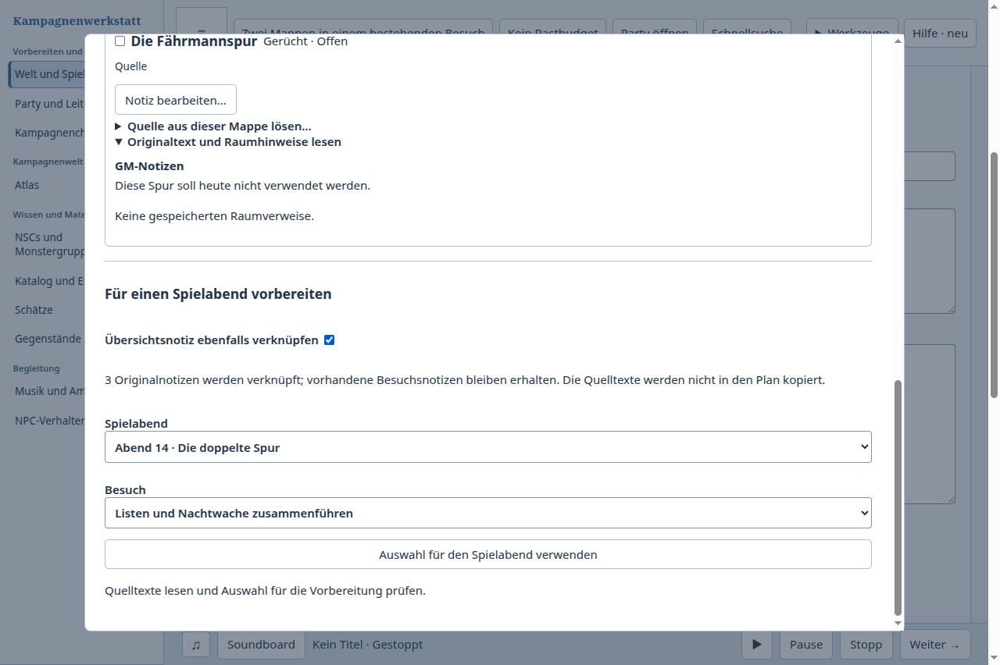
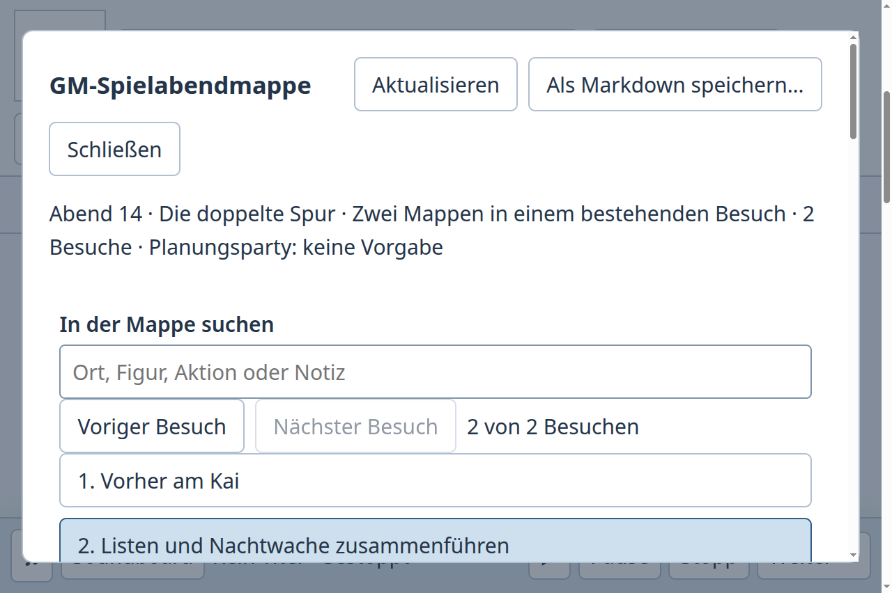

# Zwei Notizmappen für denselben bestehenden Besuch verwenden

Fall 14: Der GM bearbeitet den zweiten Besuch des zweiten Spielabends. Zwei Übersichten teilen eine NSC- und eine Gerüchtquelle. Eine geschlossene Spur sowie eine ausdrücklich abgewählte andere Spur bleiben außen vor. Die Mappen sollen den bestehenden Besuch ergänzen, seine persönlichen Notizen und Vorlesetexte erhalten und gemeinsame Originale einmal verwenden. Nach einer Ergänzung am NSC soll die Spielabendmappe den aktuellen Originaltext zeigen, auch nach Neustart. Der andere Abend, der erste Besuch und andere Verwendungen bleiben erhalten.

| Tatsächlicher Ablauf | Beobachtung |
| --- | --- |
| Kampagnenwerkstatt vorher, c21fc150, v0.156.0 | Beide Mappen schlagen den ersten Abend und dessen ersten Besuch vor, obwohl ein anderer Besuch ausgewählt ist. Das Ziel muss zweimal neu ausgewählt werden. Die Spielabendmappe öffnet anschließend den ersten Besuch des richtigen Plans; der bearbeitete zweite Besuch muss erneut gewählt werden. Nach diesen manuellen Schritten funktioniert das Ergebnis: fünf eindeutige Quellen, persönliche Notizen erhalten, geändertes Original frisch gelesen. Zwei reguläre Prozessenden. |
| [Joplin Terminal](https://joplinapp.org/help/apps/terminal/) 3.7.1 | Zwei Übersichten und ihre Quellen über öffentliche CLI-Befehle gelesen; den bereits geöffneten Abend anhand seiner bestehenden ID weitergeschrieben. Die zweite Mappe ergänzt nur ihren eigenen Übersichtslink, weil NSC und Gerücht bereits verlinkt sind. Diese Deduplizierung wird manuell aus den sichtbaren Links bestimmt. Nach Änderung am NSC zeigt ein neuer Prozess über denselben Original-Link den neuen Text. Andere Notizen, alter Abend und vorhandene Besuchsabschnitte bleiben erhalten. |
| Kampagnenwerkstatt nachher, b90b3657, v0.157.0 | Die Mappen starten beim tatsächlich ausgewählten Abend/Besuch. Die Spielabendmappe startet bei diesem Besuch. Explizit andere Ziele sowie Navigation innerhalb der Spielabendmappe bleiben möglich. Gemeinsame Quellen verwenden weiterhin die vorhandene Zusammenführung über Original-IDs. |

Im Joplin-Shell-Ablauf bleibt das Ziel durch die ausdrücklich verwendete Notiz-ID erhalten; dafür müssen Abschnitt und Links manuell gepflegt werden. Die eigene App kann die schon vorhandene Planungsauswahl direkt verwenden. Der Fix entfernt die wiederholte Zielwahl aus diesem konkreten Ablauf. Er behauptet weder einen grafischen Joplin-Test noch allgemeine menschliche Zeitersparnis oder Überlegenheit.

## Umsetzung

Preparation gibt die bereits vorhandene Plan-/Besuchsauswahl an den Notizmappenleser weiter. Ein Hinweis wird nur verwendet, wenn Plan und Besuch zusammen in den angezeigten Plänen vorhanden sind; ein fremder Besuch wird nicht übernommen. Eine ausdrückliche andere Zielwahl innerhalb der Mappe wird bei erneuten Quellenlesevorgängen nicht zurückgesetzt. Es gibt keine zusätzliche gespeicherte Auswahl, Tabelle, Quelle oder Schreibgrenze.

Auch der normale Knopf „Spielabendmappe öffnen…“ erhält die aktuelle Besuchs-ID. Ein ausdrücklich angeforderter Besuch hat weiterhin Vorrang; das Blättern und Aktualisieren in der geöffneten Mappe erhält deren bewusst ausgewählte Seite. Die Gültigkeitsprüfung umfasst jetzt neben Kampagne und Plan auch die ursprüngliche Besuchsauswahl. Späte Antworten und Fehler des inzwischen verlassenen Besuchs können nicht mehr als aktueller Inhalt erscheinen. Die Kennzeichnung einer tatsächlich übernommenen Live-Szene bleibt der Live-Ansicht vorbehalten.

## Nachweise

- [Vollständiger Vorlauf](before-result.json) mit den tatsächlich vorgeschlagenen falschen Zielen und zwei regulären Hauptprozessenden; [Bindung des Ausgangsstands](baseline.json).
- [Joplin-Ergebnis](joplin-result.json), [öffentliche Befehle samt Ausgaben](joplin-transcript.jsonl), [ausgeführtes Skript](joplin-compare.py) und [Paketmetadaten](joplin-package-metadata.json). Initialbestand über den unterstützten öffentlichen `batch`-Befehl; eigene Installation und eigenes Profil ohne Syncdienst. Auswahl, Lesen und Schreiben erfolgen über `cat`, `set` und `ls`. Keine Datenbankänderungen außerhalb des Produkts.
- Vier neue Tests reproduzierten vor dem Fix die falsche Mappenzielwahl, die falsche erste Paketseite und späte Paketantwort/Fehlermeldung nach Besuchswechsel. Die zusätzlichen Prüfungen umfassen echte Preparation-Verdrahtung, ungültige oder fremde Besuchshinweise und bewusst abweichende Ziele. Der erste kombinierte Nachlauf bestand mit 173 Tests; nach der letzten gemeinsamen Integration und den technischen Reparaturen bestehen **[426 Tests der vollständigen fokussierten Gruppe](targeted-tests.txt)** mit 0 Fehlern und 0 übersprungenen Prüfungen. Die [drei zuvor fehlgeschlagenen gebündelten Kernfälle](core-tests.txt) bestehen zusätzlich auf dem endgültigen Produktstand; diese getrennte Gruppe wird nicht als volle Gesamtsuite ausgegeben.

Die gemeinsamen Stände fca88dd7 und 4f80a418 wurden integriert. Die neue Prüfung bindet die tatsächlichen Produktdateien an den Merge ac35a861. Die eingegangenen Beuteprüfungen bleiben zusätzlich zur eigenen Preparation-Kontextprüfung erhalten. Ein früher Selektor der Testprobe traf zusätzlich einen Suchauszug mit denselben Wörtern; die tatsächliche Oberfläche hat getrennte zugängliche Titel, anhand derer der vollständige Vorlauf ausgeführt wurde. Diese erfolglose Selektorsonde wird nicht als Produktfehler oder vollständiger Ablauf gezählt. Die zusätzliche erste Paketseiten-Probe wurde durch ausdrückliche sichtbare Besuchsauswahl zum vollständigen Vorlauf ergänzt.

## Technische Reparatur der gemeinsamen Integration

Die vorherige vollständige [CI38889397557](https://github.com/ThonkTank/Obsidian-Dungeon-Editor-Phase1/actions/runs/38889397557) endete mit 182 Fehlern bei 3288 Tests; [terminale Zusammenfassung](prior-ci-failure.json). Sie wird nicht durch einen kleinen grünen Nachlauf ersetzt oder als erfolgreich geführt.

Die betroffenen Fixtures konfigurieren jetzt über den öffentlichen World-Schreiber die vorhandene Atlaswurzel. Alte Mehrkartenfälle prüfen entsprechende Kampagnen-/Gruppenwechsel, fehlende Providerdaten und getrennte Reisen innerhalb einer Welt. Die Testdoubles verwenden die tatsächlich aufgerufene Atlas-Autorengrenze mit vorhandenen Verzögerungs-/Verlustproben sowie die Eventtypen ihrer DOM-Umgebung. Der gemeinsame Atlas darf mehrere getrennte Orte innerhalb desselben Welt-Hexes behalten; der zugehörige Test prüft beide Identitäten und den unveränderten ursprünglichen Ort. Es wurden keine Prüfungen übersprungen.

Ein bestehender Guard galt nur für Schema 44 und ließ eine im Schema 45 fehlende Verfolgungsentwurfstabelle still neu anlegen. Er weist diesen Schaden jetzt vor einer Mutation zurück. Die Paketprüfungen berücksichtigen die bereits dokumentierte Grenze für alte Testformate ohne gemeinsamen Atlas und prüfen unveränderte Quell- und Zieldaten; eine Legacy-Migration wird damit nicht behauptet.

Beim tatsächlichen Atlas-Schreiber führte eine verlorene Antwort zu einem zurückgegebenen unbekannten Ausgang, den die bisherige Weltoberfläche nicht als ihre aufklärbare Unsicherheit erkannte. Der Adapter führt genau diesen Ausgang wieder zum vorhandenen manuellen World-Receipt-Dialog. Nach dessen erfolgreicher ausschließlich lesender Statusprüfung wird nur der in Kennung und vollständigem verschachtelten Befehl passende Atlasauftrag freigegeben. Es gibt keinen automatischen Wiederholungsversuch und keinen neuen Schreibport. Geprüft sind sowohl eine bereits angewandte Änderung als auch der Verbindungsverlust vor Ausführung; die zweite Prüfung schreibt nichts nach, bis ausdrücklich erneut gespeichert wird.

## Abschließender Produktstand

Auf **ac35a861**, Version **0.157.0**, bestehen [beide Typprüfungen und die Repositoryprüfung](typechecks-repo.txt), [Plugin- und Desktopbuild](builds.txt) sowie die oben genannten gezielten Gruppen. [Quellbindung und fünf Artefakthashes](checks.json). Der Vorlauf gehört zu c21fc150; der frühe Nachlauf vor den letzten Integrationen bleibt lokal getrennt erhalten.

Die vollständigen Nachläufe bei [100 %](after-result.json) und [200 %](after-zoom-result.json) verwenden dieselben endgültigen Artefakte und haben zusammen vier reguläre Hauptprozessenden mit anschließend abwesenden eigenen PIDs. Beide Mappen und beide frisch geöffneten Spielabendpakete starten beim zweiten Besuch des zweiten Plans. Für den Nachlauf wird kein Ziel manuell neu gesetzt. Alle acht Wissensnotizen behalten ihre Identität; nur die ausdrücklich bearbeitete NSC-Notiz erhält neuen Text und Revision. Alte Pläne, der andere Besuch, persönliche Besuchsnotizen, Vorlesetext und die Quellenbeziehungen beider Mappen bleiben unverändert. Die Quelle wird im frisch geöffneten Paket bei 200 % tatsächlich ins Blickfeld gescrollt und gelesen.

Die volle CI des neuen veröffentlichten Stands ist damit noch nicht nachgewiesen. Der frühere volle grüne Stand bleibt 59c554a1 mit 3256 Tests/3255 bestanden/1 übersprungen; der spätere c21fc150 bleibt als fehlgeschlagen dokumentiert. Grafisches Joplin-Schreiben, menschliche Bedienabnahme und Merge/Release werden für diesen Vergleich nicht behauptet. Der laufende separate Startversuch der grafischen Joplin-App gehört zur Werkzeugprüfung für künftige Aufgaben.

Nach dieser Prüfung wurde im letzten Fetch noch a8458c40 mit getrennten Initiativeeingaben und einer korrigierten Encounter-Aktualisierung festgestellt. Der PR hatte deshalb einen Versionskonflikt und erhielt zunächst keine neue CI. Die Integration **b90b3657** löst ausschließlich den Paketversionskonflikt mit der höheren eigenen Version 0.157.0; alle fachlichen Änderungen bleiben erhalten. Auf diesem jüngsten Produktstand bestehen **[190 kombinierte Notiz-/Spielabend-/Initiativeprüfungen](last-sync-tests.txt)**, [beide Typprüfungen und Repositoryprüfung](last-sync-checks.txt) sowie [beide Builds](last-sync-builds.txt). Die vorherigen 426 Prüfungen werden nicht zu dieser überlappenden Gruppe addiert.

Die vollständige Aufgabe wurde erneut bei [100 %](last-sync-after-result.json) und [200 %](last-sync-after-zoom-result.json) auf den neuen, untereinander gleichen fünf Artefakthashes ausgeführt: vier weitere reguläre Prozessenden mit anschließend abwesenden eigenen PIDs; Ergebnis und Datenerhalt unverändert. Der bereits veröffentlichte ac35a861-Nachweis bleibt getrennt bestehen. Eine neue komplette CI wird erst für den nach dieser Konfliktlösung veröffentlichten Kopf erwartet.
