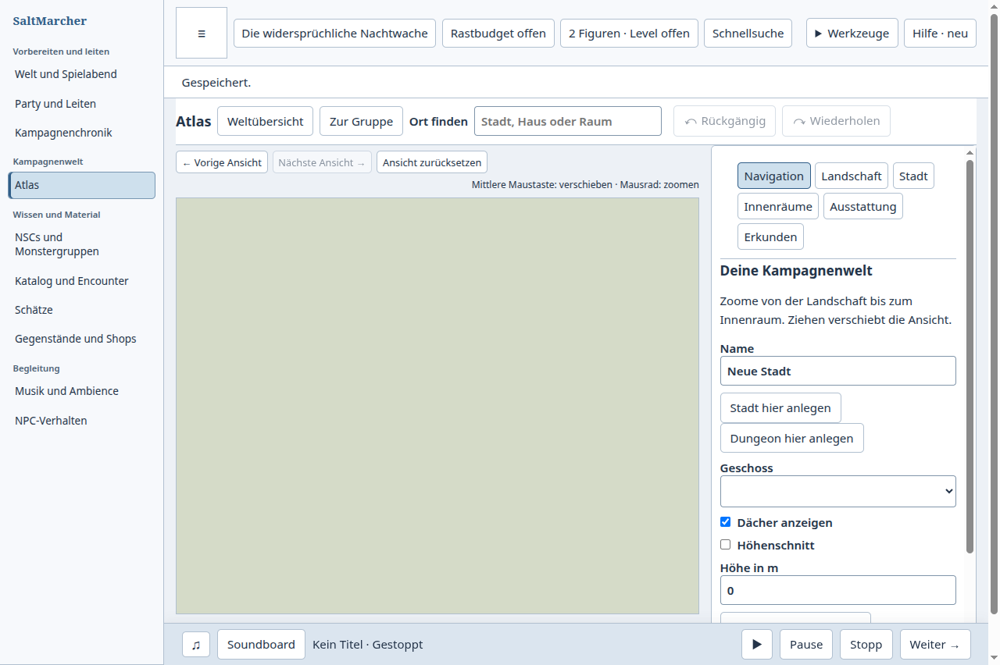
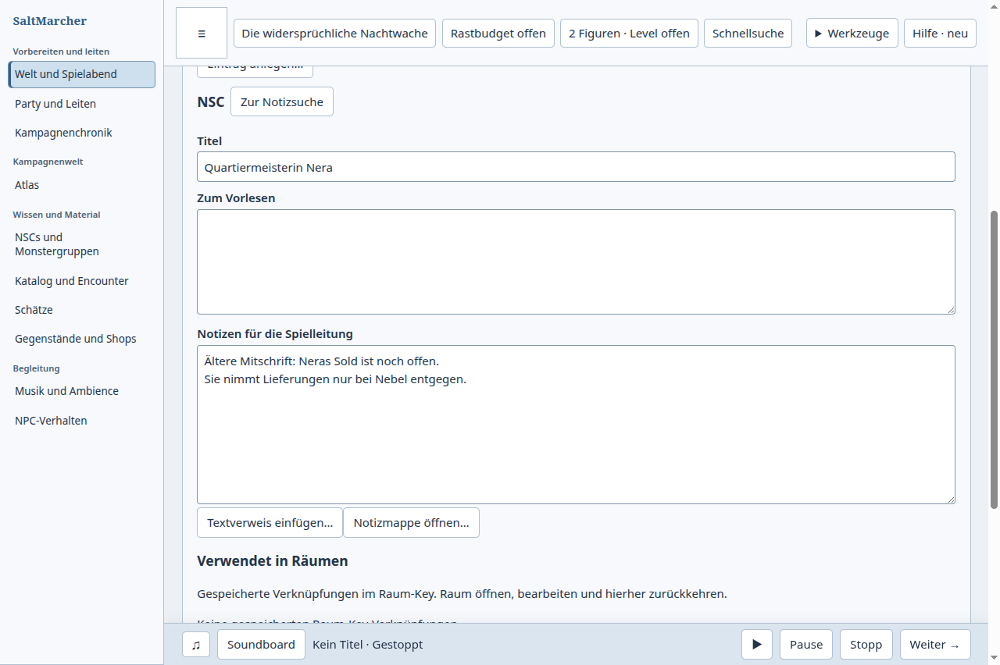
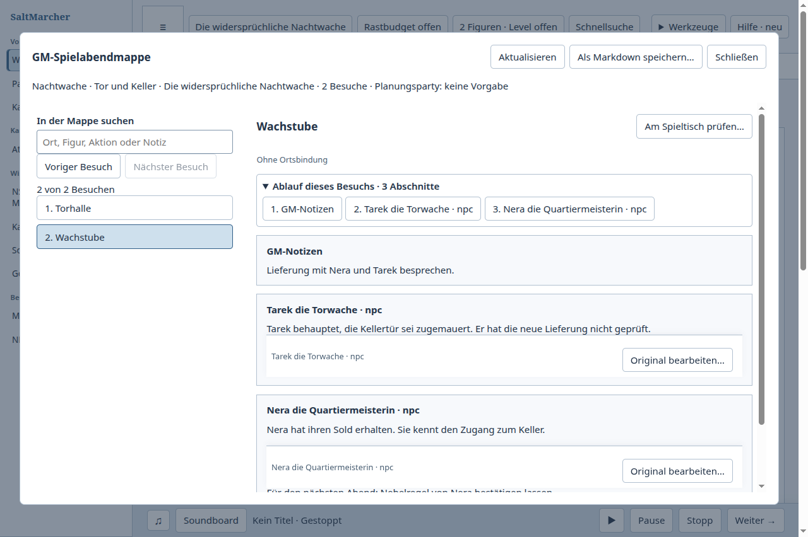
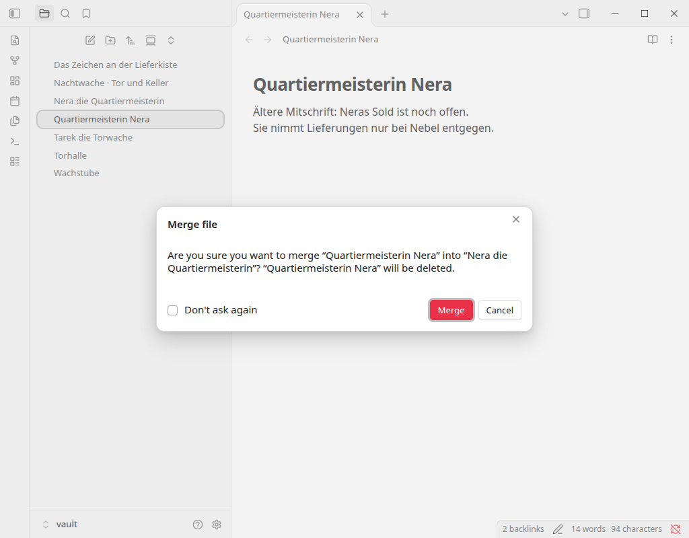
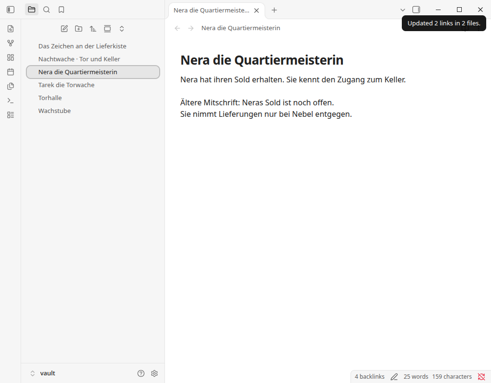
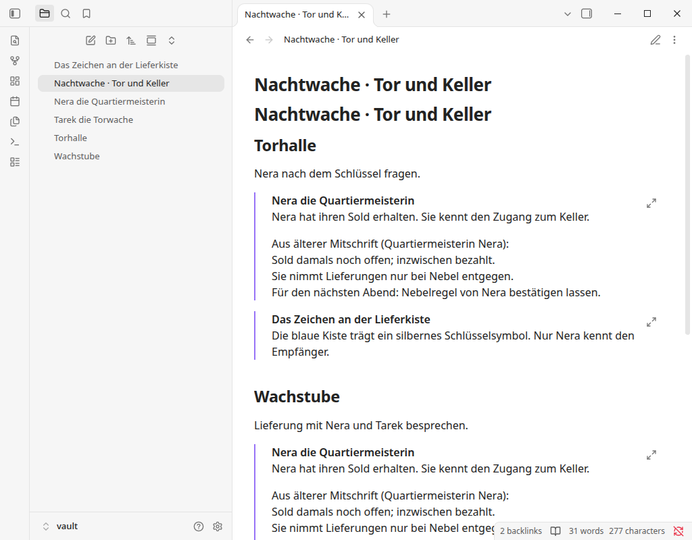

# Von Raum und Plan zur Ausgangsnotiz zurückkehren

Fall 22, tatsächlich über beide Oberflächen am 17. Oktober 2026 ausgeführt.
Die beauftragte GM-Aufgabe: Zwei Nera-Notizen mit unterschiedlichen Titeln und
widersprüchlicher Soldinformation zu einem aktiven Original bereinigen.
Die ältere Mitschrift nachvollziehbar erhalten, den Raumverweis der Wachstube
und deren Besuchsquelle im bestehenden Zweiraumplan umstellen, beide Besuche
lesen und die alte Notiz wiederherstellbar ablegen. Nach regulärem Schließen
frisch öffnen, dasselbe Original weiterbearbeiten und die Ergänzung im Plan lesen.

## Beobachteter Weg und eigener Eingriff

SaltMarcher kann die Aufgabe mit vorhandenen Einzelhandlungen erledigen:
Originaltext ergänzen, über die verwendenden Räume den Key öffnen, den alten
NSC-Verweis lösen und das Original hinzufügen. Der bestehende Plan lässt sich
aus dem Key öffnen, um ebenso die Besuchsquelle umzustellen. Allerdings führte
danach „Zum Raum-Key“ → „Zurück zur Notiz“ in den Atlas. Die gespeicherte
Ausgangsnotiz war noch vorhanden. Vorbereitung, Wissensbereich und Notiz mussten
erneut geöffnet werden, bevor der alte Eintrag abgelegt werden konnte.

Die Korrektur trennt die Lebensdauer dieses Rückwegs vom erneuten Zeichnen der
Notizansicht. Aktualisiert sich dieselbe Notiz während der Planeingabe, bleibt
der Rückweg gültig. Ein tatsächlicher Notiz- oder Kampagnenwechsel entwertet ihn
weiterhin, auch beim Wechsel weg und zurück zur gleichen ID. Die Rückkehr
öffnet den Wissensbereich und bringt die Ausgangsnotiz sichtbar in den
Arbeitsbereich. Das gilt auch dann, wenn gerade ihr letzter Raumverweis entfernt
wurde und daher kein früherer Raumtreffer mehr fokussiert werden kann.

Keine Änderung am Datenmodell oder an Speicher-/Bestätigungsgrenzen. Die
vollständige Aufgabe wurde nach dem Eingriff erneut ausgeführt, einschließlich
der wiederherstellbaren Ablage und frischer Weiterbearbeitung des Originals.
Die beiden ursprünglichen Wissensquellen und die ursprünglichen CRLF-Raumabschnitte
blieben exakt. Beide Räume und beide Besuche verweisen auf dieselbe Nera-ID.

## Tatsächliche Obsidian-Gegenprobe und offener größerer Bedarf

Obsidian 1.14.4 bietet „Merge entire file with…“ im Dateimenü. Im isolierten
Test-Vault wurden das vorhandene Ziel, „Merge“ und anschließend „Just once“
für die angebotene Linkaktualisierung gewählt. Tatsächlich wechselten zwei
Links in zwei Dateien: Wachstube und Spielabendplan. Die frühere Quelldatei blieb
bytegenau im lokalen Papierkorb. Widerspruch und Raumprosa wurden bewusst
redaktionell bereinigt. Die beiden Planeinbettungen zeigten nach frischer
Weiterbearbeitung die Ergänzung desselben Originals. Normales Zurück führte
vom Plan über den Raum zur Notiz.

Das vermeidet das einzelne Umstellen mehrerer Verweise. **Dieser größere
Zusammenführungsbedarf ist in SaltMarcher noch offen.** Die Rückwegkorrektur
allein löst ihn nicht. Als nächster Schritt muss eine ausdrückliche
Zusammenführungsansicht das verbleibende Original, den übernommenen Text und
betroffene Verweise prüfbar machen; Identitäten und bestehende weitergehende
NSC-Bindungen sind dabei zu erhalten. Der vorliegende Eingriff beansprucht keine
automatische Notiz-, Figuren- oder Familienzusammenführung.

## Getrennte Nachweise

- Eigener passender Ausgang: [vollständiges Resultat](saltmarcher-before.json),
  tatsächlicher Produktbuild von Main `4522696d1f930f27079993fdc98ae49e42bbe502`.
  Die fünf bereits quellgebunden belegten Buildhashes wurden vor dem Lauf exakt
  verglichen; der Arbeitsbaum enthielt zu dieser Zeit bereits die ungebauten
  Korrekturen. `source`, `checkoutSource` und `dirty` sind daher separat erfasst.
  Zwei reguläre Exits 0 ohne Signal, PIDs anschließend abwesend.
- Nachher: sauberer Produktcommit `04115bbd6ad46ded43ceada0a2e2bd04625978b0`
  auf Main `2248252d1e4b40cb079f4dc81d885599bdc896e7`;
  [vollständiges natives Resultat mit Buildhashes](saltmarcher-after.json).
  Zwei reguläre Exits 0, keine UI-Fehler; sichtbarer Notiztitel nach Rückkehr,
  Ablage des unveränderten alten Texts, Fresh und Planlektüre bestanden.
- Reproduktion: `npm run build:desktop`, dann
  `node tools/test-desktop-note-room-plan-return.mjs --out=/tmp/note-room-plan-check`.
  Die Option `--baseline-proof` ist ausschließlich für den Hashabgleich eines
  bereits belegten unveränderten Ausgangsbuilds vorgesehen.
- Lokale betroffene Tests: 109 bestanden, keine Fehler oder Skips. Zwei neue
  Rückwegregressionen scheiterten am Ausgang und bestanden nachher; zusätzlich
  tatsächlicher Notizwechsel, Wechsel weg/zurück und explizites Zurücksetzen
  geprüft. Nach der letzten Sichtbarkeitskorrektur den betroffenen Integrationstest
  erneut bestanden. Typprüfungen, Repository-Prüfung und Desktop-Build bestanden.
  Exakte Kandidaten-CI und Main-Integration sind separate Veröffentlichungsbelege.
- Gegenstück: [Obsidian-Resultat mit allen Dateien und Hashes](obsidian-result.json),
  [tatsächliche UI-Spur](obsidian-ui.jsonl), offizielles AppImage 1.14.4
  SHA-256 `6362ddbeeeebb7bbccb48fae009572cf2284ef92f5c919c1332aba48de6ffeaa`.
  Zwei reguläre Exits 0 und abwesende PIDs. Torhalle, Tarek und Hinweisquelle
  bytegenau unverändert, bearbeitete Dateien mit LF-Normalisierung.
- Ein anfänglicher manueller Obsidian-Versuch wurde nach Entdeckung des
  Zusammenführungsbefehls erhalten und regulär geschlossen; er zählt nicht als
  vollständige Gegenprobe. Fehler des neuen eigenen Starthelfers sowie eine
  Korrektur der vorbereiteten Raumprosa sind getrennt im lokalen Checkpoint
  erhalten. Die oben verknüpften passenden Vorher-/Nachher-Läufe sind vollständig.
- Menschliche Abnahme, installierte Paketabnahme, große Kampagnen und Überlegenheit
  für menschliche GMs sind nicht belegt.

