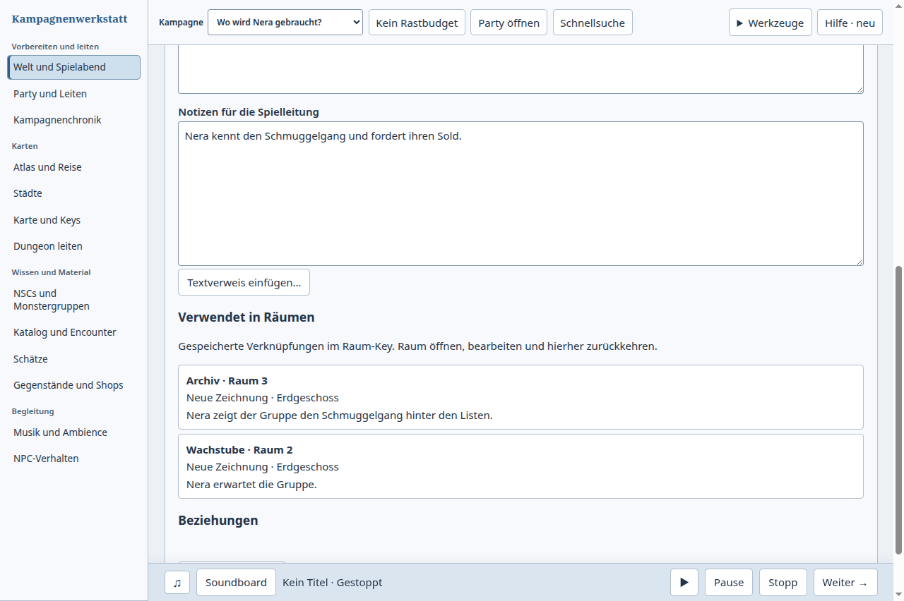

# Von der NSC-Notiz zu ihren Raum-Keys

Geprüfter Fall: Beim Vorbereiten von Nera die Quartiermeisterin alle Räume
mit einer gespeicherten Verknüpfung zu dieser Notiz finden, den Hinweis im
Archiv ändern und bei Neras Notiz weiterarbeiten. Eigene synthetische Kampagne
mit Torhalle, Wachstube und Archiv; kein Benutzervault wurde geöffnet.

Die Kampagnenwerkstatt wurde zuerst in der nativen Electron-Oberfläche
benutzt, anschließend derselbe Fall in der offiziellen Logseq-Browserdemo.
Der korrigierte Ablauf wurde danach erneut nativ geprüft.

## Beobachtung und Produktentscheidung

Vorher zeigte die Notiz nur Beziehungen zwischen Weltinhalten. Obwohl zwei
Raum-Keys ausdrücklich auf Nera verwiesen, war die Rückverweisliste leer.
Der tatsächlich funktionierende Umweg war Atlas → Dungeon-Key → Suche nach
Nera → Archiv → Bearbeiten → Schließen → Welt und Spielabend. Die Suche fand
beide Räume; die ursprüngliche Notiz blieb erhalten. Es gab keinen beobachteten
Datenverlust. [Vorherbeleg](before.json), [Oberfläche](before.png).

Logseq zeigte auf der NSC-Seite beide Räume als „2 Linked References“, jeweils
mit dem verweisenden Absatz. Ein Klick in den Archiv-Absatz erlaubte dessen
Bearbeitung direkt dort. Nach Escape war die Änderung an Ort und Stelle
sichtbar; die NSC-Seite musste nicht verlassen werden. Für diesen begrenzten
Fall wurde dort keine Navigationsreibung beobachtet. Die englische Bezeichnung
in der deutschen Oberfläche war sichtbar, aber kein Blocker.
[Direkt bediente Vergleichsschritte und Grenzen](comparator.json).

Unser Tool erhält deshalb unter dem Notiztext „Verwendet in Räumen“ mit
Raumname, Nummer, Zeichnung, Geschoss und Textauszug. Ein normaler Klick öffnet
den vorhandenen vollständigen Key-Editor über der Notiz. „Zurück zur Notiz“
kehrt zum Ausgang zurück, aktualisiert die Auszüge und setzt den Tastaturfokus
wieder auf den Raumverweis. Die manuelle Atlas-Suche entfällt. Der zusätzliche
Editor ist weiterhin ein eigener Dialog; Logseq kann einfache Absätze direkt
im Rückverweis bearbeiten. Eine allgemeine Gleichwertigkeit wird nicht behauptet.

## Umsetzung und Geltungsbereich

- Die Liste enthält **gespeicherte ausdrückliche Verknüpfungen im Raum-Key**.
  Ein bloß ausgeschriebener NSC-Name, Textverweise in anderen Dokumentformaten,
  Flächen-Keys und Szenenpläne sind keine zusätzlichen Treffer dieser Liste.
  Diese Grenze steht direkt in der Oberfläche.
- Der neue lesende Core-Anschluss leitet die Treffer aus geprüften
  Dungeon-Key-Dokumenten ab. Er prüft Bytes, Identität, Revision und Zuordnung;
  sein begrenzter Metadatencache ist flüchtig. Es gibt keinen neuen gespeicherten
  Autorenindex und keinen zweiten Notiz- oder Key-Schreibweg.
- Je Seite werden höchstens 40 verschiedene Räume übertragen. „Weitere Räume“
  lädt die nächste Seite. Beschädigte Quellen erzeugen einen Hinweis auf
  Unvollständigkeit; beschädigte zugehörige Räume bleiben gesperrt sichtbar.
- Notiz-/Kampagnenwechsel entziehen alten Leseresultaten und abgelösten
  Bedienelementen ihre Gültigkeit. Öffnen und Schließen benutzen die vorhandenen
  Speicherschranken. Der ausdrückliche Atlas-Befehl öffnet weiterhin den Atlas.

## Prüfung

Der abschließende native Build stammt vom sauberen Quellstand `dd4705e8`,
integriert `efd465f4` und zeigt Version **0.131.0**. Der einzige Mergekonflikt
betraf angehängte CSS-Regeln; beide Regelgruppen wurden erhalten.

Der neue Ablauf wurde einschließlich frischem Prozess geprüft:

- beide Rückverweise finden; Archiv direkt öffnen, GM-Text speichern und zur
  sichtbar zugänglichen ursprünglichen Notiz zurückkehren;
- aktualisierten Auszug nach Rückkehr sehen; unveränderte NSC-Notiz und
  ursprüngliche CRLF-Raumabschnitte separat in SQLite nachweisen;
- nach einem Neustart beide Verweise und den gespeicherten Key wiederfinden;
- bei 200 Prozent Zoom den Raumverweis tatsächlich anklicken und per
  `elementFromPoint` seine Erreichbarkeit nachweisen;
- eine offene NSC-Notizänderung vor dem Raumzugriff speichern und nach
  Rückkehr sowie anschließend direkt aus der Datenbank bestätigen.

[Native Ergebnisse](after.json), [200-Prozent-Aufnahme](zoom200.png).
Die vorherigen Such- und Notizkontextabläufe wurden auf demselben Build erneut
bedient: [Raumsuche](integrated-lookup.json),
[verknüpfte Notiz bearbeiten](integrated-note-context.json).
Alle drei Ergebnisdateien binden dieselben fünf gebauten Artefakthashes.
Alle sieben Appstarts endeten regulär mit Exit 0; ihre eigenen Haupt-PIDs
waren danach nicht mehr vorhanden. [Artefakt- und Prozessbeleg](native-integration.json).

Die automatisierten Prüfungen und der genaue CI-Status stehen in
[Prüfzusammenfassung](validation.json). Lokale Prüfungen, native Abläufe und
vollständige CI sind getrennte Aussagen. Der PR bleibt offen.

Logseq wurde in derselben bereits geöffneten Demo benutzt, deren angezeigte
Version zuvor mit 1.0.0 geprüft wurde. Die Demo warnt ausdrücklich vor fehlender
Speicherung ohne lokales Verzeichnis. Ein solches wurde nicht freigegeben;
für Logseq wird weder Neustart- noch Festplattenspeicherung behauptet.

Weitere Notizorganisation, lange Keys, andere Quellformate und weitere
GM-Vergleichsfälle bleiben Bestandteil des laufenden Auftrags.
