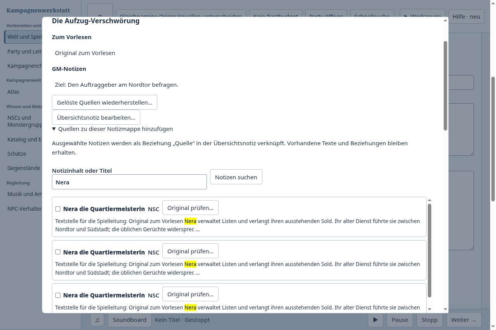
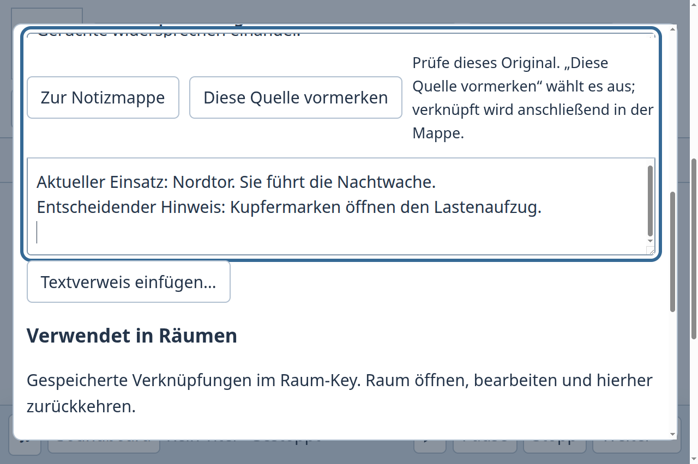

# Gleichnamige Quellen vor dem Verknüpfen prüfen

Fall 13: Drei unabhängige NSC-Notizen heißen „Nera die Quartiermeisterin“. Ihr langer gemeinsamer Einführungstext erwähnt dieselben Orte; erst am Ende unterscheidet sich ihr aktueller Auftrag. Der GM soll die Nera der Nordtor-Nachtwache vollständig lesen und mit der Aufzug-Verschwörung verknüpfen. Ein bereits benannter neuer Abend/Besuch und eine zuvor abgewählte Spur sollen erhalten bleiben. Der neue Abend muss die richtige Originalquelle verwenden, auch nach einem frischen App-Start. Andere Originalnotizen, die Südstadt-Mappe und der alte Abend bleiben unverändert.

| Tatsächlich ausgeführter Ablauf | Beobachtetes Ergebnis und Bedienarbeit |
| --- | --- |
| Kampagnenwerkstatt vorher, a9f7f216, v0.155.0 | Der Quellenwähler zeigt drei gleiche Titel und Typen ohne Möglichkeit, das vollständige Original anzusehen. Mappe schließen, Nera im Wissensbestand suchen, Originale bis zur entscheidenden Stelle lesen, Übersicht erneut suchen und Mappe öffnen. Eigene Abend-/Besuchsnamen sind danach wieder durch Vorgaben ersetzt und müssen erneut eingetragen werden. Mit dem erlernten eindeutigen Wort „Kupfermarken“ ist die richtige Quelle anschließend verknüpfbar. Neuer Abend und frische Mappe funktionieren; zwei reguläre Prozessenden. |
| [Joplin Terminal](https://joplinapp.org/help/apps/terminal/) 3.7.1, offizieller öffentlicher Shell-Modus | Eine normale Notiz hält den bereits benannten neuen Abend fest. `ls --format json` zeigt getrennte IDs der gleichnamigen Originale. Die Originale werden über `cat <ID>` vollständig gelesen; nur die sichtbar beschriebene Nordtor-Quelle wird gewählt. Übersicht und neuer Abend erhalten manuell formulierte interne Notizlinks mit dieser ID. Anschließend werden der Abend und seine tatsächlichen Linkziele durch neue Joplin-Prozesse gelesen. Quellen, andere Verwendung und alter Abend bleiben gleich; keine Kopien der Quellen. |
| Kampagnenwerkstatt nachher, fcebcb05, v0.156.0, gemeinsamer Stand 0aba09cd integriert | Jeder Kandidat bietet „Original prüfen…“. Der vorhandene Originaleditor zeigt den ganzen Text. „Diese Quelle vormerken“ kehrt zur Mappe zurück und wählt exakt diese Identität aus. Suchbegriff, vorherige Quellenwahl und eigene Abend-/Besuchsnamen bleiben erhalten. Erst „Ausgewählte Quellen verknüpfen“ schreibt die Beziehung. Vorbereitung, tatsächliches Spielabendpaket und erneutes Öffnen im frischen Prozess verwenden nur die richtige Nera. Vollständig bei 100 % und 200 % Zoom ausgeführt, insgesamt vier reguläre Prozessenden. |

Im eigenen Vorlauf wurde zusätzliche Such- und Wiedereingabearbeit beobachtet. Der Nachlauf beseitigt diese Schritte für den beschriebenen Fall. Im Joplin-Shell-Ablauf bleiben Identitätstransfer und Verlinkung explizite Handarbeit; das gespeicherte Abenddokument erhält seinen Namen während der Quellenprüfung. Übernommen wird das Arbeiten an dauerhaft identifizierten Originalen, ohne den GM im eigenen Quellenwähler IDs übertragen zu lassen. Dies ist ein tatsächlicher CLI-Vergleich, keine Aussage über die grafische Joplin-App oder menschliche Geschwindigkeit und Vorlieben. Joplins interne Linksyntax ist [offiziell dokumentiert](https://joplinapp.org/help/apps/markdown/); eine spezielle GM-Paketfunktion wird dort nicht behauptet.

## Umsetzung und Grenzen

Die Kandidaten zeigen den bestehenden wörtlichen Suchauszug und öffnen denselben Preparation-Editor, den auch normale Notizen, Raum-Keys und Notizmappen verwenden. Es entsteht weder eine zweite Editorinstanz noch eine Quellenkopie oder ein neuer Schreibport. Die eigene Vorbereitung bleibt während der Prüfung in der Mappe erhalten. Ohne „vormerken“ bleibt die Auswahl unverändert.

Vor dem Vormerken wird die lesbare Übersicht erneut geladen und die aktuelle Kandidatenidentität, Verfügbarkeit und konsistente Revision geprüft. Ein gewechselter oder geschlossener Kontext kann keinen alten Kandidaten übernehmen. Eine unlesbare Übersicht sperrt die Übergabe und behält ihre Fehlermeldung. Die Verknüpfung bleibt eine normale Beziehung der Übersicht; spätere Quellenänderungen sind weiterhin Änderungen am Original.

Das Hinzufügen verwendet den vorhandenen kanonischen Preparation-Schreiber und öffnet zuvor dessen ursprünglichen Editor. Bei verlorener Antwort bleiben die bestehenden manuellen Receipt-Kontrollen erreichbar. Eine bestätigte manuelle Prüfung entfernt bereits übernommene IDs aus der Vormerkliste; es wird nicht automatisch nochmals geschrieben. Bestehende Spielabendprüfungen für Quellenrevision, Auswahl und narrativen Status bleiben erhalten.

## Nachweise

- Vollständiger [Vorlauf](before-result.json), [Nachlauf bei 100 %](after-result.json) und [Nachlauf bei 200 %](after-zoom-result.json). Die Nachläufe verwenden dieselben fünf Desktop-Artefakthashes aus dem sauberen integrierten Build fcebcb05. Jeder hat zwei normale Hauptprozessenden mit anschließend abwesenden eigenen PIDs. Ergebnisprüfung: genau sieben ursprüngliche Wissensnotizen; sämtliche anderen Originale einschließlich CRLF und Revision gleich; nur die Übersicht erhält die eine neue Quellenbeziehung; andere Mappe und alter Plan/Besuch bleiben unverändert. Der neue Besuch enthält exakt Übersicht, blaues Siegel und Nordtor-Nera.
- [Joplin-Ergebnis](joplin-result.json), [tatsächliche öffentliche Befehle samt Ausgaben](joplin-transcript.jsonl), [Vergleichsskript](joplin-compare.py) und [Paketmetadaten](joplin-package-metadata.json). Isolierter Installationspräfix und eigenes Profil; keine globale Installation und kein aktivierter Syncdienst. Ein anfänglicher Versionsaufruf mit `--version` war unzulässig; der tatsächliche Ablauf verwendet den unterstützten Befehl `version`.
- Die ergänzende [Raum-Key-Prüfung](room-result.json) verwendet denselben integrierten Build: Original neben dem Raum lesen und ändern, verschachtelte Mappe öffnen und zum selben Editor zurückkehren, Eingabe-Komposition schützen, regulär schließen und in einem frischen Prozess bei 200 % wieder lesen. Zwei reguläre Prozessenden. Der zuvor verwendete direkte Atlas-Einstieg führte nach der gemeinsamen Umstellung zu einem verborgenen Bedienelement; der Nachlauf benutzt die sichtbaren Innenraum-Fachwerkzeuge. Die erfolglose Einstiegssonde zählt nicht als abgeschlossene Abnahme.
- [Typprüfungen, Repositoryprüfung und Buildzuordnung](checks.json), [beide Buildausgaben](builds.txt) sowie [gezielte Tests](targeted-tests.txt). Die erste kombinierte Gruppe hatte drei Fehler in den neuen Kandidaten-Testdoubles: Sie machten auch die Übersicht unlesbar und erreichten deshalb den vorgesehenen Kandidatencheck nicht. Nach Beschränkung auf die Kandidatenidentität bestehen **alle 235 Tests der erneut vollständig ausgeführten Gruppe**. Enthalten sind die Quellenwahl, echte Übersicht-Lesefehler, späte Antworten, manuelle Receipt-Klärung, bestehende Raum-/Quellenregressionen, Backup und ID-Remapping, der neue Atlas und die neue Encounter-Suche. Die zusätzliche echte Übersicht-Lesefehlerprüfung bleibt erhalten.
- Der vorige veröffentlichte Stand 59c554a1 hat die vollständige [CI38884326883](https://github.com/ThonkTank/Obsidian-Dungeon-Editor-Phase1/actions/runs/38884326883) bestanden: 3256 Tests, 3255 bestanden, 0 fehlgeschlagen, 1 übersprungen. [Terminale Metadaten](previous-publication-ci.json). Dies ist kein voller CI-Nachweis für den späteren Stand dieses Falls.

Der frühere Nachlauf vor der letzten Integration und eine fehlerhafte Zählsonde des Testskripts bleiben lokal als getrennte Proben erhalten. Sie werden nicht mit den hier qualifizierten Läufen addiert. Die Integration löst die gemeinsamen Atlas-/Session-Konflikte so auf, dass Notizmappen, neue Encounter-Suche und Quellenhistorie erhalten bleiben. Der abschließende Fetch bestätigt 0aba09cd als unveränderten gemeinsamen Stand. Allgemeine menschliche Bedienabnahme und Merge/Release bleiben offen; der übergreifende Vergleichsauftrag läuft weiter.

Nach der Publikation endete die vollständige Prüfung des exakten Stands **c21fc150** in [CI38889397557](https://github.com/ThonkTank/Obsidian-Dungeon-Editor-Phase1/actions/runs/38889397557) mit **3288 Tests, 3105 bestanden, 182 fehlgeschlagen und 1 übersprungen**. Viele historische Fixtures legten nach der gemeinsamen Atlas-Umstellung eine zweite Weltkarte an. Weitere Fehler betrafen alte UI-Testports, Schemaerwartungen und die Prüfung auf eine fehlende Verfolgungsentwurfstabelle. Dieser Stand erhält damit keine volle CI-Abnahme. Die anschließende Reparatur und ihre neue Prüfung stehen beim [überlappenden Mappenablauf](../note-map-overlap-20261016/README.md).
