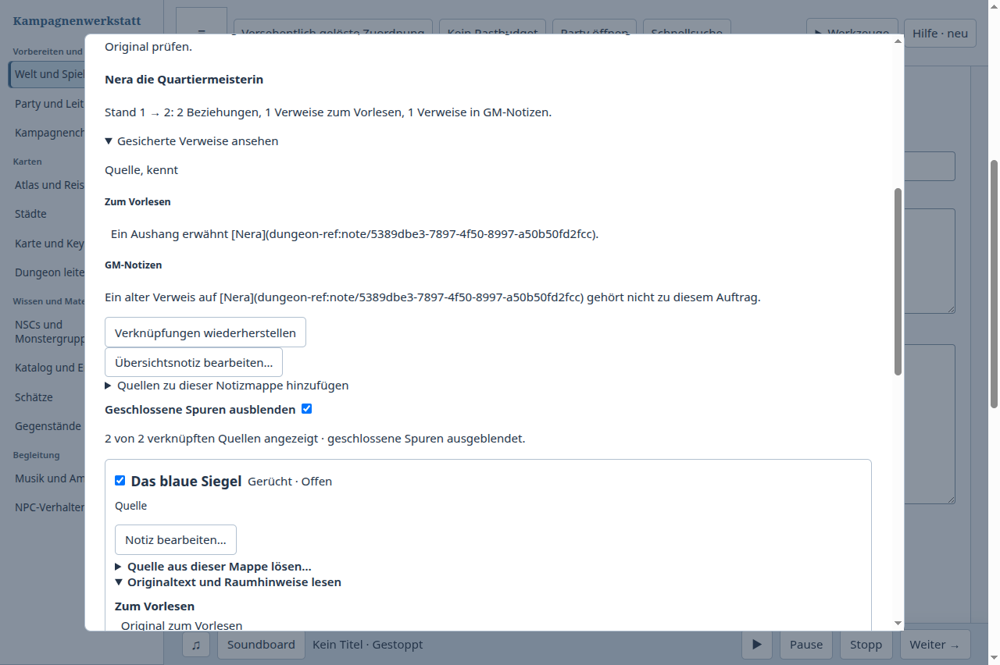
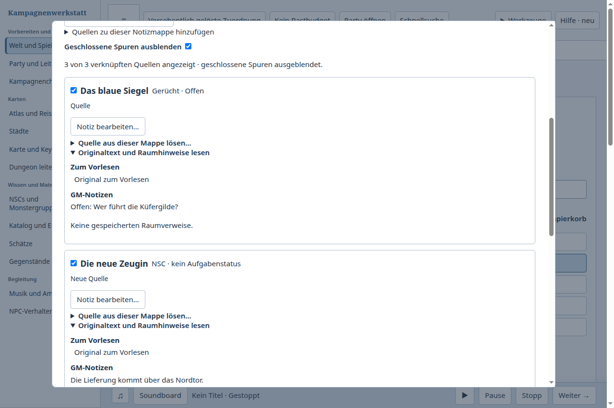
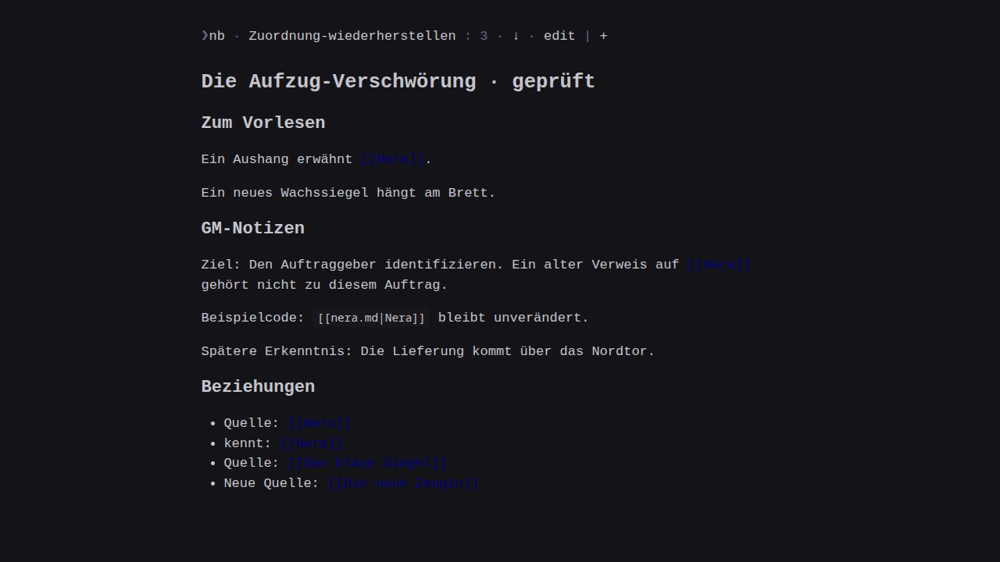

# Gelöste Quellen nach späteren Änderungen wiederherstellen

Fall 11: Nera wurde aus der Aufzug-Verschwörung gelöst. Erst nach einer Umbenennung, neuen Erkenntnissen, zusätzlichem Vorlesetext, einer neuen Zeugin-Beziehung und einem App-Neustart wird der Irrtum bemerkt. Ihre zwei Beziehungen und zwei aktiven Textverweise sollen zurückkommen. Die späteren Änderungen, der wörtliche Code-Verweis, die Originalnotizen, die Torwache als andere Verwendung und der bisherige Abend müssen erhalten bleiben. Anschließend wird Abend 11 vorbereitet, seine GM-Mappe gelesen und der Stand frisch wiedergeöffnet.

## Tatsächliche Abläufe

| Produkt / Stand | Beobachtung und brauchbares Endergebnis |
| --- | --- |
| Kampagnenwerkstatt vorher: Produkt50025a1a, Publikation2ccf42ce, v0.150.0 | Nach dem Neustart keine Quellenwiederherstellung angeboten; Strg+Z in der Mappe stellte die Zuordnung nicht her. Originaleditor öffnen, zwei Beziehungen wieder anlegen und beide Textverweise rekonstruieren. Spätere Änderungen blieben erhalten; Abend11, GM-Mappe und frisches Wiederöffnen vollständig geprüft. Drei reguläre Prozessenden. |
| [nb](https://github.com/xwmx/nb)7.25.5, öffentlicher CLI und eigenes nb-browse | Notizen anlegen, Quelle lösen, später ändern; neue CLI-Aufrufe zeigen die Historie. `nb git revert` erzeugte Konfliktmarkierungen neben späteren Änderungen. `nb git revert --abort` meldete keinen laufenden Revert. Über den gewöhnlichen `nb edit` wurden ausschließlich die Verknüpfungen aus der sichtbaren Historie rekonstruiert. Neue Texte und Beziehung, Originalquellen, andere Verwendung und alter Abend blieben erhalten. Neuer Abend angelegt und gelesen; Browser zeigt Übersicht, vier aktive Nera-Links und unveränderte Originalquelle. |
| Kampagnenwerkstatt nachher: Produkt7eabf5a5, danach6702a946, v0.154.0, gemeinsame Stände85892623 und1dcb3211 integriert | Nach späteren Änderungen und Neustart: „Gelöste Quellen wiederherstellen…“, gesicherte Verweise ansehen, „Verknüpfungen wiederherstellen“. Zwei Beziehungen und beide Textverweise kehren gemeinsam zurück. Neue Erkenntnisse, Titel, Zeugin, Originale, andere Verwendung und alter Abend bleiben erhalten. Abend11 mit allen vier Originalnotizen vorbereitet, GM-Mappe gelesen, App normal geschlossen und Mappe erneut frisch geöffnet. Vollständige Abläufe bei100% und200% Zoom auf7eabf5a5. Nach abschließender Synchronisierung und Desktop-Neubau auf6702a946 erneut vollständiger100%-Ablauf mit drei regulären Prozessenden. |

Der Nutzen der nb-Historie ist beobachtet; eine gezielte konfliktfreie Wiederherstellung gelang dort in diesem Fall erst durch manuelle Rekonstruktion. Schreiben erfolgte über den öffentlichen CLI, Lesen zusätzlich im tatsächlichen nb-Browser. Das ist kein grafischer Schreibvergleich und keine Aussage über menschliche Geschwindigkeit, Vorlieben oder allgemeine Überlegenheit. Ausgefallene Browser-Klicksteuerung früherer Gegenproben zählt nicht als Produktfriktion.

## Änderung und Grenzen

Die bestehende kanonische Preparation-Transaktion sichert reine Quellenlösungen mit Vorher-/Nachherstand atomar zur Notiz und ihrem Receipt. Es gibt keinen zweiten Notizschreiber und keinen neuen Sammlungstyp. Die neue Tabelle `note_source_history` enthält den Wiederherstellungsverlauf. Kopie/Transfer stellen die Notiz-IDs und aktiven Markdown-Verweise um; Backups prüfen Bytes und Zuordnung, Kampagnenlöschung entfernt die zugehörigen Verlaufszeilen.

Die Mappe lädt den Verlauf nur auf ausdrücklichen Aufruf. Angezeigt werden die letzten20 Quellenlösungen dieser Übersicht; bereits erneut verknüpfte Quellen stehen in der normalen Mappe. Alte Löschungen vor dieser Version erhalten rückwirkend keinen Verlauf. Gemischte Textänderungen mit gleichzeitigem Lösen mehrerer Quellen werden nicht als gezielte Quellenlösung gespeichert.

Die Wiederherstellung ergänzt die entfernten Beziehungen und ersetzt ausschließlich eindeutig wiedergefundene, unveränderte Verweiszeilen. Andere Felder, neue Beziehungen und spätere Absätze bleiben aktuell. Bei geänderter/mehrdeutiger Zeile oder verändertem Markdown-Kontext erfolgt kein automatischer Schreibversuch; die gesicherten Verweise bleiben zur Prüfung im Original sichtbar. Nicht verfügbare Quellen sind gesperrt. Familienbeziehungen behalten ihre Paargrenze.

Vor dem Schreiben wird der aktuelle Originaleditor geöffnet und dessen Revision geprüft. Bei verlorener Antwort bleibt er mit der vorhandenen manuellen Receipt-Prüfung offen. Kein automatischer zweiter Schreibversuch. Ein veralteter Stand darf keinen neueren ersetzen.

## Belege und Prüfung

- [Vorher](before-result.json), [nachher100%](after-result.json), [nachher200%](after-zoom-result.json): vollständige UI-Texte, fünf identische Artefakthashes für beide Nachherläufe, sechs reguläre Prozessenden mit anschließend abwesenden eigenen Haupt-PIDs auf Produkt7eabf5a5. Der [abschließende Lauf nach letzter Synchronisierung](after-final-result.json) hat eigene neue Artefakthashes und drei weitere reguläre Prozessenden auf6702a946. Die Vorher-Artefakte gehören ausdrücklich zum älteren Produktstand.
- [158 integrierte gezielte Tests](integrated-tests.txt) bestanden nach der Synchronisierung. Anschließend [73 aktualisierte Preparation-/Speichertests](receipt-storage-tests.txt) bestanden, darunter die zusätzlichen Fälle „verlorene Wiederherstellungsantwort“ und „atomarer Rollback“. Keine Addition der überlappenden Gruppen zu einer erfundenen Gesamtsuite.
- [Typprüfungen, Repositoryprüfung, Plugin-/Desktopbuild](checks.json) bestanden auf Produkt7eabf5a5. Checks umfassen Neustart, spätere Autorarbeit, Konflikte, Markdown-Kontext, Verlaufsladung auf Abruf, veraltete Antworten, Receipts, beschädigte Daten, Backup, unabhängigen Transfer und Kampagnenlöschung.
- [nb-Ergebnis](nb-result.json) und [vollständige öffentliche Befehle](nb-transcript.jsonl), einschließlich fehlgeschlagener Format-/Revert-/Abort-Proben. Die Originalnotiz-Ausgaben wurden vom ersten bis zum letzten Lesen separat auf Gleichheit geprüft. Skripte [Start](nb-compare.py), [Fortsetzung](nb-resume.py), [Abschluss](nb-finish.py) dokumentieren die tatsächlichen Versuche.
- Bei200% öffnet die schmale Navigation ein Bereichsmenü; der Test wurde auf dessen sichtbaren Einstieg korrigiert. Die zunächst leere Playwright-Bildaufnahme wurde durch die native Electron-Aufnahme ersetzt. Ein weiterer vollständiger200%-Ablauf lief danach durch. Die Navigation wartet außerdem ausdrücklich auf den sichtbaren Arbeitsbereich, bevor sie zwischen breitem Einstieg und Bereichsmenü unterscheidet. Die korrigierten Bilder und sechs zuerst gezählten Enden gehören zum100%- und korrigierten200%-Ablauf auf7eabf5a5; Zwischenproben werden nicht als zusätzliche finale Abnahmen gezählt.

Die letzte Synchronisierung übernahm die Party-XP-Vorschaukorrektur aus1dcb3211. Deren **8 Tests**, beide Typprüfungen und beide Builds bestanden erneut; [abschließende Checks](final-checks.json). Dabei war ausschließlich die QA-Harness-Anpassung als geändert markiert, keine Produktdatei. Die Produktdateien des Publikationsstands sind identisch zu6702a946.

Nach Veröffentlichung ist die [exakte CI38880896060](https://github.com/ThonkTank/Obsidian-Dungeon-Editor-Phase1/actions/runs/38880896060) für **f2414429** erfolgreich abgeschlossen: **3244 Tests,3243 bestanden,0 fehlgeschlagen,1 übersprungen**; [terminaler Nachweis](terminal-ci.json). Sie prüft genau den Publikationsstand dieses elften Falls. Spätere Produktstände benötigen ihren eigenen Nachweis. Die ältere diagnostische Gesamtsuite bleibt ein historischer Befund. Kein Merge, Release oder Owner-Akzeptanznachweis; der übergreifende Vergleichsauftrag läuft weiter.

