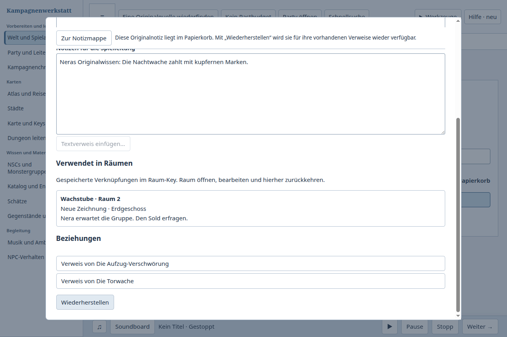
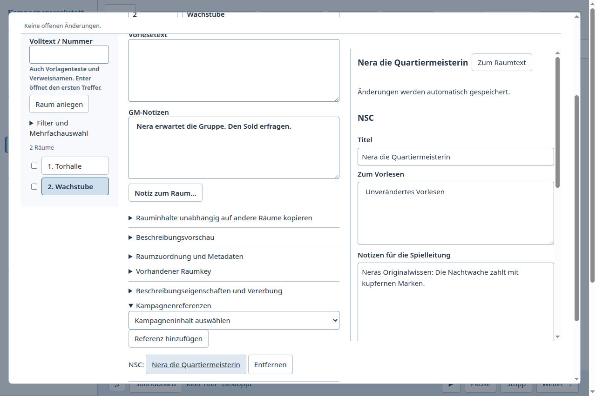
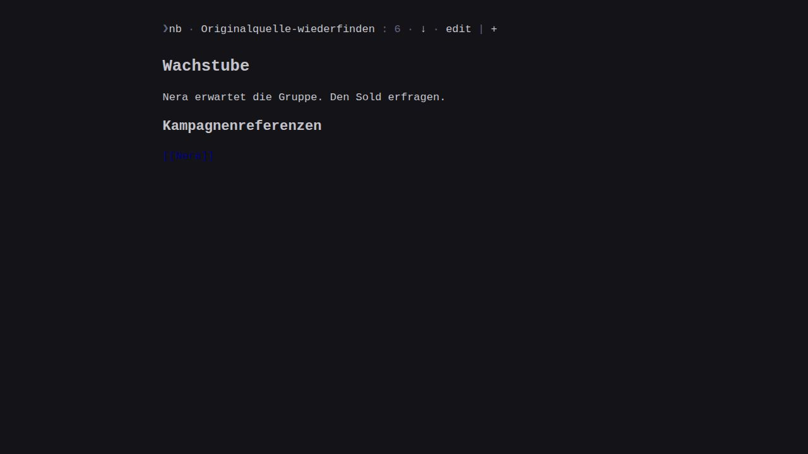

# Die richtige Originalnotiz aus dem Papierkorb zurückholen

Fall12: Nera wurde versehentlich in den Papierkorb verschoben. Eine unabhängige zweite Figur trägt denselben Namen. Der GM ergänzt danach den Auftrag, schließt die App und entdeckt die fehlende Quelle in seiner Notizmappe. Er soll die Originalnotiz prüfen und wiederherstellen, anschließend den alten Spielabend und dessen Raum-Key verwenden. Identitäten, die gleichnamige zweite Figur, spätere Notizänderungen, andere Verwendungen, vorhandene Besuchsquellen und Raumprosa müssen erhalten bleiben.

| Tatsächlich benutzter Ablauf | Ergebnis und beobachtete Bedienarbeit |
| --- | --- |
| Kampagnenwerkstatt vorher: Produkt6702a946, Publikationf2414429, v0.154.0 | Quelle erscheint als „Notiz nicht verfügbar“ mit zusammengefasster Fehlermeldung für fehlend/beschädigt/Papierkorb; Bearbeitung gesperrt. Mappe schließen, Papierkorb einschalten, Original suchen und Text prüfen, wiederherstellen, Papierkorb ausschalten, Übersicht suchen und Mappe erneut öffnen. Danach alter Spielabend und Raum-Key erfolgreich benutzt und frisch wiedergeöffnet. Original-ID, zweite Nera, spätere Erkenntnis und alle alten Verweise erhalten. Drei reguläre Prozessenden. |
| [nb](https://github.com/xwmx/nb)7.25.5, öffentlicher CLI und eigenes nb-browse | Originaldatei löschen, Auftrag später ändern; Notebook-Historie aufrufen und ursprünglichen Datei-Commit finden. Öffentlicher `nb git restore --source <Commit> nera.md` holt ausschließlich die Originaldatei zurück. Alte Raum-/Abenddateien und Dateiverweise bleiben unverändert und funktionieren. Die unabhängige gleichnamige Notiz und spätere Arbeit bleiben erhalten. Numerische Notiznummer wechselt von1 auf8; filenamebasierte Verweise bleiben gültig. Alter Abend, Originalquelle, Raum und geänderter Auftrag anschließend im tatsächlichen Browser gelesen. |
| Kampagnenwerkstatt nachher: Produkt2a4ce7e5, v0.155.0, gemeinsamer Stand20d7f2ee integriert | Mappe zeigt den geprüften Namen und „Papierkorb“. „Original im Papierkorb ansehen…“ öffnet genau diese Notiz im vorhandenen schreibgeschützten Editor. „Wiederherstellen“ erhält die ursprüngliche ID; der Editor bleibt geöffnet und zeigt danach die wieder verfügbare Originalnotiz. „Zur Notizmappe“ führt zurück. Alter Spielabend samt Originalwissen und Raum-Key mit unverändertem Wortlaut funktionieren sofort und nach erneutem App-Neustart. Drei reguläre Prozessenden. |

Das beobachtete Ergebnis entfernt die erneute Papierkorbsuche und das Wiederfinden der Übersicht aus diesem Ablauf. Es behauptet keine menschliche Zeitersparnis oder allgemeine Überlegenheit. Der Gegenvergleich benutzt CLI-Schreiben und tatsächliches Browser-Lesen; grafisches Schreiben wird nicht behauptet. Die nb-Git-Probe mit `--` lieferte zunächst die ganze Historie, weil nb nachfolgende Argumente verwirft. Diese fehlgeschlagene Probe bleibt im Transkript; die tatsächlich erfolgreiche Wiederherstellung verwendete den oben genannten selektiven öffentlichen Befehl ohne diesen Trenner.

## Umsetzung

Der bestehende Notizmappenleser prüft auch bei Papierkorbeinträgen Checksumme, Dokumentformat, ID und Revision. Nur ein lesbarer, gültig zugeordneter Papierkorbeintrag erhält seinen Originalnamen und die Aktion zum Ansehen. Beschädigte, fehlende oder widersprüchliche Quellen bleiben ohne diese Freigabe. Papierkorbquellen sind weiterhin von der Spielabendauswahl ausgeschlossen. Ein geschlossener, später weggeworfener Auftrag bleibt zum Wiederherstellen sichtbar; sein Aufgabenstatus wird dabei nicht als lesbar ausgegeben.

Die Aktion verwendet denselben Originaleditor und den vorhandenen kanonischen `note-trash`-Befehl. Es gibt keine Notizkopie, keinen neuen Schreibport und keine neue Tabelle. Beim Wiederherstellen oder erneuten Wegwerfen innerhalb der Mappe bleibt die ausgewählte Original-ID erhalten. Bestätigte manuelle Receipt-Prüfung aktualisiert den sichtbaren Papierkorbzustand. Eine verlorene Antwort bleibt im Editor aufklärbar und wird nicht automatisch erneut gesendet.

## Nachweise

- [Vollständiger Vorlauf](before-result.json), [Nachlauf vor letzter Synchronisierung](after-result.json) und [abschließender Nachlauf auf2a4ce7e5](after-synced-result.json): jeweils echte UI-Handlungen, alter Abend und Raum-Key, frischer Prozess, drei reguläre Hauptprozessenden und anschließend abwesende eigene Haupt-PIDs. Die beiden Nachläufe haben getrennte Artefakthashes und jeweils ihre eigene Quellbindung. Storeprüfung belegt die Original-ID und Inhalte, genau fünf bestehende Notizen ohne Duplikat, unveränderte zweite Nera, andere Mappe, ursprünglichen Plan/Besuch/Quellen, Raumgeometrie und Raum-Key-Prosa.
- Die fünf tatsächlich im abschließenden Nachlauf verwendeten Artefakthashes sind identisch zum Desktop-Neubau auf **53e7499d**. [Typprüfungen, Repositoryprüfung und beide Builds](checks.json) bestanden. Der abschließende native Nachlauf und die Tests liefen nach dem Produktcommit. Der Pluginbuild meldet wegen des parallel aktualisierten älteren CI-Berichts `+dirty`; Produktdateien waren unverändert.
- Die abschließenden [138 gezielten Prüfungen](targeted-tests.txt) bestanden auf demselben Produktstand. Geprüft sind tatsächlicher Trash-/Restore-Roundtrip im gemeinsamen Editor, verlorene Antwort und manuelle Bestätigung ohne zweiten Schreibversuch, beschädigte Papierkorbzeilen, Auswahlverbot, bestätigte Zustände und bestehende Quellen-/Planungsregressionen. Ein geschlossener weggeworfener Auftrag erhält den unbekannten Status im Lesemodell und bleibt nach Wiederherstellung weiterhin geschlossen.
- Nach abschließender Synchronisierung wurden die gemeinsamen Raum-Key-/Backupkorrekturen aus20d7f2ee konfliktfrei integriert. Auf **2a4ce7e5** bestehen die vollständige native Aufgabe sowie **[144 kombinierte Notiz-/Raumprüfungen](synced-tests.txt)**, beide Typprüfungen und beide Builds erneut; [abschließende Checks mit neuen Artefakthashes](synced-checks.json). Dieser Build ist sauber. Die138 vorherigen Prüfungen werden nicht zu dieser überlappenden Gruppe addiert. Produktdateien bleiben bis zur Publikation identisch zu2a4ce7e5.
- [nb-Ergebnis](nb-result.json), [öffentliche Befehle samt Ausgaben](nb-transcript.jsonl), [Startskript](nb-compare.py), [selektive Fortsetzung](nb-resume.py). Die Originalausgaben von Quelle, gleichnamiger Figur, anderer Verwendung, Raum und altem Abend wurden separat vom ersten bis zum letzten erfolgreichen Lesen auf Gleichheit geprüft.
- Der frühere Publikationsstand **f2414429** hat inzwischen die vollständige [CI38880896060](https://github.com/ThonkTank/Obsidian-Dungeon-Editor-Phase1/actions/runs/38880896060) bestanden:3244 Tests,3243 bestanden,0 fehlgeschlagen,1 übersprungen. Das ist der volle Nachweis für Fall11, keine erfundene aktuelle155-Gesamtabnahme.

Die Prüfung dieses Falls erfolgte bei100% Desktopzoom. Der veröffentlichte Stand **59c554a1** hat anschließend die vollständige [CI38884326883](https://github.com/ThonkTank/Obsidian-Dungeon-Editor-Phase1/actions/runs/38884326883) bestanden:3256 Tests,3255 bestanden,0 fehlgeschlagen,1 übersprungen. Das gilt für genau diesen Publikationsstand; spätere Änderungen benötigen ihren eigenen Nachweis. Grafisches Schreiben im Gegenprodukt, menschliche Bedienabnahme und Merge/Release bleiben offen. Der übergreifende Vergleichsauftrag läuft weiter.

