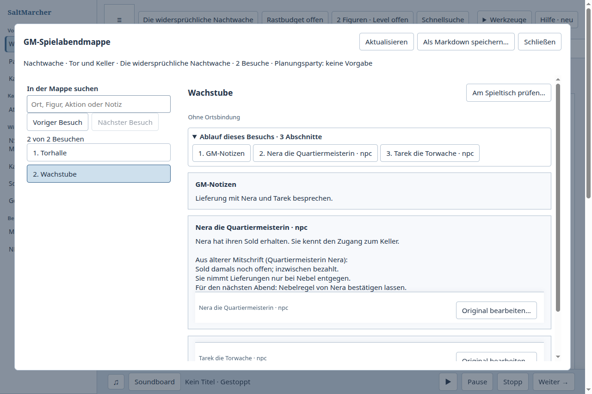

# Doppelte NSC-Notizen gemeinsam bereinigen

Fall 22, vollständige reale GM-Aufgabe in SaltMarcher und Obsidian 1.14.4.
Zwei Nera-Notizen widersprechen sich beim Sold; die ältere Quelle enthält die
zusätzliche Nebelregel. Ein verbleibendes Original, nachvollziehbare Redaktion,
beide Räume und beide Besuche des vorhandenen Plans müssen anschließend
zusammenpassen. Die frühere Quelle bleibt wiederherstellbar. Nach normalem
Schließen muss dieselbe Nera weiterbearbeitbar sein und die Ergänzung aus beiden
Besuchen gelesen werden können.

## Beobachtung und Änderung

Der [passende eigene Ausgang und tatsächliche Obsidian-Vergleich](../note-room-plan-return-20261017/README.md)
zeigten den größeren Unterschied: SaltMarcher erforderte einzelne Lösch- und
Hinzufügehandlungen am Raum und Besuch. Obsidian stellte durch „Merge entire
file with…“, Auswahl des Originals, „Merge“ und „Just once“ tatsächlich zwei
Links in zwei Dateien um und erhielt die alte Datei bytegenau im Papierkorb.
Die Aussagen zum Sold und die örtliche Raumprosa mussten in beiden Abläufen
redaktionell geklärt werden. Die vorherige Rückwegkorrektur allein löste die
verteilte Verweisarbeit noch nicht.

„NSC-Notizen zusammenführen…“ zeigt jetzt Quelle, verbleibendes Original, beide
Originaltexte, vorgeschlagene öffentliche/private Texte und betroffene aktuelle
Verweisstellen. Erst nach Textprüfung und ausdrücklicher Bestätigung werden
Notiz, unterstützte Verweise und Quellablage gemeinsam gespeichert. Der
verbleibende Eintrag behält seine ID. Die vollständigen Quelltexte bleiben im
Papierkorb lesbar und wiederherstellbar; der Zieltext wird anschließend geöffnet.
Ein lokaler redaktioneller Entwurf kann geschlossen und wiederaufgenommen werden.

Beide Revisionen und ein Manifest der aktuellen Verweisstellen begrenzen den
Auftrag. Veränderte oder hinzugekommene Verweise erfordern eine neue Vorschau.
Die bestehenden Writer ändern Notizen/Orte, Key-Inhalte samt History und
Besuchsquellen innerhalb einer Transaktion. Ein später Fehler rollt alle
Teile einschließlich Receipts zurück. Gesicherte unklare Aufträge werden
abgefragt; sie werden nicht automatisch erneut gesendet. Zu lange kombinierte
Texte bleiben als bearbeitbarer Entwurf erhalten und werden vor dem Senden
begrenzt. Scheitert die lokale Entwurfssicherung, bleibt die Eingabe offen;
Schließen und Verlassen setzen erfolgreiche Sicherung oder ausdrückliches
Verwerfen voraus.

Der erste native Nachlauf fand nach erfolgreicher Umstellung einen weiteren
Fehler: Ein später geladener Raumtreffer zog nach Raum → Plan → Notiz den
Ausschnitt vom Notizanfang weg. Der [unterbrochene Nachweis](first-native-attempt.json)
bleibt erhalten. Bei der Rückkehr zum Original lädt die Raumliste jetzt ohne
eigenen Fokus-/Scrollwechsel nach. Ihre bisherige selbständige Wiederherstellung
mit Seiten und Tastaturfokus bleibt verfügbar und ist weiter geprüft.

## Ergebnis und getrennte Nachweise

- [Vollständiges natives Ergebnis](result.json), Produktquelle
  `6cbbb74d6847bb716874100e6146e9919e93c678` einschließlich des aktuellen
  SaltMarcher-Main `3ad67c46a`; fünf Buildhashes, sauberer Arbeitsbaum.
  Eine Bestätigung, automatische Wachstuben-/Besuchsumstellung, redaktionelle
  Raumkorrektur, beide Besuche, sichtbare Rückkehr, reguläres Schließen,
  Fresh und weitere Eingabe am selben Original bestanden. Beide Besuche zeigen
  die Ergänzung. Zwei reguläre Exits 0 ohne Signal, PIDs abwesend, keine UI-Fehler.
- Abschließend beide Raum- und Besuchsverweise mit derselben kanonischen ID
  geprüft. Alte Nera-Texte, Tarek, Hinweisquelle und ursprüngliche CRLF-Raumabschnitte
  exakt erhalten. Die Quelldaten wurden erst nach Schließen aller Writer geprüft.
- Ein [früherer Zwischenlauf](intermediate-result.json) wurde nach einem
  [Navigationsfehler des Helfers](failure.json) im selben Profil fortgesetzt:
  Der Helfer hatte am bereits letzten Besuch nochmals „Weiter“ versucht.
  Beide Besuche wurden anschließend ausdrücklich ausgewählt; keine wiederholte
  Zusammenführung und keine doppelte Textänderung. Dieser Zwischenlauf hatte
  drei normale Exits; er wird nicht mit dem abschließenden Zweistartlauf vermischt.
- Lokal: 171 betroffene Speicher-/UI-/Vorbereitungs-/Notizkontexttests bestanden.
  Zusätzliche Export-/Import-, verspätete Vorschau-, beschädigte Auftrags-,
  Textlimit- und lokale Sicherungsfehlerfälle bestanden. Nach den letzten
  Änderungen alle elf Merge-UI-Tests sowie alle elf Raumverweis-DOM-Tests grün.
  Beide Typprüfungen, Repository-Prüfung und Desktop-Build bestanden.
- Ergänzend die drei weiteren betroffenen Preparation-Einstiege geprüft:
  34 Textverweistests bestanden. In zwei älteren synthetischen Browserhosts
  fehlte der nun benötigte lokale Speicher; dadurch scheiterten 14 von 22
  Planungs-/Übergabeprüfungen an der aktiven Sicherheitssperre. Nur die beiden
  Testhosts erhielten einen isolierten Browser-Speicher. Danach alle 22 grün;
  der Produktpfad bei unlesbarem Speicher bleibt gesperrt und separat geprüft.
- Transaktionsrollback, stale Vorschau, Replay/lost ack, Entwurfserhalt,
  Profil-/Familienblockade, unabhängiges Backup und Import sind technische Belege.
  Reproduktion: `npm run build:desktop`, dann
  `node tools/test-desktop-note-merge.mjs --out=/tmp/npc-merge-check`.
  Der Helfer wählt nach Fresh beide Besuche anhand ihrer bestehenden IDs.
- Exakte Kandidaten-CI, geschützte SQUASH-Main-Integration und native Prüfung des
  tatsächlichen Main werden separat im Chat-Checkpoint dokumentiert. Der
  aktuelle Main wurde regulär in den schon veröffentlichten Topic-Zweig
  aufgenommen; kein Force-Push und keine historische Dungeon-/Migrationsbasis.
  Die anschließende Main-Integration erfolgt per SQUASH mit linearer Main-Historie.
  Menschliche und Paket-/Installationsabnahme werden nicht beansprucht.

## Begrenzung

Die Aktion führt NSC-Wissensnotizen zusammen. Ein eigenes Profil, eine laufende
Figur, Standort-/Gebäudebindung, andere Kreatur oder typisierte Familienpaare an
der Quelle verhindern die Zusammenführung, bis diese Identitäten getrennt
geklärt sind. Betroffene offene Notiz-/Ortsentwürfe bleiben erhalten und sperren
den Vorgang. Dies ist keine automatische Zusammenlegung laufender Figuren.

Unterstützt sind ausdrückliche NSC-Keyverweise und aktuelle Besuchsquellen sowie
freie Notizbeziehungen und deklarierte Textverweise in Notizen und Ortsabschnitten.
Wörtliche Erwähnungen und Code bleiben wörtlich. Historische Aufzeichnungen
behalten die alte Identität mit lesbarer archivierter Quelle. Widersprüche und
örtliche Raumprosa werden weiterhin bewusst redigiert. Große Kampagnen,
physische IME-Eingabe und menschliche Bedienpräferenzen sind nicht belegt.

Die Bilder des erhaltenen Zwischenlaufs zeigen zusätzlich beide Planeinbettungen:
[Torhalle](fresh-both-visits-Torhalle.png), [Wachstube](fresh-both-visits-Wachstube.png).
