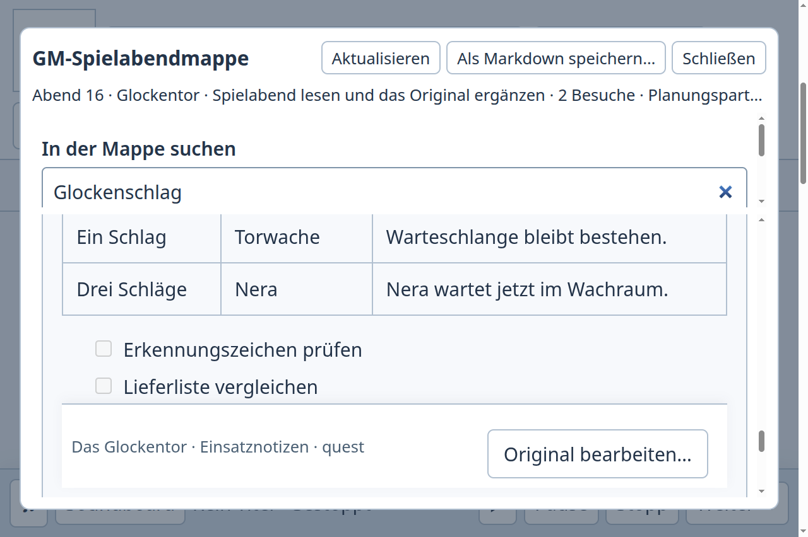

# Notizabläufe auf dem migrierten SaltMarcher-Main

Der eigene Notizbeitrag wurde als Patch aus dem alten gemeinsamen Stand `34644319` auf eine frische lineare SaltMarcher-Branch übertragen. Historische Dungeon-Historien wurden nicht gemergt. Alte Arbeitskopien und Belege bleiben bestehen. Aktuelle Basis ist `c32e0f679d6b0436f7dc9053db9c16aad69bae15` einschließlich Landschaftsindex und Schema 46. Quellstand der folgenden nativen Prüfung: `07cf9edb71770d7b38abf4f4e50bc00f0dc78a61`.

## Nutzbarer Ablauf und Gegenstück

In der Abendmappe lässt sich eine Fundstelle des zweiten Besuchs lesen, über „Original bearbeiten…“ im vorhandenen kanonischen Editor ändern und danach mit derselben Suche, demselben Besuch und derselben Leseposition weiterverwenden. Rohtexte und bestehende Zeilenenden außerhalb der Änderung bleiben erhalten. Notizmappen, NSC-Verweise und Raum-Keys verwenden denselben Editor und dieselbe Speicherung.

Der vollständige tatsächliche Vergleich dieser Aufgabe mit Obsidian 1.14.4 und ergänzend Joplin 3.7.21 bleibt im [ursprünglichen Fallbericht](../packet-original-20261016/README.md) mit den jeweiligen Quellen und Grenzen gebunden. Dessen historische SaltMarcher-Integrationsankündigung wird durch diese zusätzliche Zielprüfung konkretisiert. Kanka 3.15 ist separat aus dem offiziellen Release lokal installiert und gebaut; die Registrierungsseite ist erreichbar. Ein tatsächlicher Kanka-Schreibvergleich steht aus. Installation, Dokumentation und Login zählen nicht als Vergleich.

## Native Zielprüfung

Alle sechs Aufgaben wurden mit isolierten Profilen vollständig einschließlich frischem Prozess ausgeführt. [Die Bindung](binding.json) hält fünf identische Build-Hashes, zwölf reguläre Prozessenden (Code 0, kein Signal), anschließend abwesende eigene Haupt-PIDs und leere Seitenfehlerlisten fest.

- [Abendmappe 100 %](packet-100.json) und [200 %](packet-200.json): Originalfundstelle sichtbar ausgewählt, Änderung und Rückkehr zum Leseort, Suche und Besuch erhalten; frische Persistenz, nur beabsichtigter Text und Revision geändert, rohe CRLF und Begleitdaten unverändert.
- [Notizmappen 100 %](hierarchy-100.json) und [200 %](hierarchy-200.json): Untermappe und NSC öffnen, Original ändern, erhaltene übergeordnete Auswahl und vorbereiteter Abend; frisches Wiederfinden.
- [Raum-Key/NSC](key-context.json): neben dem Key nachlesen, ändern, zurückkehren und am Raum weiterarbeiten; Kompositionsschutz, erreichbarer Rückweg bei 200 %, frischer Prozess.
- [Notiz erfassen](key-capture.json): markierte Raumspur vorbefüllt übernehmen, gewöhnliche Notiz atomar anlegen/verknüpfen, am Key weiterschreiben, frisches Wiederfinden und folgenloser Abbruch.

Ein alter Treiber erwartete den Key-Einstieg unmittelbar nach Kampagnenöffnung. Der aktuelle sichtbare Weg führt über die Atlasfamilie Innenraum und die erweiterte Sektion. Der Treiber wurde angepasst und die vollständige Erfassungsaufgabe erneut erfolgreich ausgeführt; dies war keine Produktänderung. Die ersten vier Aufgaben wurden mit sauberem Quellstand ausgeführt. Die abschließende Treiberkorrektur ändert keine Produkt- oder Unit-Test-Dateien.

## Technische Prüfung und Liefergrenzen

Repositoryprüfung, beide Typprüfungen und beide Builds bestehen auf `07cf9edb`. Der vollständige lokale Lauf `npm test` auf diesem eingefrorenen Produkt-/Teststand läuft noch; Originalsession 33026, `/tmp/salt-notes-current-full.txt`. Kein Neustart wegen Beobachtungstimeouts.

Der vorherige eingefrorene Transferstand `68017e9d` hat einen vollständigen TAP-Abschluss mit 3388 Tests, 3384 bestanden, 3 fehlgeschlagen, 1 übersprungen. Zwei Chase-Tests warteten nicht auf bestätigte UI-Bereitschaft; ein weiterer Test erwartete nach der absichtlich formatierten Darstellung noch rohe Markdown-Syntax im DOM. Die Korrektur wartet auf tatsächliche Bereitschaft beziehungsweise prüft semantische Darstellung und behält die exakten gespeicherten Rohtextassertionen. Ein isolierter Reparaturvergleich bestand mit 89/89 Tests; er ersetzt die noch laufende volle Zielsuite nicht. Die alte Wrapper-Session meldete später Exit 143; der vollständige TAP-Abschluss bleibt davon getrennt dokumentiert.

Beim abschließenden Fetch war Main bereits auf `7d9aa8930c212563e1a7e85399f99b29771e41e7` weitergelaufen (Live-Moment-Drafts, Layout, Encounter-Komposition, Fixturekorrekturen, Autonomie-Opt-in). Diese nach dem Start eingegangenen Änderungen sind in dieser Qualifikation noch nicht enthalten. Vor Main-Integration müssen sie auf einem frischen linearen Kandidaten übernommen und passend nachqualifiziert werden. Der aktuelle Beitrag wird als Entwurf zur Prüfung veröffentlicht; exakte Kandidaten-CI, aktuelle Main-Integration, Paketinstallation und menschliche Abnahme sind getrennt offen.

## Frischer Kandidat nach dem abschließenden Main-Fortschritt

Die eigenen drei Commits wurden anschließend in einer weiteren frischen Branch `qa/notes-live-main` direkt auf `7d9aa893` übertragen. Der einzige manuelle Konflikt lag in `tests/desktop-preparation-context.test.mjs`: Die Bridge enthält die aktuellen Main-Methoden einschließlich `generatorRegistry` sowie `noteThread`/`checkNoteThread`/`noteRoomUses`; sowohl die Bereitschafts- als auch die Bestätigungswartebedingung bleiben erhalten. Der konfliktbehaftete erste PR #724 wird durch diesen linearen Kandidaten ersetzt, ohne veröffentlichte Historie umzuschreiben.

Produkt-/Teststand der neuen Branch ist `43886438d`. Repositoryprüfung bestand; beide Typprüfungen/Builds und acht betroffene DOM-/Kontext-Testdateien laufen noch auf dem eigenen Host. Eine vollständige native Wiederholung auf diesem neuesten Produktstand ist noch offen; die sechs obigen Aufgaben bleiben ausdrücklich an `07cf9edb` gebunden. Der unveränderte alte Gesamttest läuft separat weiter. Exakte CI des neuen veröffentlichten Kandidaten steht aus.

## Qualifikation vom 16.10., 17:26 UTC

Der exakte Kandidat `5924656f50033727817b06a8dc0d2c1bce01f0e3` hat anschließend auch die vollständige erforderliche [CI 38930379103](https://github.com/ThonkTank/Salt-Marcher/actions/runs/38930379103) bestanden: 3415 Tests, 3414 bestanden, 0 fehlgeschlagen, 1 optionaler PDF-Test übersprungen. Alle Repository-/Typ-/Build-Schritte bestanden. Die sechs nativen Aufgaben wurden auf genau diesem Commit erneut vollständig ausgeführt; zwölf reguläre Prozessenden, abwesende eigene Haupt-PIDs und fünf identische Artefakthashes sind im Chat-Arbeitsverzeichnis `evidence/salt-notes-5924656f/` gebunden. Dies ergänzt die älteren Belege; es ersetzt keine Main- oder menschliche Abnahme. Der ältere lokale Diagnosegesamtlauf auf `07cf9edb` endete bei Test 1914 ohne abschließendes TAP-Ergebnis (Exit 143); daraus wird kein Gesamterfolg abgeleitet und kein doppelter Lauf gestartet.

Für den nächsten Integrationskandidaten wurde ausschließlich die eigene Differenz aus `e6355707` bis `5924656f` auf eine frische Branch von `73b86356e5b9b8fdeaaa04ccde5902ee3c58746c` übertragen. Main-Version 0.160.0, öffentliche Raum-Key-Ausgabe, gemeinsame Kreaturen-Leseansicht und Quellenhistorie, persistente Szenengruppen sowie neue Tagesplanung bleiben erhalten. Die Importkonflikte führen gemeinsamen Kreaturenleser und KeyDocumentReader sowie Tagesplanung und Raum-Key-Notiznavigation zusammen. Die veröffentlichten alten Kandidaten und Arbeitskopien bleiben erhalten; keine Historie wurde umgeschrieben. Diese neue Quellkombination wird separat über betroffene technische Tests, native Abläufe und exakte Kandidaten-CI qualifiziert. Kanka bleibt bis zu funktionierender tatsächlicher Eingabe ein offener Gegenstückvergleich; es ist kein neuer abgeschlossener Vergleich hinzugekommen.

## Lineare Fortsetzung vom 16.10., 18:31 UTC

Auch Kandidat `82826a88090269e472a703ef40d9f67a03200247` bestand die vollständige [Pflicht-CI 38940055164](https://github.com/ThonkTank/Salt-Marcher/actions/runs/38940055164): 3432 Tests, 3431 bestanden, 0 fehlgeschlagen, 1 optionale PDF-Prüfung übersprungen. Auf diesem Commit bestanden 202 gezielte Tests sowie acht vollständige native Abläufe mit 16 regulären Prozessenden; fünf identische Artefakthashes und frische Wiederöffnung sind im Chat-Arbeitsverzeichnis `evidence/salt-notes-82826a88/` gebunden. Die automatische lineare Integration blieb wegen zwischenzeitlicher Main-Konflikte aus.

Die eigene Differenz wurde deshalb auf eine frische Branch von `c0f0b249c20dad989883aafd991193d7eae20984` übertragen. Der Konflikt in `sessionContext` erhält sowohl die bestätigte Tagesplan-Aktualisierung als auch die Synchronisierung der Besuchsnotizen, ohne laufende Eingaben neu aufzubauen. Der Store behält beide Prüfungen für Tagesplanung und Notizmappen. Zusätzliche Notiz-Imports im Renderer stehen separat, damit neue Main-Imports nicht dieselbe lange Zeile verändern müssen. Aktuelle Mob-/Szenengruppen, Reaktionsquellen und Raritäts-/XP-Korrekturen bleiben erhalten. Für diese neue Kombination sind die betroffenen technischen und nativen Prüfungen sowie eine eigene exakte CI erforderlich. Alte Kandidaten werden nicht umgeschrieben.
