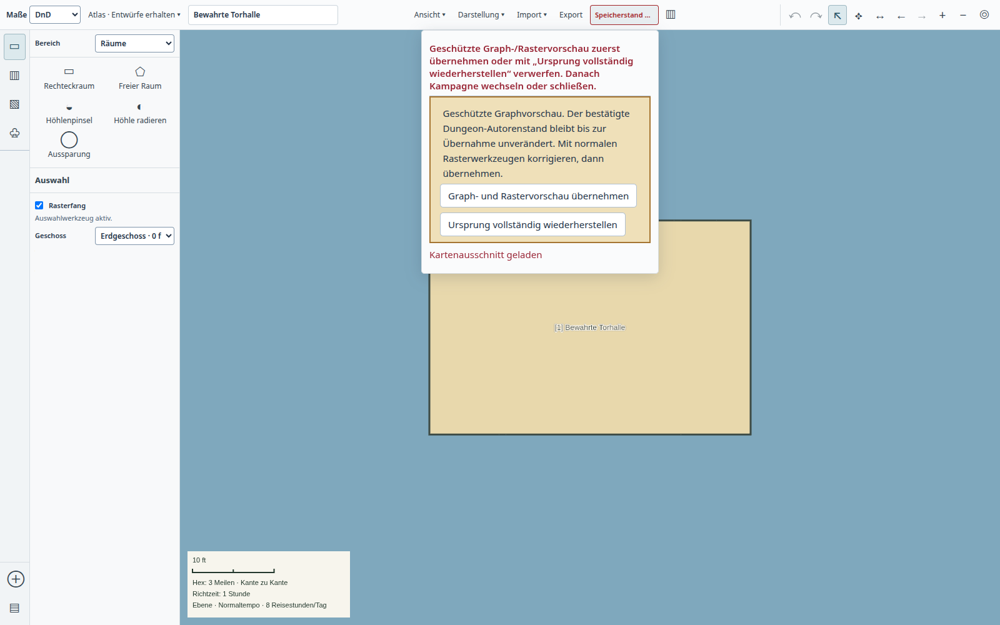

# Unabhängige Codeprüfung vom 24. Oktober 2026

Ein frischer Prüfagent ohne übergebenen Chatverlauf und mit ausdrücklichem
Verbot von Chat-/Memoryzugriff untersuchte den Worktree auf
`b54819bf7218af58dc21f6d1138019de4b2e7885` zuerst ausschließlich lesend.
Die fünf belegten Fehler wurden erst in einem separaten Auftrag behoben.
Die fünf unfertigen Atlasdateien des pausierten Entwicklungstasks blieben erhalten.

Die Integrationskopie basiert auf `d3d31363fc40cff1f0f2f5d0b6699dacd54e8b30`.
Sie übernimmt nur die folgenden Korrekturen und die Version `0.188.0`;
die 30 noch nicht integrierten Atlasentwicklungs-Commits sind nicht enthalten.

| Befund | Korrektur | Direkter Nachweis |
| --- | --- | --- |
| Kampagnenübersicht umgeht den Atlas-Guard und kann offene Eingaben verwerfen | Gemeinsamer `leaveCampaign`-Guard vor Wechsel und Übersicht | Nativer Eingangsentwurf blockiert die Übersicht; ausdrückliches Verwerfen erlaubt den Wechsel |
| Reguläres Schließen verwirft eine temporäre Graph-/Rastervorschau | Wechsel, Schließen und Update verlangen ausdrückliche Übernahme oder Wiederherstellung; interne Bearbeitung bleibt möglich | Graph-DOM für beide Phasen; native Schließblockade, Übernahme und frischer Start |
| Dauerhafte Löschung lässt alte Transfersnapshots und private Bilder zurück | Alte verwaltete Stagingverzeichnisse beim Start entfernen; Bilddateiplan vor Zeilenlöschung sichern; nur ohne verbleibende Besitzer löschen; Fehler bleiben ausstehend | Neustart, Dateifehler/Wiederaufnahme, gemeinsame Besitzer sowie native echte Löschung |
| Kopierte Dungeonreise behält die alte Triggerereignis-ID | Referenz remappen und Beziehung zu Kampagne, Szene und Reise validieren | Echte Kampagnenkopie; nach Wiederöffnung Trigger schließen und Reise beenden |
| Zeichnungsimport ersetzt identifiergleiche Autorentexte | Ausschließlich Identitäts-/Referenzfelder umschreiben | Gültige v4-Zeichnung mit ID, Name, Nummer und Markdown `1`; Texte bleiben bytegleich |

## Prüfungen

- `npm run check`, `npm run check:desktop`, `npm run check:repo` und Desktopbuild erfolgreich.
- Nach `node build.mjs --test`: 46/46 Fälle aus
  `tests/desktop-review-data-retention.test.mjs`,
  `tests/desktop-review-retention-dom.test.mjs`,
  `tests/desktop-dungeon-travel-copy.test.mjs` und
  `tests/desktop-campaign-catalog.test.mjs` bestanden.
- `python3 tools/ui-session.py node tools/test-desktop-review-retention.mjs`
  auf beiden lokalen Ständen erfolgreich. Die hier abgelegten
  [Prozess-/Artefaktbelege](result.json) stammen aus der Main-Integrationskopie
  vor deren Commit (`dirty: true`), nicht aus einem behaupteten exakten Release-SHA.
  Zwei reguläre Prozessenden, verschwundene PIDs, unveränderte Runtimeartefakte
  und keine Rendererfehler. Standardplattform der Wayland-Desktopsitzung.
- Zusätzlich `python3 tools/ui-session.py node tools/test-desktop-campaign-copy.mjs`: drei reguläre Prozessenden, unabhängige Kopie und Import, erhaltene Quelltexte/Geometrie, verlorene Antwort geklärt, keine Rendererfehler.
- Die vorherigen fehlgeschlagenen nativen Versuche betrafen veraltete bzw.
  versteckte Navigationsselektoren im neuen Prüfskript. Sie wurden nicht als
  Produktnachweis gewertet; die korrigierte vollständige Probe bestand.

## Grenzen und Anforderungen

Die Prüfung stützt den Campaign-Datenlebenszyklus `SMR-01`, insbesondere
[Wechsel, Kopie und Erasure](../../../ROADMAP-SALTMARCHER-SMR-01-CAMPAIGN-DATA-PLAN.md),
sowie den [geschützten Graphentwurf](../../../ROADMAP-HEX-ATLAS.md).
Sie ersetzt keine Gesamtprodukt- oder Ownerabnahme. Die vollständige
Exact-SHA-Qualifikation und signierte Paket-/Neustartprobe gehören weiterhin
zu Candidate-CI und Linux-Releaseworkflow.

Bei bereits mit alten Versionen gelöschten Datenbankzeilen kann die fehlende
Bildzuordnung nicht nachträglich sicher rekonstruiert werden. Unbekannte Bilder
werden nicht pauschal entfernt. Neue Löschungen behalten ihren Dateiplan bis
zum erfolgreichen Abschluss. Gemeinsam referenzierte Bilder bleiben erhalten.
